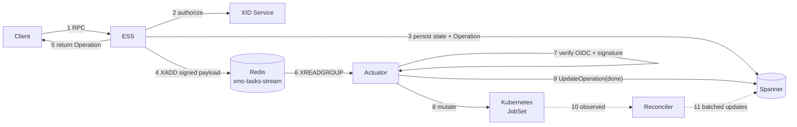
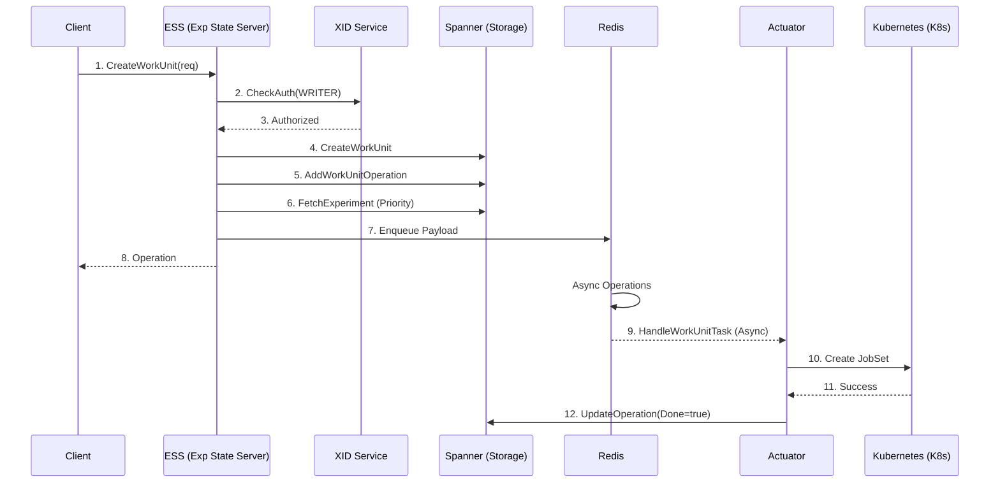
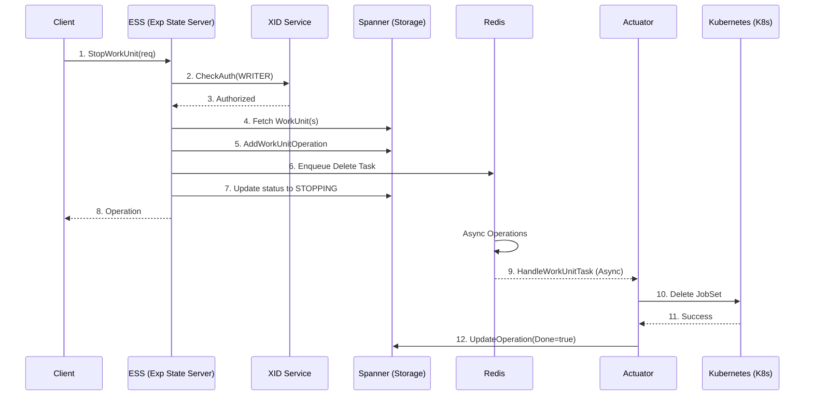
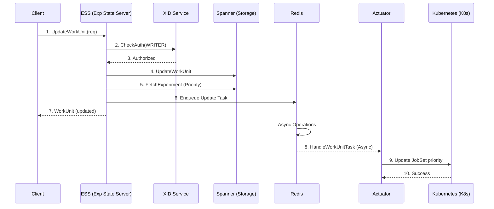

# Work Unit Lifecycle Flows

The asynchronous actuation path: how a `CreateWorkUnit` call becomes running pods, and how stop,
restart, and update requests reach the cluster. This is the flow that defines XMC's operational
behaviour.

Prerequisites: [Execution Model](../architecture/execution_model.md) for the resource hierarchy and
state machine, and [Main Flows](README.md#anatomy-of-an-xmc-request) for the three request shapes.

---

## 1. The Actuation Path in One Picture

Every mutating work unit RPC follows the same skeleton. Only the action inside the payload
differs.



Steps 1–5 are the **intent loop**; steps 6–9 are actuation; steps 10–11 are the **observation
loop** described in [Reconciliation](reconciliation.md). Only steps 1–5 are on the client's
critical path.

### What is on the queue

The Redis message is not a bare command. `internal/task_queue` builds an `ActuatorPayload`
containing the target, the full `WorkUnit`, the action, and metadata (idempotency key, operation
name, trace ID), serialises it as protojson, and wraps it with two credentials:

- a **Tink-signed JWT** binding a SHA-256 hash of the payload body, with a TTL from
  `taskSignatureTtlSeconds` (86400 s by default), and
- a **Google OIDC token** minted for the Actuator's audience.

The Actuator rejects the message unless both verify and the body hash matches. The queue is treated
as a trust boundary, not as internal plumbing.

---

## 2. Create Work Unit



Step 6 is easy to overlook and important: the *experiment's* priority is fetched at enqueue time
and combined with the work unit's own priority to resolve the Kueue `WorkloadPriorityClass`
(see [Execution Model §6](../architecture/execution_model.md#6-scheduling-and-priority)).
Priority is therefore captured when the task is enqueued, not when the JobSet is built.

### What the Actuator builds

Step 10 is where a protobuf `WorkUnit` becomes a Kubernetes object. `cmd/actuator/k8s_client`
assembles a `JobSet` with:

- **Identity labels** — `xmc.google.com/experiment-id`, `-work-unit-id`, `-execution-id`, and
  `app.kubernetes.io/managed-by: xmc`, plus the author annotation.
- **Scheduling labels** — `kueue.x-k8s.io/queue-name` and `kueue.x-k8s.io/priority-class`.
- **`FailurePolicy.MaxRestarts: 0`** — validated before submission; a non-zero value is rejected as
  a contract violation.
- **Replicated jobs** — one per `KubernetesJob` in the work unit, each with its containers, init
  containers (including native sidecars with `restartPolicy: Always`), volumes, ports, and pod
  restart policy (`Never` by default; `OnFailure` gets a backoff limit of 100).
- **Injected environment** — the `XMC_*` variables listed in
  [Execution Model §5](../architecture/execution_model.md#5-identifier-and-metadata-contract),
  plus managed-`xprof` GCS wiring when configured.
- **Accelerator node selectors** — GKE TPU topology and accelerator keys where the work unit
  requests them.

Once submitted, XMC's own involvement pauses. Kueue admits the workload when quota allows, the
JobSet controller expands it into Jobs and Pods, and the work unit moves `SCHEDULING → STARTING →
RUNNING` as the Reconciler observes each transition.

### Why the client gets an `Operation`

The response returns after step 8, typically in milliseconds and before any pod exists. This is
what makes launching an experiment with hundreds of work units practical, and it is why
`CreateWorkUnit` succeeding does not mean the work started — only that the intent is durably
recorded and queued.

---

## 3. Stop Work Unit



Stopping is implemented as JobSet **deletion**, not suspension. The work unit enters `STOPPING`
immediately (step 7) so the UI reflects the user's intent without waiting for the cluster, and
reaches `STOPPED` once the Reconciler observes the deletion. (If the work unit is currently in
`SCHEDULING_PAUSED`, step 7 transitions it directly to `STOPPED`, because its task is buffered in
Spanner and no JobSet exists in the cluster to emit a deletion watch event.)

The XMC finalizer (`jobset.xmanager.cloud/finalizer`) is what makes that observation reliable: the
JobSet cannot vanish before the Reconciler has recorded its terminal state and removed the
finalizer. See [Reconciliation §2](reconciliation.md#2-jobset-reconciler).

`BatchStopWorkUnits` runs the same flow per work unit, enqueuing one task each. Because the RPC
returns after enqueuing rather than after deletion, stopping a large experiment is a fast call
followed by gradual convergence.

---

## 4. Restart Work Unit


Step 4, `RestartExecutions`, is the heart of the
[non-restarting JobSets contract](../architecture/execution_model.md#4-the-non-restarting-jobsets-contract).
It does **not** restart anything in place. It marks the current `WorkUnitExecution` `INACTIVE` and
creates a new one with a fresh `eid`, so the previous attempt survives as history.

Step 10 follows the same principle at the cluster level: the Actuator validates and deletes the
existing JobSet, then creates a new one carrying the new `eid` label. There is no JobSet-level
restart anywhere in this path, because a JobSet restart would re-run jobs that had already
succeeded.

This is the *only* mechanism in XMC that re-runs work, and it is reachable only by explicit user
action — which is exactly the property the contract requires.

`BatchRestartWorkUnits` applies the same flow across many work units.

---

## 5. Update Work Unit



`UpdateWorkUnit` is the odd one out: it returns the updated `WorkUnit` rather than an `Operation`,
because the metadata change is committed synchronously. The queued task exists only to propagate
the consequence — re-labelling the running JobSet's
`kueue.x-k8s.io/priority-class` so Kueue re-evaluates its position.

The Actuator patches the label in place rather than recreating the JobSet, so a priority change
never interrupts running work.

---

## 6. Reading Work Unit State

After five diagrams of queues, signatures, and Kubernetes calls, the read path is a plain
[Shape 1 — synchronous read](README.md#shape-1--synchronous-read), and that contrast is the point.

`GetWorkUnit`, `GetCurrentWorkUnitExecution`, `ListWorkUnits`, `SearchWorkUnits`, and
`ListWorkUnitExecutions` all take that shape. None of them query the Kubernetes API — they read
state that the Reconciler already persisted. That is what keeps read latency flat regardless of
cluster size, and why a Reconciler outage shows up as *stale* state rather than unavailable state.

`ListWorkUnitExecutions` is the call that exposes execution history: every attempt, with the
current one marked `ACTIVE`.

---

## 7. Pause and Resume Workload Scheduling

When `XMC_PAUSE_SCHEDULING_ENABLED` is enabled, operators can pause global workload scheduling
from the Admin Panel (`PauseScheduling` on the Health Service) during cluster maintenance without
rejecting user submissions.

```mermaid
sequenceDiagram
    participant Admin as Operator / Admin UI
    participant HS as Health Service
    participant Spanner as Spanner (ESS DB)
    participant PauseStream as Redis (xmc-pause-stream)
    participant ResumeStream as Redis (xmc-scheduling-resume-stream)
    participant Actuator
    participant ESS as ESS Resumption Worker
    participant TaskStream as Redis (xmc-tasks-stream)

    Admin->>HS: 1. PauseScheduling
    HS->>Spanner: 2. Set PauseSchedulingState(paused=true)
    HS->>PauseStream: 3. Publish SchedulingPaused
    PauseStream-->>Actuator: 4. Refresh local pause cache from Spanner

    Note over Actuator,Spanner: While paused: Create / Restart / Update tasks<br/>are buffered in PausedTasks; Create & Restart<br/>executions move to SCHEDULING_PAUSED.<br/>Delete tasks bypass pause and execute immediately.

    Admin->>HS: 5. ResumeScheduling
    HS->>Spanner: 6. Set PauseSchedulingState(paused=false, run_id)
    HS->>PauseStream: 7. Publish SchedulingResumed(run_id)
    HS->>ResumeStream: 8. Publish trigger(run_id, batch_size, max_backlog)
    PauseStream-->>Actuator: 9. Refresh local pause cache (paused=false)
    ResumeStream-->>ESS: 10. Claim trigger (ess-group) & fence worker_id
    loop Batch replay (ordered by Priority DESC, CreateTime ASC)
        ESS->>Spanner: 11. ListPending PausedTasks + live WorkUnit state
        ESS->>TaskStream: 12. Re-enqueue eligible tasks (or skip obsolete/stopped)
        ESS->>Spanner: 13. MarkProcessed(replayed | skipped)
    end
```

### What happens while paused

- **Client RPCs succeed normally.** `CreateWorkUnit`, `RestartWorkUnit`, `UpdateWorkUnit`, and
  `StopWorkUnit` commit to Spanner and enqueue to `xmc-tasks-stream` as usual.
- **Actuator intercepts `Create`, `Restart`, and `Update`.** Instead of calling the Kubernetes API,
  the Actuator writes a row to `PausedTasks` and (for `Create` and `Restart`) transitions the target
  execution to `SCHEDULING_PAUSED` with an `INFO` system message ("Scheduling has been paused by
  administrators. This work unit will be scheduled once scheduling is resumed.") in a single
  Spanner transaction.
- **`Delete` bypasses the pause.** `StopWorkUnit` and `BatchStopWorkUnits` always execute against
  Kubernetes immediately, and work units in `SCHEDULING_PAUSED` transition directly to `STOPPED`.

### What happens on resume

1. The Health Service writes `SchedulingPaused = false` with a fresh `ResumptionRunID` to
   `PauseSchedulingState`, broadcasts `SchedulingResumed` on `xmc-pause-stream`, and publishes a
   trigger on `xmc-scheduling-resume-stream`.
2. One ESS replica in the `ess-group` consumer group claims the trigger, records its
   `ResumptionWorkerID` in `PauseSchedulingState` (fencing any stale worker), and replays pending
   `PausedTasks` in batches (`schedulingResumeBatchSize`, default `100`) ordered by
   `Priority DESC, CreateTime ASC`.
3. Before each batch, the worker checks the `actuator-group` backlog on `xmc-tasks-stream`; if
   unprocessed tasks reach `schedulingResumeMaxBacklog` (default `500`), it pauses replay for 10s
   and extends its Redis message claim.
4. Tasks whose work unit has moved to a newer execution ID, reached a terminal/stopping state
   (`COMPLETED`, `STOPPED`, `STOPPING`, `FAILED`), or carries a superseded `Update` priority are
   marked `skipped` rather than re-enqueued. Replayed tasks carry `resumption_time` in their
   metadata so any Actuator replica whose broadcast listener lagged behind immediately advances its
   local cache to unpaused.

---

## 8. Failure Handling Along the Path

| Failure | Effect | Recovery |
| :--- | :--- | :--- |
| ESS crashes after committing but before enqueuing | Operation exists with no task; work unit stays in its pre-actuation state. | Client retries the RPC; the idempotency key prevents duplicate cluster mutations if a task did land. |
| Actuator crashes mid-task | Message is unacknowledged in the Redis stream. | Reclaimed after the 5-minute abandoned-message timeout and redelivered to another consumer. |
| Task fails repeatedly | Retried up to 5 times with a 2-minute processing timeout each. | After exhaustion, moved to `xmc-dlq-stream` for operator inspection. |
| Kubernetes rejects the JobSet | Actuator records the failure on the operation. | Surfaced to the user as a status message; requires a corrected resubmission. |
| Kueue never admits the workload | Work unit sits in `SCHEDULING`. | The Workload reconciler surfaces the `Inadmissible` reason as a status message rather than leaving it silent. |
| Pods fail to start | Work unit sits in `STARTING`. | The JobSet reconciler inspects the pods after a delay and reports image pull or scheduling errors. |
| Reconciler is down | Cluster keeps running; Spanner state stops advancing. | State catches up on restart — the reconcilers re-list all watched resources. |

---

## 9. Related Reading

- [Reconciliation](reconciliation.md) — the other half of the loop.
- [Execution Model](../architecture/execution_model.md) — states, retry boundaries, priority.
- [Component Reference](../architecture/components.md#3-execution-plane) — Actuator and Reconciler
  internals.
