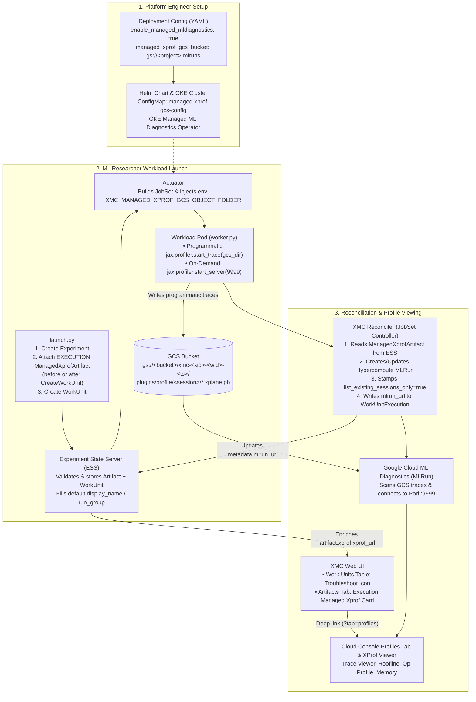
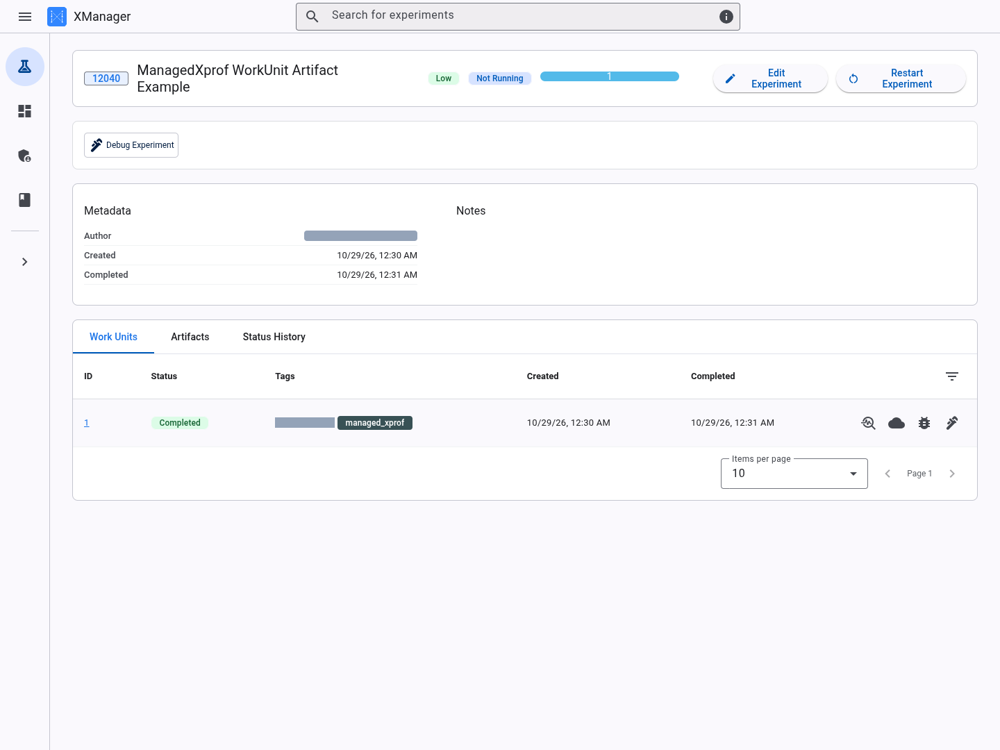
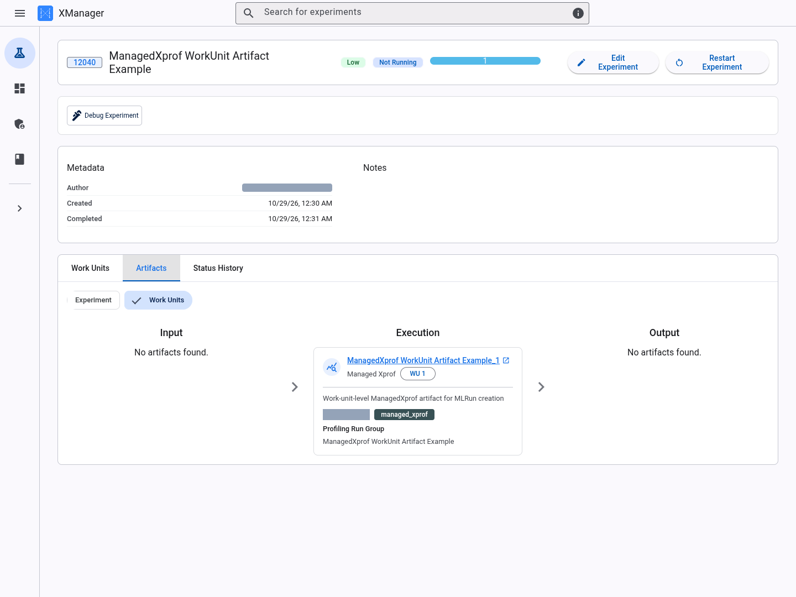
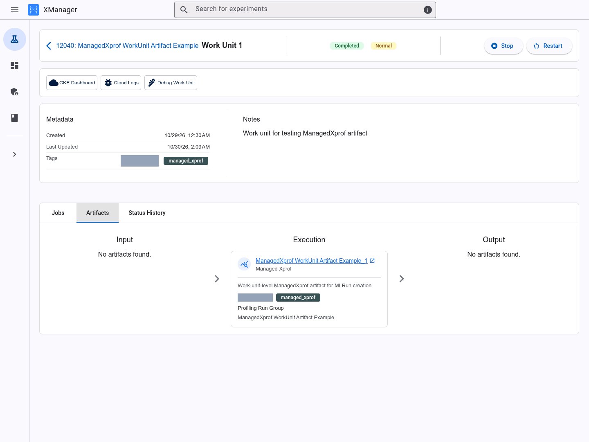

# Managed XProf User Guide

XManager Cloud (XMC) integrates with **Google Cloud Managed ML Diagnostics** (Hypercompute Cluster `MachineLearningRun` and GKE Managed ML Diagnostics) and **XProf** to provide zero-boilerplate performance profiling for ML workloads on GKE.

With Managed XProf enabled on an XMC cluster:

1. **Automated GCS Trace Routing**: The XMC Actuator automatically provisions and injects an isolated, per-work-unit Cloud Storage path (`XMC_MANAGED_XPROF_GCS_OBJECT_FOLDER`) into every workload container.
2. **Programmatic & On-Demand Profiling**: Workloads can capture deterministic step ranges programmatically via `jax.profiler.start_trace()` / `stop_trace()` and expose a live XProf profiler server (`jax.profiler.start_server(9999)`) for interactive on-demand captures.
3. **Automatic MLRun Registration & UI Enrichment**: When a workload attaches a `ManagedXprof` work-unit artifact, the XMC Reconciler automatically registers a Google Cloud `MachineLearningRun` linked to the Kubernetes `JobSet` and GCS trace folder, and the Experiment State Server (ESS) enriches both the Work Unit row and the `ManagedXprof` artifact card in the XMC Web UI with direct deep links to the Google Cloud Console **Profiles** tab and **XProf Viewer**.

## End-to-End Architecture



## Stage 1: Platform Engineer Guide — Upgrading XMC & Enabling Managed XProf

To support Managed XProf on an XMC cluster, a Platform Engineer must ensure the GKE cluster is running a supported version, configure a GCS bucket with Workload Identity write access for trace storage, and enable two flags in the Cluster Toolkit deployment configuration.

### 1.1 Prerequisites

* **GKE Cluster Version**: `1.35.0-gke.3065000` or later (required for Google Cloud Managed ML Diagnostics and the in-cluster `mldiagnostics-connection-operator`).
* **GCS Bucket & Workload Identity Write Access**: A Cloud Storage bucket in your GCP project to store XProf trace artifacts (for example, `gs://<your-project-id>-mlruns`). Because XMC node pools run with GKE Workload Identity (`GKE_METADATA`), workload pods in queue-named namespaces (such as `cpu-queue`) authenticate as their Kubernetes ServiceAccount's Workload Identity principal rather than the node pool service account (`xmc-np-sa`). Create the bucket and grant `roles/storage.objectUser` to each queue namespace whose workloads will write profiles (or to a bound KSA if `KubernetesJob.service_account` is customized):

  ```bash
  export PROJECT_ID="your-gcp-project-id"
  export REGION="us-central1"
  export QUEUE_NAMESPACE="cpu-queue"

  gcloud storage buckets create "gs://${PROJECT_ID}-mlruns" \
    --project="${PROJECT_ID}" \
    --location="${REGION}" \
    --uniform-bucket-level-access

  PROJECT_NUMBER="$(gcloud projects describe "${PROJECT_ID}" --format='value(projectNumber)')"
  gcloud storage buckets add-iam-policy-binding "gs://${PROJECT_ID}-mlruns" \
    --role=roles/storage.objectUser \
    --member="principalSet://iam.googleapis.com/projects/${PROJECT_NUMBER}/locations/global/workloadIdentityPools/${PROJECT_ID}.svc.id.goog/namespace/${QUEUE_NAMESPACE}"
  ```

### 1.2 Enable Managed XProf Flags in Deployment YAML

In your Cluster Toolkit deployment configuration file (for example, `deploy/ctk_v2/xmanager-cloud-deployment.yaml`, copied from [`deploy/ctk_v2/xmc-deployment-template.yaml`](../deploy/ctk_v2/xmc-deployment-template.yaml)), set the following two variables under `vars:`:

```yaml
vars:
  project_id: your-gcp-project-id
  region: us-central1
  environment: your-env

  # 1. Enable Google Cloud Managed ML Diagnostics on the GKE cluster and IAM roles
  enable_managed_mldiagnostics: true

  # 2. Configure the cluster-wide GCS bucket for Managed XProf trace storage
  managed_xprof_gcs_bucket: "gs://your-gcp-project-id-mlruns"
```

What these two flags configure automatically via [`deploy/ctk_v2/xmanager-cloud.yaml`](../deploy/ctk_v2/xmanager-cloud.yaml) and [`deploy/helm`](../deploy/helm):

| Configuration Flag | Infrastructure & Kubernetes Effect |
| :--- | :--- |
| `enable_managed_mldiagnostics: true` | • Enables the `hypercomputecluster.googleapis.com` API in the GCP project.<br/>• Grants `roles/hypercomputecluster.editor` to the XMC Workload Service Account (`xmc-wl-sa`) so the Reconciler can create and update `MachineLearningRun` resources.<br/>• Grants `roles/storage.objectAdmin` to the GKE Node Pool Service Account (`xmc-np-sa`). *(Note: because XMC node pools use `GKE_METADATA` Workload Identity, workload pods authenticate as their KSA's Workload Identity principal rather than `xmc-np-sa` and still require the §1.1 bucket IAM binding.)*<br/>• Sets `enable_ml_diagnostics: true` on the GKE cluster (`compute_cluster`), deploying the GKE `mldiagnostics-connection-operator` for on-demand profiling. |
| `managed_xprof_gcs_bucket: "gs://..."` | • Sets Helm value `managedXprofGcsBucket`, which creates the `managed-xprof-gcs-config` ConfigMap in namespace `xmc` with key `gcs_path`.<br/>• Injects `MANAGED_XPROF_GCS_PATH` into `actuator-deployment` so the Actuator automatically sets `XMC_MANAGED_XPROF_GCS_OBJECT_FOLDER=gs://<bucket>/xmc-<xid>-<wid>-<unix_ts>` on every container of every launched `JobSet`. |

### 1.3 Upgrade (or Deploy) the XMC Cluster

Use the unified `dev_env.py` CLI to upgrade an existing XMC installation's application release (`xmc_app`):

```bash
# 1. Run pre-flight checks (CLI dependencies, GCP/GKE authentication, namespace)
python3 tools/dev_env/dev_env.py gke-upgrade \
  --config deploy/ctk_v2/xmanager-cloud-deployment.yaml \
  --only check

# 2. Run the full upgrade (migrations, OCI image build & push, Helm/CTK app deploy, rollout verify)
python3 tools/dev_env/dev_env.py gke-upgrade \
  --config deploy/ctk_v2/xmanager-cloud-deployment.yaml \
  --run-migrations
```

> [!IMPORTANT]
> **Existing clusters**: `gke-upgrade` only redeploys the `xmc_app` deployment group—it applies `managed_xprof_gcs_bucket` via Helm, but **not** `enable_managed_mldiagnostics` (which is applied in the `apis`, `primary`, and `compute` Cluster Toolkit groups). On an existing cluster that was not originally provisioned with `enable_managed_mldiagnostics: true`, also:
> 1. Enable Managed ML Diagnostics on the GKE cluster:
>    ```bash
>    gcloud container clusters update <CLUSTER_NAME> \
>      --project="${PROJECT_ID}" \
>      --location="${REGION}" \
>      --enable-managed-mldiagnostics
>    ```
> 2. Apply the API and IAM changes by redeploying the `apis`, `primary`, and `compute` groups with `./cluster-toolkit/gcluster deploy`, or manually enable `hypercomputecluster.googleapis.com` and grant `roles/hypercomputecluster.editor` to `<deployment_name>-xmc-wl-sa@${PROJECT_ID}.iam.gserviceaccount.com`.

> [!TIP]
> You can also run individual upgrade stages step-by-step using `--only migrate --run-migrations`, `--only images`, `--only app`, `--only restart`, and `--only verify`, or resume from a specific stage with `--start-from <step>`.

### 1.4 Verify Cluster Readiness

After deployment or upgrade completes, verify both the Managed ML Diagnostics infrastructure and the Actuator GCS configuration:

```bash
# 1. Confirm the Hypercompute Cluster API is enabled in the project
gcloud services list --enabled \
  --project="${PROJECT_ID}" \
  --filter="config.name=hypercomputecluster.googleapis.com"

# 2. Confirm the GKE Managed ML Diagnostics connection-operator is running
kubectl get deployment -n gke-managed-mldiagnostics

# 3. Verify the managed-xprof-gcs-config ConfigMap in namespace xmc
kubectl get configmap managed-xprof-gcs-config -n xmc -o yaml

# 4. Confirm actuator-deployment has MANAGED_XPROF_GCS_PATH mounted
kubectl set env deployment/actuator-deployment -n xmc --list | grep MANAGED_XPROF_GCS_PATH
```

## Stage 2: ML Researcher Guide — Using the `ManagedXprof` Artifact

Once the cluster is configured, ML researchers and workload authors can collect both **programmatic** and **on-demand** XProf profiles without hardcoding GCS bucket names or manually creating `MachineLearningRun` resources.

A complete reference implementation is provided in [`examples/managed_xprof_artifact_job/`](../examples/managed_xprof_artifact_job/).

### 2.1 Instrumenting Your Workload (`worker.py`)

When the XMC Actuator creates a Kubernetes `JobSet` for a Work Unit, it automatically injects the environment variable `XMC_MANAGED_XPROF_GCS_OBJECT_FOLDER` into every container in the pod:

```text
XMC_MANAGED_XPROF_GCS_OBJECT_FOLDER=gs://<bucket>/xmc-<xid>-<wid>-<operation_unix_timestamp>
```

Your training script ([`examples/managed_xprof_artifact_job/worker.py`](../examples/managed_xprof_artifact_job/worker.py)) should:

1. **Read `XMC_MANAGED_XPROF_GCS_OBJECT_FOLDER`** from the environment.
2. **Wrap target steps in `jax.profiler.start_trace(profile_dir)` and `jax.profiler.stop_trace()`** to automatically write `.xplane.pb` trace files to GCS under `<XMC_MANAGED_XPROF_GCS_OBJECT_FOLDER>/plugins/profile/<timestamp>/`.
3. **Start the XProf server (`jax.profiler.start_server(9999)`) after `stop_trace()`** so operators can trigger on-demand captures from Google Cloud Console during subsequent steps without colliding with an active programmatic trace.

```python
import os
import jax
import jax.numpy as jnp
import jax.profiler

# 1. Read the per-work-unit GCS folder injected by the XMC Actuator
# (falls back locally to /tmp/xprof when running outside an enabled cluster)
profile_dir = os.environ.get("XMC_MANAGED_XPROF_GCS_OBJECT_FOLDER") or "/tmp/xprof"


@jax.jit
def train_step(x: jax.Array, w: jax.Array) -> jax.Array:
    return jnp.tanh(x @ w)


x = jax.random.normal(jax.random.PRNGKey(0), (2000, 2000))
w = jax.random.normal(jax.random.PRNGKey(1), (2000, 2000))

# Warm up JIT compilation before starting the trace
x = train_step(x, w)
x.block_until_ready()

# 2. Capture the initial steps programmatically to GCS
programmatic_steps = 10
total_steps = 10000

jax.profiler.start_trace(profile_dir)
try:
    for _ in range(programmatic_steps):
        x = train_step(x, w)
        x.block_until_ready()
finally:
    jax.profiler.stop_trace()

# 3. Start the on-demand XProf server on port 9999 for the remaining steps
server = None
try:
    server = jax.profiler.start_server(9999)
except Exception as exc:
    print(f"Failed to start JAX profiler server on port 9999: {exc}", flush=True)

for _ in range(programmatic_steps, total_steps):
    x = train_step(x, w)
    x.block_until_ready()
```

### 2.2 Attaching the `ManagedXprof` Artifact in `launch.py`

You can attach the `EXECUTION`-phase `ManagedXprofArtifact` before or after `CreateWorkUnit`. The Actuator injects `XMC_MANAGED_XPROF_GCS_OBJECT_FOLDER` independently of the artifact whenever `MANAGED_XPROF_GCS_PATH` is configured, and the Reconciler looks up the artifact on every reconcile pass and creates the `MachineLearningRun` once both the artifact and the running `JobSet` exist. Pre-creating it with an explicit `work_unit_id` (as in [`examples/managed_xprof_artifact_job/launch.py`](../examples/managed_xprof_artifact_job/launch.py) below) saves one reconcile cycle:

```python
import logging
from xmanager_cloud.experiment_state_server import experiment_state_api
from xmanager_cloud.experiment_state_server.proto import (
    api_pb2 as ess_api_pb2,
    artifact_pb2,
    experiment_pb2,
    priority_pb2,
    resources_pb2,
    status_pb2,
    work_unit_pb2,
)

logger = logging.getLogger(__name__)
stub = experiment_state_api.get_experiment_state_api()
exp = stub.create_experiment(
    ess_api_pb2.CreateExperimentRequest(
        experiment=experiment_pb2.Experiment(
            title="ManagedXprof WorkUnit Artifact Example",
            priority=priority_pb2.Priority.NORMAL,
        )
    )
)

try:
    wid = 1
    wu_name = f"{exp.name}/workUnits/{wid}"
    image_path = "us-docker.pkg.dev/your-project/xmc/managed-xprof-artifact-job:latest"

    # 1. Pre-create the EXECUTION-phase ManagedXprof artifact BEFORE CreateWorkUnit
    artifact = artifact_pb2.Artifact(
        tags=["diagon-e2e", "managed_xprof"],
        notes="Work-unit-level ManagedXprof artifact for MLRun creation",
        lifecycle_phase=artifact_pb2.Artifact.LifecyclePhase.EXECUTION,
        payload=artifact_pb2.ArtifactPayload(
            managed_xprof=artifact_pb2.ManagedXprofArtifact(
                display_name=f"ManagedXprof WorkUnit Artifact Example_{wid}",
                run_group="ManagedXprof WorkUnit Artifact Example",
            )
        ),
    )
    stub.create_artifact(
        ess_api_pb2.CreateArtifactRequest(
            parent=wu_name,
            artifact=artifact,
        )
    )

    # 2. Submit the Work Unit with explicit work_unit_id matching wu_name
    work_unit = work_unit_pb2.WorkUnit(
        work_unit_type=work_unit_pb2.WorkUnit.WorkUnitType.STANDARD,
        priority=priority_pb2.Priority.NORMAL,
        notes="Work unit for testing ManagedXprof artifact",
        tags=["diagon-e2e", "managed_xprof"],
        executable=work_unit_pb2.Executable(
            scheduling_constraints=work_unit_pb2.SchedulingConstraints(queue_name="cpu-queue"),
            jobset=work_unit_pb2.JobSetExecutable(
                jobs=[
                    work_unit_pb2.KubernetesJob(
                        name="programmatic-xprof-worker",
                        replicas=1,
                        spec=work_unit_pb2.ExecutableSpec(
                            name="programmatic-xprof-worker",
                            docker_image=image_path,
                            command=[
                                "python3",
                                "-u",
                                "/app/worker.py",
                                "--programmatic_steps=10",
                                "--total_steps=10000",
                                "--matrix_size=2000",
                            ],
                            resources=resources_pb2.ResourceSet(
                                cpu_resources=resources_pb2.CpuResources(
                                    cpu_millicores=1000,
                                    memory_bytes=4 * 1024 * 1024 * 1024,
                                ),
                            ),
                        ),
                    ),
                ]
            ),
        ),
    )
    stub.create_work_unit(
        ess_api_pb2.CreateWorkUnitRequest(
            parent=exp.name,
            work_unit_id=wid,
            work_unit=work_unit,
        )
    )
except BaseException:
    try:
        stub.update_experiment_launch_state(
            ess_api_pb2.UpdateExperimentLaunchStateRequest(
                name=exp.name,
                launch_state=status_pb2.ExperimentStatus.LaunchState.FAILED,
            )
        )
    except Exception as exc:
        logger.warning("Failed to mark experiment %s launch FAILED: %s", exp.name, exc)
    raise

stub.update_experiment_launch_state(
    ess_api_pb2.UpdateExperimentLaunchStateRequest(
        name=exp.name,
        launch_state=status_pb2.ExperimentStatus.LaunchState.COMPLETED,
    )
)
```

> [!NOTE]
> **Server-Side Defaults & URL Enrichment**:
> * Unlike generic `Url` artifacts, you **do not** pass an `artifact.url` when creating a `ManagedXprofArtifact`. The XMC Reconciler creates the Google Cloud `MachineLearningRun` asynchronously once the `JobSet` starts, and ESS dynamically populates `artifact.payload.managed_xprof.xprof.xprof_url` when the artifact is read.
> * If `display_name` or `run_group` are left empty (`""`), ESS automatically fills them with `<experiment_title>_<wid>` and `<experiment_title>`, respectively.

### 2.3 Building & Launching the Example Workload

Install the CLI virtual environment, build and push the example container image, authenticate with `xmanager login`, and run `launch.py`:

```bash
cd examples/managed_xprof_artifact_job

# 1. Set up the Python virtual environment and compile local XMC protos
python3 ../../deploy/cli/install_xmanager.py --venv .venv --requirements requirements.txt
source .venv/bin/activate

# 2. Build and push the workload container image
export PROJECT_ID="your-gcp-project-id"
export IMAGE_PATH="us-docker.pkg.dev/${PROJECT_ID}/xmc/managed-xprof-artifact-job:latest"
./build_and_push.sh

# 3. Authenticate with XMC (if not already logged in)
export XMC_DOMAIN="<env>.<domain>"
export XMANAGER_ENDPOINT="dns:///grpc.<env>.<domain>"
export QUEUE_NAME="cpu-queue"
xmanager login

# 4. Launch the experiment
python3 launch.py
```

## Stage 3: Viewing Profile Data in XMC UI & Google Cloud Console

Once your experiment is launched and the Work Unit enters the `RUNNING` (or `COMPLETED`) state, you can inspect and analyze your profiles directly from the XMC Web UI.

### 3.1 Opening Profiles from the XMC Experiment Page

Navigate to your experiment in the XMC Web UI (`https://<env>.<domain>/experiments/<xid>`). There are **two ways** to access your workload's profiles:

#### Option A: Work Units Table — Troubleshoot / Profile Action Button

In the **Work Units** tab on the Experiment page, locate your Work Unit row. Once the Reconciler registers the `MachineLearningRun`, a **Profile (`troubleshoot` icon)** action button appears in the right-hand actions column:



Hovering over the icon displays *"Access all profiles collected by the work unit in ML Diagnostics as well as capture on-demand profiles"*. Clicking it opens the Google Cloud Console **AI/ML Run Details -> Profiles** tab in a new browser tab.

#### Option B: Artifacts Tab — `Managed Xprof` Card in the `Execution` Column

Click the **Artifacts** tab on the Experiment page (or navigate to the individual Work Unit page at `/experiments/<xid>/workUnits/<wid>` and select its **Artifacts** tab).

The Artifacts view organizes artifacts into a three-stage lifecycle pipeline (**Input** -> **Execution** -> **Output**). Under the **Execution** column, you will find the **Managed Xprof** artifact card:



On the individual Work Unit detail page (`/experiments/<xid>/workUnits/<wid>`), the **Artifacts** tab shows the artifacts scoped specifically to that Work Unit:



The **Managed Xprof** card displays:

* **Artifact Title & Deep Link**: Your configured `display_name` (for example, `ManagedXprof WorkUnit Artifact Example_1`) with an external-link icon (`open_in_new`) linking directly to `https://console.cloud.google.com/kubernetes/aiml/run/<region>/<mlrun_id>?project=<project_id>&tab=profiles`.
* **Work Unit Badge**: A clickable `WU 1` badge (when viewed from the Experiment-level Artifacts tab).
* **Tags & Notes**: Any custom tags (such as `managed_xprof`) and notes attached to the artifact.
* **Profiling Run Group**: The `run_group` identifier grouping related profiling runs in Google Cloud ML Diagnostics.

### 3.2 Analyzing Programmatic & On-Demand Profiles in Google Cloud Console

Clicking either the **Profile (`troubleshoot`)** button in the Work Units table or the **Managed Xprof** artifact card opens the **Google Cloud Console Kubernetes Engine -> AI/ML Runs** detail page with the **Profiles** tab pre-selected (`?tab=profiles`).

From the **Profiles** tab in Google Cloud Console, you can:

1. **Inspect Programmatic Sessions**: Because the XMC Reconciler automatically stamps `list_existing_sessions_only=true` on the `MachineLearningRun` and links it to `gs://<bucket>/xmc-<xid>-<wid>-<timestamp>`, Google Cloud ML Diagnostics automatically scans the GCS folder and lists every programmatic trace session written by `jax.profiler.start_trace()` / `stop_trace()`.
2. **Capture Live On-Demand Profiles**: While the Work Unit is in the `RUNNING` state and serving `jax.profiler.start_server(9999)`, click **Capture profile** in the Cloud Console Profiles tab to select target pods and capture a live trace on demand. *(No `managed-mldiagnostics-gke=true` namespace label is needed on XMC queue namespaces: the XMC Reconciler registers the `MachineLearningRun` directly with the queue namespace in `workloadDetails.gke`, and GKE's `mldiagnostics-connection-operator` connects directly to `<pod_ip>:9999` across namespaces without webhook injection.)*
3. **Open XProf Viewer**: Click **View in XProf** next to any completed profiling session to launch the interactive XProf dashboard, including:
   * **Overview Page**: Step-time breakdown (compute vs. input vs. communication) and performance recommendations.
   * **Trace Viewer**: Microsecond-level timeline of host threads, JAX/XLA ops, and device execution streams.
   * **Op Profile & Roofline Model**: FLOPs utilization, memory bandwidth efficiency, and most time-consuming HLO operations.
   * **Memory Viewer & Graph Viewer**: Peak heap allocation timeline and HLO computation graph inspection.

## Verification & Troubleshooting

### Automated Verification Script

You can verify that an experiment's Work Unit, Kubernetes `JobSet`, and `ManagedXprof` artifact were created and executed properly using the built-in verification tool:

```bash
python3 -m tools.nightly_tests.examples_verification.managed_xprof_artifact_job_test \
  --xid=<XID> \
  --expected_title_pattern="<EXPERIMENT_TITLE_REGEX>"
```

### Troubleshooting Common Issues

* **Profiles Written Locally (`/tmp/xprof`) Instead of GCS (`XMC_MANAGED_XPROF_GCS_OBJECT_FOLDER` Unset)**:
  * Cause: The Actuator did not have `MANAGED_XPROF_GCS_PATH` set when constructing the `JobSet`.
  * Fix: Verify `managed_xprof_gcs_bucket` is set to a non-empty `gs://...` URI in your deployment YAML, run `python3 tools/dev_env/dev_env.py gke-upgrade --config ... --only app` followed by `--only restart` (or `--start-from app`), and confirm `kubectl get cm managed-xprof-gcs-config -n xmc` exists.
* **`[Errno 13] Permission denied` When Starting `/app/worker.py` in Pod Logs**:
  * Cause: XMC executes JobSet containers as non-root (`runAsUser: 1000`, `runAsGroup: 1000`). Building a custom image from a `umask 027` checkout with `chmod +x` produces `0751` permissions without world-read access for `python3`.
  * Fix: Set explicit world-readable permissions in your container `Dockerfile` (`RUN chmod 0755 /app/worker.py`, as in [`examples/managed_xprof_artifact_job/Dockerfile`](../examples/managed_xprof_artifact_job/Dockerfile)).
* **`Managed Xprof` Artifact Card Title Is Not Clickable (No External Link Icon)**:
  * Cause: The `xprof_url` is populated from `WorkUnitExecution.metadata.mlrun_url`, which the Reconciler writes while the Work Unit is active (`RUNNING`) and after the `ManagedXprof` artifact has been attached.
  * Fix:
    1. Check that `enable_managed_mldiagnostics: true` is configured, and if the cluster was upgraded via `gke-upgrade` rather than freshly provisioned, apply the §1.3 existing-cluster steps so `hypercomputecluster.googleapis.com` is enabled and `<deployment_name>-xmc-wl-sa` has `roles/hypercomputecluster.editor`.
    2. Inspect the Reconciler logs for `MLRun` creation status:
       ```bash
       kubectl logs deployment/reconciler-deployment -n xmc | grep -i mlrun
       ```
    3. Ensure your workload runs long enough (for example, at least 15–30 seconds) for the Kubernetes `JobSet` reconciler loop to observe the running JobSet and register the `MachineLearningRun` before the Work Unit transitions to a terminal state.
* **Programmatic Profiles Do Not Appear in the Cloud Console `Profiles` Tab**:
  * Cause: Either the workload wrote traces to the wrong GCS path, or the workload pod's Kubernetes ServiceAccount / Workload Identity principal lacks write permissions on the bucket (because XMC node pools run with `GKE_METADATA`, pods do not inherit `xmc-np-sa`'s storage role).
  * Fix: Grant `roles/storage.objectUser` on the bucket to the queue namespace's Workload Identity `principalSet` (or bound KSA) as shown in §1.1, confirm the workload passes `os.environ["XMC_MANAGED_XPROF_GCS_OBJECT_FOLDER"]` directly to `jax.profiler.start_trace()`, and verify `.xplane.pb` files exist under `gs://<bucket>/xmc-<xid>-<wid>-*/plugins/profile/` using `gcloud storage ls --recursive "gs://<bucket>/xmc-<xid>-<wid>-*"`.
