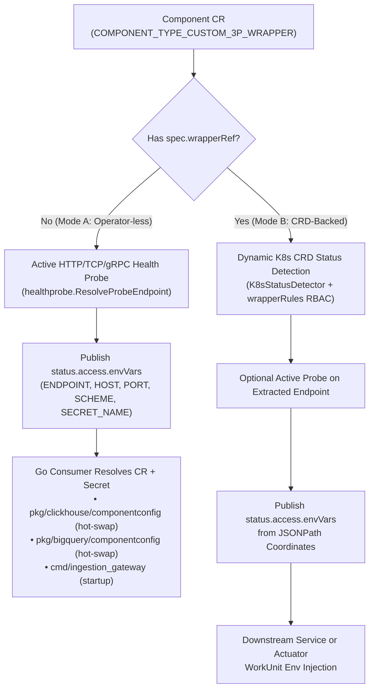

<!--
Copyright 2026 Google LLC

Licensed under the Apache License, Version 2.0 (the "License");
you may not use this file except in compliance with the License.
You may obtain a copy of the License at

    http://www.apache.org/licenses/LICENSE-2.0

Unless required by applicable law or agreed to in writing, software
distributed under the License is distributed on an "AS IS" BASIS,
WITHOUT WARRANTIES OR CONDITIONS OF ANY KIND, either express or implied.
See the License for the specific language governing permissions and
limitations under the License.
-->

# Updating Third-Party (3P) Component Contracts

This guide defines the end-to-end engineering and verification playbook for updating the contract of a third-party (`COMPONENT_TYPE_CUSTOM_3P_WRAPPER`) component in XManager on Cloud (XMC)—such as `clickhouse`, `redpanda`, `bigquery`, or CRD-backed operators like `RayCluster` and `ClickHouseInstallation`.

Use this playbook whenever:
- A 3P dependency requires a **new upstream server/API version**, wire protocol capability, or SQL/Protobuf schema change (for example, ClickHouse requiring a newer HTTP/TCP API feature or minimum server version).
- An XMC 3P wrapper blueprint needs **new, renamed, or retired `spec.parameters`** or `status.access.envVars` coordinates.
- A CRD-backed 3P operator upgrades its **Kubernetes CRD API version** (`spec.wrapperRef.version`, e.g., `v1beta1` to `v1`) or changes its `.status` schema/JSONPaths.
- Cross-component **SemVer compatibility bounds** in [`rules.yaml`](../../deploy/profiles/stable-2026a/rules.yaml) or CMS must be tightened to prevent skew between 1P consumers and 3P wrappers.

---

## 1. Critical Distinction: Wrapper Version vs. Upstream 3P Version

The single most common mistake when updating a 3P component contract is conflating **XMC's 3P wrapper version** with the **upstream 3P software/API version**. They represent completely different layers, live in different files, and are enforced by different mechanisms.

| Version Axis | Authoritative Source | Examples (`clickhouse` / `redpanda`) | What It Versions | What Enforces / Limits It |
| :--- | :--- | :--- | :--- | :--- |
| **1. XMC 3P Wrapper Blueprint Version** (`spec.version` & `spec.chartVersion`) | `components/<name>/Chart.yaml` ([`clickhouse`](../../deploy/profiles/stable-2026a/components/clickhouse/Chart.yaml), [`redpanda`](../../deploy/profiles/stable-2026a/components/redpanda/Chart.yaml)) | `"0.1.0"` → `"0.2.0"` | XMC's **wrapper contract**: `spec.parameters` keys/defaults, `spec.wrapperRef` GVK/JSONPaths, and `status.access.envVars` shape. **Never** the ClickHouse server or Redpanda broker version. | [`rules.yaml`](../../deploy/profiles/stable-2026a/rules.yaml) (`compatibilityMatrix`), [`values.schema.json`](../../deploy/profiles/stable-2026a/values.schema.json), [`profilecontract`](../../test/helm/profiles/profilecontract/contract.go), and CMS `ValidateComponentRequirement`. |
| **2. Profile Meta-Chart Version** | [`deploy/profiles/<profile>/Chart.yaml`](../../deploy/profiles/stable-2026a/Chart.yaml) (`version`) & [`profile.yaml`](../../deploy/profiles/stable-2026a/profile.yaml) | `"1.0.0"` → `"1.0.1"` | The release bundle of all `Component` CR blueprints in the profile (e.g., `stable-2026a`). | Helm release revision (`xmc-profile`) and profile `supportWindow` stability policy. |
| **3. Upstream 3P Server / Wire API / Driver Version** | Go client/producer packages ([`pkg/clickhouse`](../../pkg/clickhouse/clickhouse.go), [`kafka_producer.go`](../../cmd/ingestion_gateway/ingestiongateway/kafka_producer.go)), [`go.mod`](../../go.mod), [`deploy/clickhouse/schema.sql`](../../deploy/clickhouse/schema.sql), and dev addons ([`metrics-addons.yaml`](../../deploy/addons/metrics/manifests/metrics-addons.yaml)) | ClickHouse `>= 24.3` (`clickhouse-go/v2`, TCP `9000` / HTTP `8123`); Redpanda `>= v24.1` (`franz-go` Kafka protocol `9092`) | The external Bring-Your-Own (BYO) database/broker binary, wire protocol, SQL/Kafka engine DDL, and Go client SDK. | **Runtime checks in Go consumers/clients** (e.g., ClickHouse `conn.ServerVersion()` on `/readyz`, or Redpanda Kafka API/topology checks at `ingestion-gateway` startup) + documentation. **Helm/linter cannot inspect a BYO server.** |
| **4. Upstream 3P Operator CRD API Version** *(CRD-backed wrappers only)* | `spec.wrapperRef.{group,version,kind}` in `component.yaml` + `componentsDeployment.rbac.wrapperRules` in [`deploy/helm/values.yaml`](../../deploy/helm/values.yaml) | `clickhouse.altinity.com/v1` `ClickHouseInstallation`; `cluster.redpanda.com/v1alpha2` `Cluster` | The Kubernetes Custom Resource GVK and `.status` JSONPath schema watched by `xmc-bridge`. | `xmc-bridge` [`K8sStatusDetector`](../../pkg/components/bridge/statusdetector/k8s_status_detector.go) (`CRDNotFound` / `ContractBroken` → `Stalled=True`), RBAC [`rbac.yaml`](../../deploy/helm/templates/components/rbac.yaml), and `rules.yaml` `requiredCRDs`. |

> [!IMPORTANT]
> **Why `Chart.yaml` Cannot Limit Upstream BYO Server Versions**:
> For 3P wrappers (`COMPONENT_TYPE_CUSTOM_3P_WRAPPER`), `xmc-bridge` **does not install or upgrade the 3P workload**. Operators provision ClickHouse or Redpanda out-of-band (or via [`setup_metrics_addons.sh`](../../deploy/addons/metrics/setup_metrics_addons.sh) in dev/CI). Therefore:
> 1. Never set `components/clickhouse/Chart.yaml` `version` to `"24.3.0"` (ClickHouse Server) or `components/redpanda/Chart.yaml` `version` to `"24.1.1"` (Redpanda broker). Keep wrapper SemVer (`0.1.0`, `0.2.0`, …) strictly for XMC's wrapper schema.
> 2. Always keep `spec.version` equal to `spec.chartVersion` (`{{ .Chart.Version }}`) in `templates/component.yaml`. In [`helm_builder.go`](../../pkg/components/bridge/helm/helm_builder.go), `spec.version == spec.chartVersion` is the guard ensuring chart SemVer is never mistaken for a container image tag; [`values.schema.json`](../../deploy/profiles/stable-2026a/values.schema.json) also forbids admin overrides of `chartVersion`, `componentClass`, and `stability`.
> 3. Whenever XMC requires a minimum upstream 3P server or API version, **enforce that floor at runtime in the Go client/consumer** (and optionally expose the minimum or API parameter in `spec.parameters` if operators need configurability), not solely in `rules.yaml`.

---

## 2. Architecture Overview: Two 3P Wrapper Modes

Before editing files, identify which 3P wrapper mode the component uses in [`pkg/components/bridge/wrapper_reconciler.go`](../../pkg/components/bridge/wrapper_reconciler.go):



- **Mode A — Operator-less / Network-Probed Wrapper** (current `clickhouse` and `redpanda` in `stable-2026a`, plus `bigquery` consumer): Omits `spec.wrapperRef`. Requires at least one connection/probe endpoint parameter (`healthCheckEndpoint`, `endpoint`, `clusterEndpoints`, `brokerEndpoints`, or `host`) enforced by both CRD CEL admission ([`crd.yaml`](../../deploy/helm/templates/components/crd.yaml)) and `component-linter` ([`schema.go`](../../pkg/components/linter/schema.go)).
- **Mode B — CRD-Backed Operator Wrapper** (e.g., `RayCluster`, `ClickHouseInstallation`): Declares `spec.wrapperRef` (`group`, `version`, `kind`, `name`, and optional `.status` JSONPaths). `xmc-bridge` reads the target CR in the **same namespace** (`CrossNamespaceForbidden` blocks cross-namespace targets) using least-privilege `get` rules from `componentsDeployment.rbac.wrapperRules`.

---

## 3. Decision Matrix: What to Limit & How

### 3.1 Stability & Profile Support Window Limits

Check the component's `spec.stability` tier ([`pkg/components/README.md`](../../pkg/components/README.md#7-component-stability-contract)) and the profile's `supportWindow` in [`profile.yaml`](../../deploy/profiles/stable-2026a/profile.yaml) before changing any contract:

| Change Classification | Examples | Allowed In-Place in `STABLE` Profile (`stable-2026a`)? | Required Versioning & Compatibility Limits |
| :--- | :--- | :--- | :--- |
| **Additive / Backward-Compatible Wrapper Change** | Adding an optional `spec.parameters` key with a safe default (e.g., `minServerVersion`, `httpApiPath`, `dialTimeoutSeconds`, `compression`); adding a fallback JSONPath candidate. | **Yes** | 1. Bump `components/<name>/Chart.yaml` (`0.1.0` → `0.2.0` or `0.1.1`).<br>2. Bump profile `Chart.yaml` patch (`1.0.0` → `1.0.1`).<br>3. Consumer Go code MUST treat missing keys on older existing CRs as defaulting to prior behavior (dual-read backward compatibility).<br>4. Update `rules.yaml` `requires[].version` only when an updated 1P consumer strictly requires the new wrapper parameter. |
| **Upstream 3P API / Protocol / Server Floor Raise** | Requiring ClickHouse `>= 24.3` (or a new HTTP/native protocol feature / `schema.sql` column) while keeping existing `Component` YAML valid for admins. | **Only if existing supported deployments satisfy the floor or opt in**; otherwise gate behind a parameter/flag or new profile. | 1. Implement a runtime version/capability check in the Go client (`pkg/clickhouse`) so incompatible BYO servers fail fast with an explicit diagnostic on `/readyz`.<br>2. Update dev/CI addon images/DDL (`deploy/addons/metrics/`, `deploy/clickhouse/schema.sql`).<br>3. If wrapper parameters also changed, bump wrapper `Chart.yaml` + `rules.yaml`. |
| **Breaking Wrapper or CRD Contract Change** | Removing/renaming a `spec.parameters` key (`nativePort` → `tcpPort`), changing default semantics incompatibly, switching `wrapperRef` to a CRD `version` not served on supported clusters without fallback, or changing `componentClass`. | **No** (`STABLE` components guarantee backward compatibility across the profile `supportWindow`). | **Option 1 (Preferred during `supportWindow`)**: Make it non-breaking via dual-read in the Go consumer (accept both new and legacy parameter keys, keep default safe).<br>**Option 2 (New Profile / Tier)**: Introduce the breaking major/0.x bump in the next profile (e.g., `stable-2026b`) or as an `EXPERIMENTAL`/`PREVIEW` component, and upper-bound the old profile's `rules.yaml` (`version: ">=0.1.0 <0.2.0"`). |

### 3.2 SemVer Constraint Semantics in `rules.yaml` (`0.y.z` Gotcha)

`component-linter` evaluates SemVer 2.0.0 constraints via [`pkg/components/linter/constraints.go`](../../pkg/components/linter/constraints.go) and [`matrix.go`](../../pkg/components/linter/matrix.go) against `Component.spec.version`:

- **Caret (`^`) on `0.y.z` versions is minor-locked**: `^0.1.0` expands to `>=0.1.0 <0.2.0` (NOT `<1.0.0`), and `^0.0.3` expands to `=0.0.3`.
- **Bounding both lower and upper wrapper versions**: When `ingestion-gateway` (or another 1P component) requires wrapper contract `0.2.x` and must reject both `0.1.x` (missing contract fields) and `0.3.x` (future breaking wrapper revision), express explicit relational bounds in [`rules.yaml`](../../deploy/profiles/stable-2026a/rules.yaml):
  ```yaml
  compatibilityMatrix:
    componentDependencies:
      - component: ingestion-gateway
        componentVersion: ">=0.2.0"
        requires:
          - component: clickhouse
            version: ">=0.2.0 <0.3.0"
            reason: "ClickHouse wrapper >=0.2.0 (<0.3.0) is required for the v2 metrics query contract."
  ```
- **Disabled component nuance**: `component-linter` intentionally skips `compatibilityMatrix` checks for components with `spec.enabled: false` so profiles can ship disabled-by-default catalog components. Always test `component-linter` against a rendered manifest where the target component and its dependents have `enabled: true`!
- **Control-plane runtime check (`CMS`)**: Services calling `ComponentManagerService.ValidateComponentRequirement` pass `required_type = COMPONENT_TYPE_CUSTOM_3P_WRAPPER` and `minimum_version = "0.2.0"` (note: CMS checks a minimum SemVer floor against `spec.version`, whereas `rules.yaml` supports full ranges and `||` disjunctions).

---

## 4. Playbook A: Updating an Operator-less 3P Wrapper Contract (e.g., ClickHouse / Redpanda)

Follow these steps in order when updating an operator-less 3P component contract (using `clickhouse` as the concrete reference).

### Step 1: Update the Component Sub-Chart Blueprint

Edit `deploy/profiles/<profile>/components/<name>/`:

1. **[`Chart.yaml`](../../deploy/profiles/stable-2026a/components/clickhouse/Chart.yaml)**: Bump `version` (e.g., `0.1.0` → `0.2.0` for new contract parameters, or `0.1.1` for template/default fixes). Do **not** put the upstream ClickHouse server version here.
2. **[`values.yaml`](../../deploy/profiles/stable-2026a/components/clickhouse/values.yaml)**: Add or update keys under `parameters:` with clear comments and safe, backward-compatible defaults.
3. **[`templates/component.yaml`](../../deploy/profiles/stable-2026a/components/clickhouse/templates/component.yaml)**:
   - Render every entry under `spec.parameters` as a **quoted string** (`| toString | quote` or `| quote`) because [`crd.yaml`](../../deploy/helm/templates/components/crd.yaml) enforces `additionalProperties: { type: string }` on `spec.parameters`.
   - Respect the profile meta-chart's restricted `tpl` context ([`deploy/profiles/stable-2026a/README.md`](../../deploy/profiles/stable-2026a/README.md#authoring-componentyaml)): use only `.Values`, `.Chart`, `.Release`, `.Capabilities`, and `.Template`—never `include` sub-chart `_*.tpl` partials or read `.Files`.
   - Preserve at least one non-empty probe/connection endpoint key (`healthCheckEndpoint`, `endpoint`, `clusterEndpoints`, `brokerEndpoints`, or `host`) so [`healthprobe.ResolveProbeEndpoint`](../../pkg/components/bridge/healthprobe/bridge_prober.go) and `component-linter` pass.

### Step 2: Synchronize the Profile Meta-Chart Schema, Version & Matrix

Edit `deploy/profiles/<profile>/`:

1. **[`Chart.yaml`](../../deploy/profiles/stable-2026a/Chart.yaml)**: Bump the profile `version` patch number (e.g., `1.0.0` → `1.0.1`).
2. **[`values.schema.json`](../../deploy/profiles/stable-2026a/values.schema.json)**:
   - For `clickhouse` and `redpanda`, `properties.components.<name>.properties.parameters` sets `"additionalProperties": false`! You **must** register every new parameter key (`{ "$ref": "#/definitions/parameterValue" }`) in `values.schema.json`, or `helm template` / `helm upgrade` will reject admin overrides for that key.
   - If retiring a parameter in a new profile, removing it from `values.schema.json` immediately blocks admins from passing the retired key.
3. **[`rules.yaml`](../../deploy/profiles/stable-2026a/rules.yaml)**: Update `compatibilityMatrix.componentDependencies` SemVer bounds if any 1P component (`ingestion-gateway`, etc.) requires the new wrapper contract version.
4. **[`test/helm/profiles/stable2026a/profile_chart_test.go`](../../test/helm/profiles/stable2026a/profile_chart_test.go)**: Add override test cases in `TestStable2026a_OverridesMatchStandalone` (and rejection cases in `TestStable2026a_RejectsInvalidValues` for disallowed keys).

### Step 3: Update the Go Consumer, Hot-Swap Fingerprint & Runtime Upstream Checks

Update the XMC service(s) that consume the `Component` CR:

| 3P Component | Resolver Package | Consuming Binary | Reload Model |
| :--- | :--- | :--- | :--- |
| `clickhouse` | [`pkg/clickhouse/componentconfig`](../../pkg/clickhouse/componentconfig/resolver.go) & [`pkg/clickhouse`](../../pkg/clickhouse/clickhouse.go) | [`cmd/dashboard_service`](../../cmd/dashboard_service/main.go) | **Dynamic hot-swap** on `/readyz` every 10s via [`dataengine.Provider`](../../internal/dashboard/dataengine/provider.go) *(initial enablement decided once at startup)*. |
| `bigquery` | [`pkg/bigquery/componentconfig`](../../pkg/bigquery/componentconfig/resolver.go) & [`pkg/bigquery`](../../pkg/bigquery/bigquery.go) | [`cmd/dashboard_service`](../../cmd/dashboard_service/main.go) | **Dynamic hot-swap** on `/readyz` via `dataengine.Provider` *(initial enablement decided once at startup)*. |
| `redpanda` | [`cmd/ingestion_gateway/ingestiongateway/component_resolver.go`](../../cmd/ingestion_gateway/ingestiongateway/component_resolver.go) | [`cmd/ingestion_gateway`](../../cmd/ingestion_gateway) | **Startup resolution** (pod rollout restart required on `Component/redpanda` parameter changes). |

Check all four consumer invariants when modifying a resolver or client:

1. **Dual-Read & Static Env Fallback**:
   - Prefer `status.access.envVars` (`ENDPOINT`, `HOST`, `PORT`, `SECRET_NAME`) published by `xmc-bridge` where applicable, falling back to `spec.parameters`, and finally to safe defaults so un-upgraded `Component` CRs continue working during rolling upgrades.
   - Preserve the static environment variable fallback (`CLICKHOUSE_*`, `BIGQUERY_*`, `-redpanda_brokers`) when the `Component` CR is `NotFound` or disabled (`crreader.IsDisabled(comp)`), so local CLI tools (`xmc-diag`) and out-of-cluster runs continue working.
2. **Hot-Swap Fingerprint Completeness (`OptionsFingerprint`) & Type-Alias Boundary — Critical Trap**:
   - In [`pkg/clickhouse/componentconfig/resolver.go`](../../pkg/clickhouse/componentconfig/resolver.go) (and [`pkg/bigquery/componentconfig/resolver.go`](../../pkg/bigquery/componentconfig/resolver.go)), `dataengine.Provider` only rebuilds the live connection pool when `OptionsFingerprint` changes!
   - **Every new connection, protocol, timeout, TLS, or API-floor field resolved from `Component/clickhouse` MUST be included in the fingerprint**, separated by `\x00` delimiters. Omitting a field silently prevents live hot-swapping until `dashboard-service` restarts.
   - Note that [`pkg/clickhouse.Options`](../../pkg/clickhouse/clickhouse.go) is a **type alias** for `github.com/ClickHouse/clickhouse-go/v2.Options` (whereas [`pkg/bigquery.Options`](../../pkg/bigquery/bigquery.go) is an XMC-owned struct). When adding an XMC-level contract field that does not exist on `clickhouse-go/v2.Options` (such as `minServerVersion`), return a wrapper struct from `componentconfig` (e.g., `ResolvedContract{Options *clickhouse.Options; MinServerVersion string}`) with its own `ContractFingerprint` and wire it in [`cmd/dashboard_service/main.go`](../../cmd/dashboard_service/main.go).
3. **Runtime Upstream 3P Server / API Version Enforcement & 4-Segment Version Strings**:
   - **ClickHouse (`pkg/clickhouse`)**: When XMC requires a new upstream ClickHouse API or minimum server version (for example, `>= 24.3.0`), validate the live server inside `pkg/clickhouse` (e.g., reading `conn.ServerVersion()`'s `{Major, Minor, Patch}` or executing a capability query right after `conn.Ping(ctx)`), closing the connection and returning a descriptive error on mismatch.
   - **Redpanda (`cmd/ingestion_gateway/ingestiongateway/kafka_producer.go`)**: Because `xmc-bridge` probes Redpanda via raw TCP (`brokerEndpoints`) and `ingestion-gateway` resolves `Component/redpanda` once at startup, enforce required Kafka wire-protocol API keys, SASL/TLS negotiation, or topic partition/replica topology during `franz-go` producer initialization so `ingestion-gateway` fails closed at startup against an incompatible broker.
   - **Upstream Version Format Gotcha**: ClickHouse `SELECT version()` returns **4 numeric segments** (CalVer `YY.M.PATCH.BUILD`, e.g., `"24.3.18.7"`), and Redpanda image/version tags often carry `v`-prefixed CalVer (`"v24.1.1"`). Strict 3-segment SemVer 2.0.0 parsers ([`pkg/components/semver`](../../pkg/components/semver/semver.go)) reject 4-segment strings unless you read `conn.ServerVersion()` (`Major.Minor.Patch`) or normalize to the first three dot-separated numeric segments before calling `semver.SatisfiesMinVersion`.
   - Because `dataengine.Provider.rebuild` verifies the new engine before swapping (`storeEngine`), validating inside the dialer gives **both** desired behaviors automatically:
     - **Cold start against an incompatible ClickHouse server**: `Provider.Ping` fails → `dashboard-service` `/readyz` returns HTTP `503` and logs the exact version mismatch.
     - **Live hot-swap to a misconfigured/incompatible ClickHouse target**: `rebuildIfChanged` fails safely, logs a warning, and **keeps the existing healthy `DataEngine` serving traffic**!
4. **Kubernetes RBAC for Secrets**:
   - If the contract introduces a new Secret reference, remember that `dashboard-service`'s `Role` ([`deploy/helm/templates/dashboard-service/`](../../deploy/helm/templates/dashboard-service/)) scopes `secrets` `get` access by `resourceNames` (`metrics.clickhouse.secretName`). Document and enforce any RBAC alignment in `deploy/helm` (or in [`deploy/profiles/stable-2026a/components/ingestion-gateway/`](../../deploy/profiles/stable-2026a/components/ingestion-gateway/) + [`deploy/helm/templates/components/rbac.yaml`](../../deploy/helm/templates/components/rbac.yaml) when `ingestion-gateway` needs Secret access for Redpanda SASL/TLS).

### Step 4: Align Upstream Schemas, Dev Addons & Migration Tooling

1. **SQL / Protobuf / Kafka Schemas**: If the ClickHouse storage or Redpanda Kafka ingestion contract changed, update [`deploy/clickhouse/schema.sql`](../../deploy/clickhouse/schema.sql) and [`deploy/clickhouse/schema_test.py`](../../deploy/clickhouse/schema_test.py) (keeping `xmc_metrics_mv` and `xmc_metrics_pubsub_mv` projections identical, and keeping `kafka_broker_list` / `kafka_topic_list` aligned with `Component/redpanda` defaults!).
2. **Dev/CI Reference Addons**: Update [`deploy/addons/metrics/manifests/metrics-addons.yaml`](../../deploy/addons/metrics/manifests/metrics-addons.yaml), [`deploy/addons/metrics/clickhouse/values.yaml`](../../deploy/addons/metrics/clickhouse/values.yaml), [`deploy/addons/metrics/redpanda/values.yaml`](../../deploy/addons/metrics/redpanda/values.yaml), and [`deploy/addons/metrics/setup_metrics_addons.sh`](../../deploy/addons/metrics/setup_metrics_addons.sh) so CI and manual deployment tests run compatible upstream versions.
3. **Migration CLI (when applicable)**: If `prepare` in [`tools/migrations/components/`](../../tools/migrations/components/) (see [`docs/migrations/components.md`](components.md)) synthesizes `profile-values.yaml` for the touched component, verify generated keys still conform to `values.schema.json`.
4. **Documentation**: Synchronize the component's README ([`clickhouse/README.md`](../../deploy/profiles/stable-2026a/components/clickhouse/README.md), [`redpanda/README.md`](../../deploy/profiles/stable-2026a/components/redpanda/README.md)) and [`deploy/profiles/stable-2026a/README.md`](../../deploy/profiles/stable-2026a/README.md) in the same PR.

---

## 5. Playbook B: Updating a CRD-Backed 3P Operator Wrapper (`spec.wrapperRef`)

When a 3P component wraps a Kubernetes operator Custom Resource (e.g., upgrading `clickhouse.altinity.com` `ClickHouseInstallation` or `ray.io` `RayCluster` to a new CRD API version or `.status` layout):

1. **Use Kubernetes CRD Schema Field Names in YAML (Critical Trap)**:
   - While offline Go parsers ([`spec_parser.go`](../../pkg/components/bridge/spec_parser.go) and `component-linter`) accept both protobuf aliases (`crdGroup`, `crdVersion`, `crdKind`, `targetName`, `targetNamespace`) and CRD camelCase keys, the live Kubernetes CRD OpenAPI schema in [`deploy/helm/templates/components/crd.yaml`](../../deploy/helm/templates/components/crd.yaml) strictly requires **`group`, `version`, `kind`, and `name`** (`required: [group, version, kind, name]`) without `x-kubernetes-preserve-unknown-fields`.
   - Always author `spec.wrapperRef` in templates and manifests using exact CRD property names:
     ```yaml
     spec:
       componentType: COMPONENT_TYPE_CUSTOM_3P_WRAPPER
       wrapperRef:
         group: "clickhouse.altinity.com"
         version: "v1"
         kind: "ClickHouseInstallation"
         name: "xmc-clickhouse"
         observedGenerationPath: "$.status.observedGeneration"
         readyConditionPath: "$.status.conditions[?(@.type=='Ready')].status"
         expectedReadyValue: "True"
         endpointJsonPath: "$.status.endpoint"
         connectionSecretJsonPath: "$.status.secretName"
     ```
2. **Validate JSONPath Prefix Constraints**:
   - Both `crd.yaml` OpenAPI `pattern` and `component-linter` (`INVALID_WRAPPER_REF`) require `observedGenerationPath` and `readyConditionPath` (when non-empty) to start with **`$.status.`** (`^\$\.status\..+`). Paths outside `.status` (such as `$.metadata.generation` or `.status.phase` without the leading `$.`) are rejected at admission!
3. **Update `xmc-bridge` Least-Privilege RBAC (`wrapperRules`)**:
   - `xmc-bridge` runs under a namespaced `Role` (`xmc-bridge-role`) with zero wildcards ([`deploy/helm/templates/components/rbac.yaml`](../../deploy/helm/templates/components/rbac.yaml)).
   - Whenever `spec.wrapperRef.group` or the plural resource name changes, update `componentsDeployment.rbac.wrapperRules` in [`deploy/helm/values.yaml`](../../deploy/helm/values.yaml) (and [`cmd/xmc_bridge/README.md`](../../cmd/xmc_bridge/README.md)) so `xmc-bridge-sa` has `verbs: ["get"]` on the new `apiGroups` and plural `resources`. Without this, `K8sStatusDetector.DetectStatus` fails with `Forbidden` (`StatusDetectionFailed`).
   - Target CRs MUST live in the same namespace as the `Component` CR (`xmc-bridge` rejects cross-namespace `wrapperRef.namespace` with `Stalled=True`, `Reason=CrossNamespaceForbidden`).
4. **Update `rules.yaml` Platform CRD Requirements**:
   - Register or update `compatibilityMatrix.platformRequirements[].platform.requiredCRDs` in `<plural>.<group>` DNS-1123 format (e.g., `clickhouseinstallations.clickhouse.altinity.com`) in `rules.yaml`.
5. **Verify Status Structural Contract (`ContractBroken` vs. `CRDNotFound`)**:
   - [`K8sStatusDetector`](../../pkg/components/bridge/statusdetector/k8s_status_detector.go) validates that `.status` (if present) is a map and `.status.conditions` (if present) is an array of objects with non-empty string `type`. If an upstream operator v2 changes `.status.conditions` into a map or non-standard type, `xmc-bridge` marks the `Component` `Ready=False, Stalled=True, Reason=ContractBroken`—update `K8sStatusDetector` and [`k8s_status_detector_test.go`](../../pkg/components/bridge/statusdetector/k8s_status_detector_test.go) before rolling out the wrapper bump.
6. **Bump Wrapper & Profile Versions**:
   - Bump `components/<name>/Chart.yaml` `version` and `deploy/profiles/<profile>/Chart.yaml` patch version as in Playbook A.

---

## 6. Offline & Live GKE Verification Checklist

Every 3P contract update MUST pass both offline static gates and live cluster verification before opening or converting a PR.

### 6.1 Offline Static & Unit Test Gates

```bash
# 1. Run profile contract & standalone parity tests (verifies Chart.yaml, values.yaml,
#    values.schema.json, and templates/component.yaml stay in lockstep)
bazel test //test/helm/profiles/... //pkg/components/... //pkg/clickhouse/...

# 2. Run repository-wide component-linter discovery (default disabled state)
bazel run //tools/components:run_linter -- --scan-roots deploy/profiles --strict

# 3. Render the profile with ALL touched 3P components and dependents ENABLED, then lint!
#    (Critical: rules.yaml compatibilityMatrix skips disabled components by default.)
RENDER_DIR="$(mktemp -d)"
helm template xmc-profile deploy/profiles/stable-2026a -n xmc \
  --set components.redpanda.enabled=true \
  --set components.clickhouse.enabled=true \
  --set components.ingestion-gateway.enabled=true \
  > "${RENDER_DIR}/profile.yaml"
bazel run //cmd/component-linter:component-linter -- \
  --manifests-dir="${RENDER_DIR}" \
  --rules-config="$(pwd)/deploy/profiles/stable-2026a/rules.yaml"
rm -rf "${RENDER_DIR}"
```

Also verify the **negative limit case**: confirm `component-linter --output=json` emits `"rule": "VERSION_INCOMPATIBILITY"` when `clickhouse` `spec.version` falls outside `rules.yaml` bounds (note: `--output=text` prints human-readable `[ERROR]` lines without the rule ID), and confirm `helm template` fails when an unlisted parameter key is passed.

### 6.2 Live GKE Deployment & Operational Gotchas

When validating on a live GKE cluster (via `tools/dev_env/dev_env.py gke-upgrade --profile-values <path>`):

1. **Provision BYO Addons & Enable `dashboard-service` (Dev/Test Clusters)**:
   - Run `./deploy/addons/metrics/setup_metrics_addons.sh` before expecting `Component/clickhouse` or `dashboard-service` to turn `Ready=True`.
   - Ensure your deployment YAML sets `dashboard_service_deployment_enabled: true` (and removes retired pre-`1.0.0` keys `enable_metrics`, `ingestion_gateway_deployment_enabled`, and `enable_components`, which `dev_env.py` rejects). Enabling `dashboard-service` also renders `Secret/clickhouse-secret` in the release namespace automatically when CSI mode is inactive ([`clickhouse-secret.yaml`](../../deploy/helm/templates/metrics/clickhouse-secret.yaml)).
2. **`helm upgrade --reset-then-reuse-values` Sticky Overrides Pitfall**:
   - `dev_env.py gke-upgrade --profile-values` upgrades `xmc-profile` with `--reset-then-reuse-values`. Removing a key from your `profile-values.yaml` does **not** erase an override stored in the previous `xmc-profile` Helm release revision!
   - If a contract update removes a retired parameter from `values.schema.json` and an existing cluster's `xmc-profile` release previously set that key, run a one-time `helm upgrade xmc-profile ./deploy/profiles/stable-2026a -n xmc --reset-values -f <complete-profile-values.yaml> --wait` to purge the stale key from Helm release storage.
3. **`dashboard-service` Startup vs. Hot-Swap Boundary**:
   - `dashboard-service` decides **at pod startup** whether `Component/clickhouse` (or `Component/bigquery`) is enabled (`COMPONENT_STATE_DISABLED` counts as disabled).
   - If `Component/clickhouse` is enabled for the **first time** after `dashboard-service` is already running, wait for `xmc-bridge` to mark it `Ready=True` and restart `dashboard-service` once:
     ```bash
     kubectl wait components.xmc.dev/clickhouse -n xmc --for=condition=Ready --timeout=120s
     kubectl rollout restart deployment/dashboard-service-deployment -n xmc
     ```
   - Subsequent updates to `Component/clickhouse` `spec.parameters` or `Secret/clickhouse-secret` hot-swap automatically within ~10–15 seconds via `/readyz` (`OptionsFingerprint`) with **zero pod restarts**.
   - By contrast, `ingestion-gateway` resolves `Component/redpanda` only at startup—restart `deployment/ingestion-gateway-deployment` after changing `Component/redpanda` parameters.
4. **Verify Both States & Contract Enforcement Live**:
   - Confirm `kubectl get components.xmc.dev -n xmc` shows `STATE=COMPONENT_STATE_ENABLED`, `READY=True`, `SYNCED=True`, and `spec.version` matching `components/<name>/Chart.yaml` (distinct from `SELECT version()` on ClickHouse).
   - Confirm consumer logs (`dashboard-service` / `ingestion-gateway`) show resolution from `Component/<name>` and test both a valid hot-swap/connection and safe rejection when an incompatible contract/version limit is configured.
