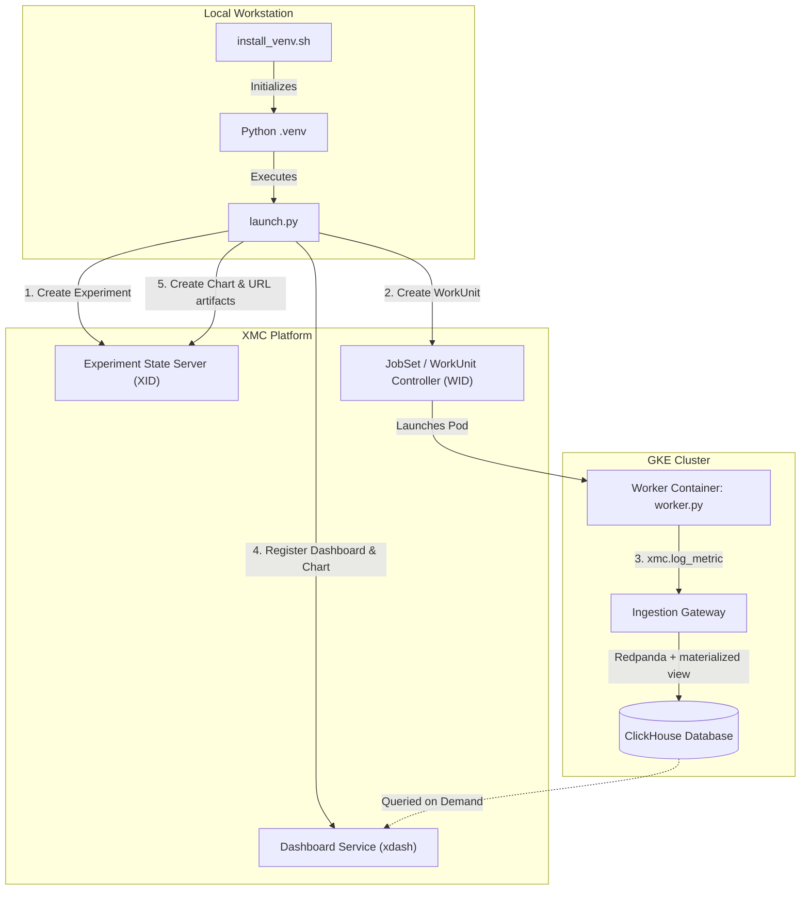

# Chart Artifact WorkUnit & Dashboard Example

This example demonstrates an end-to-end workflow for:

1. Triggering an **XMC WorkUnit** on GKE that streams randomized training metrics into
   ClickHouse through the Ingestion Gateway, using the `xmc` Python SDK.
2. Intercepting the dynamically assigned `xid` and `wid` in the **Launch Script**
   (`launch.py`).
3. Registering an **XMC Dashboard** with KPI cards and scatter plots for those metric
   names via the `xdash` Python SDK, in the same transaction that creates its Chart.
   The endpoint resolution, auth and transport selection match
   [`clickhouse_metrics_job`](../clickhouse_metrics_job): an `http(s)://` endpoint uses
   the transcoded REST route with an OIDC bearer token, anything else uses the
   Dashboard Service gRPC port via `xdash`'s `DashboardClient`.
4. Attaching a **ChartArtifact** to the WorkUnit's **Artifacts** tab, plus a companion
   **UrlArtifact** that deep-links to the dashboard.

> [!NOTE]
> The Artifacts tab renders a ChartArtifact as its metric list plus the chart resource
> the server provisioned for it — it does not draw plots inline, and it does not render
> that artifact's URL as a link. Plots are drawn on the dashboard page, and the companion
> URL artifact is what the tab turns into a clickable link.

---

## Architecture Overview



---

## File Structure

- **`install_venv.sh`**: Setup script compiling Bazel Python protos, creating a `.venv`,
  installing dependencies (`grpcio`, `absl-py`, etc.), and installing `xdash` and `xmc`
  SDKs in editable mode.
- **`launch.py`**: Client-side launch script creating the experiment, launching the
  WorkUnit, intercepting runtime IDs, creating the dashboard and attaching the artifacts.
- **`training_metrics.py`**: Metric names and the randomized sampler, shared by the
  worker and the launcher so the logged names and the plotted names cannot drift apart.
- **`training_metrics_test.py`**: Unit tests for the sampler.
- **`worker.env`**: Environment configuration pre-configured for the `xmcv2` GKE cluster
  and its in-cluster Ingestion Gateway.
- **`worker.py`**: WorkUnit container script emitting one sample per metric per step via
  `xmc.log_metric()`.
- **`Dockerfile`**: Container image definition for the worker. Its build context is the
  repository root, so `sdks/python/xmc` is visible to `COPY`. A builder stage compiles
  `api/protos/metrics/metrics.proto` with `protoc`, because the `xmc` SDK imports the
  generated `metrics_pb2` module and neither the repository nor the SDK wheel ships it.
- **`build_and_push.sh`**: Helper script to build and push the worker image to Google
  Cloud Artifact Registry.
- **`requirements.txt`**: Python dependencies list.

---

## Prerequisites

1. **GKE Cluster with XMC Deployed**: An active XMC cluster with the Experiment State
   Server, Ingestion Gateway and Dashboard Service running.
   `dashboardServiceDeployment.enabled=true` both serves the endpoints this example calls
   and gates the UI's `/dashboards` route, which is where the plots are drawn.
2. **ClickHouse Addon Deployed**: ClickHouse deployed in the cluster (see
   [ClickHouse Addon README](../../deploy/addons/metrics/clickhouse/README.md)).
3. **Google Cloud CLI (`gcloud`) & Docker**: Authenticated to push container images to
   your project's Artifact Registry.
4. **Bazel & Python 3.11+**: Installed on your workstation to build proto bindings.
5. **Client-Side Dependencies (`requirements.txt`)**: Host Python dependencies needed to execute `launch.py`:
   ```bash
   pip install -r requirements.txt
   ```

---

## Configuration & Environment Variables

The example includes a pre-configured [`worker.env`](worker.env) file with defaults for
the `xmcv2` environment. A `.env` file in the repo root takes precedence over it.

### Workstation / Launch Environment

| Variable                 | Description                                                     | Default                                                       |
| :----------------------- | :-------------------------------------------------------------- | :------------------------------------------------------------ |
| `PROJECT_ID`             | GCP project ID hosting Artifact Registry and the GKE cluster.    | Required unless `IMAGE_PATH` is set                            |
| `IMAGE_PATH`             | Worker image to run.                                             | `us-docker.pkg.dev/<PROJECT_ID>/xmc/chart-artifact-job:latest` |
| `XMANAGER_ENDPOINT`      | XMC endpoint URI (e.g. `dns:///grpc.xmcv2.example.com`). | Loaded from `.env`                                             |
| `XMANAGER_UI_URL`        | Base URL of the XMC UI, used for the printed deep links.         | Derived from `XMC_DOMAIN`                                      |
| `XMC_DASHBOARD_ENDPOINT` | Optional override for the Dashboard REST/gRPC endpoint.          | Derived from `XMANAGER_ENDPOINT`/`XMANAGER_UI_URL` (`https://<domain>/v1/dashboards`) |
| `CREATE_DASHBOARD`       | Whether to automatically register the dashboard and its chart.   | `true`                                                         |
| `QUEUE_NAME`             | Kueue queue the WorkUnit is submitted to.                        | `cpu-queue`                                                    |

### In-Cluster Worker Configuration (Passed to the WorkUnit / from `worker.env`)

| Variable                 | Description                                                 | Default                                                                  |
| :----------------------- | :---------------------------------------------------------- | :------------------------------------------------------------------------ |
| `XMC_GATEWAY_URL`        | Ingestion Gateway endpoint the `xmc` SDK posts metrics to.   | `http://ingestion-gateway-service.xmc.svc.cluster.local:8080/api/v1/metrics` |
| `CHART_DEMO_TOTAL_STEPS` | Total training steps to simulate.                            | `60`                                                                       |
| `CHART_DEMO_SEED`        | Sampler seed. Drawn by `launch.py` and printed in its banner when unset; set it to that value to reproduce a run. | Random per run                              |

---

## Quickstart Guide

### 1. Initialize Local Virtual Environment

```bash
./install_venv.sh
source .venv/bin/activate
```

### 2. Build and Push the Worker Container Image

```bash
./build_and_push.sh
```

### 3. Run the Launch Script

```bash
python3 launch.py
```

Example output:

```text
==================================================
  XMC Chart Artifact WorkUnit Launch Script
==================================================
Worker Image       : us-docker.pkg.dev/my-project/xmc/chart-artifact-job:latest
Queue Name         : cpu-queue
Dashboard Endpoint : https://xmcv2.example.com/v1/dashboards
Sampler Seed       : 484217
==================================================

[1/4] Created Experiment successfully: experiments/234911125 (XID: 234911125)
[2/4] Created WorkUnit successfully: experiments/234911125/workUnits/1 (WID: 1)

[3/4] Creating Dashboard and Chart for the generated metrics...
--> Publishing Dashboard 'Chart Artifact Experiment 234911125' to HTTP REST https://xmcv2.example.com/v1/dashboards...
--> Created Dashboard successfully: dashboards/chart_artifact_x234911125_w1 (HTTP 200)
--> Server-assigned chart IDs: ['b6f1c0a2-3d5e-4f18-9c47-2a0e8d3b7f91']

[4/4] Attaching artifacts to the WorkUnit...
--> Created Chart artifact: experiments/234911125/workUnits/1/artifacts/1
--> Created Dashboard link artifact: experiments/234911125/workUnits/1/artifacts/2

==================================================
  🎉 Experiment and WorkUnit Launch Completed!
  Work Unit : https://xmcv2.example.com/experiments/234911125/workUnits/1
  Dashboard : https://xmcv2.example.com/dashboards/chart_artifact_x234911125_w1
==================================================
```

---

## Verification

### 1. Verify Ingested Data in ClickHouse

```bash
kubectl exec -n xmc deployment/clickhouse -- clickhouse-client --query \
  "SELECT metric_name, count() FROM default.xmc_metrics WHERE xid = [XID] GROUP BY metric_name"
```

You should see one row per `chart_demo/*` metric.

### 2. Verify Dashboard & Charts

```bash
python3 -m xdash get-dashboard chart_artifact_x[XID]_w[WID]
```

The chart is created together with the dashboard in one transaction, so its ID is
assigned by the server rather than chosen by the launch script — take `[CHART_ID]` from
the `chart_ids` above, or from the launch script's `Server-assigned chart IDs` line:

```bash
python3 -m xdash get-chart-data experiments/[XID]/workUnits/[WID]/charts/[CHART_ID] --width 800
```

### 3. Verify the Artifacts

Open the WorkUnit's **Artifacts** tab. The chart artifact lists the three metric names;
its `status` flips from `PROVISIONING` once the server has provisioned its own chart
resource for it. The URL artifact below it links straight to the dashboard.

---

## Notes on the artifact payload

`CreateArtifact` rejects a `ChartArtifact` that sets `chart`, `status` or `error_message`
— they are `OUTPUT_ONLY`. The client supplies only `title` and `metric_names`; the server
marks the artifact `PROVISIONING` and fills the rest asynchronously.

The dashboard URL is repeated in three places because each is read by something
different: `Artifact.url` for API consumers, the artifact's notes for anyone reading the
card, and the companion `UrlArtifact` payload, which is the only one the UI turns into a
clickable link.
