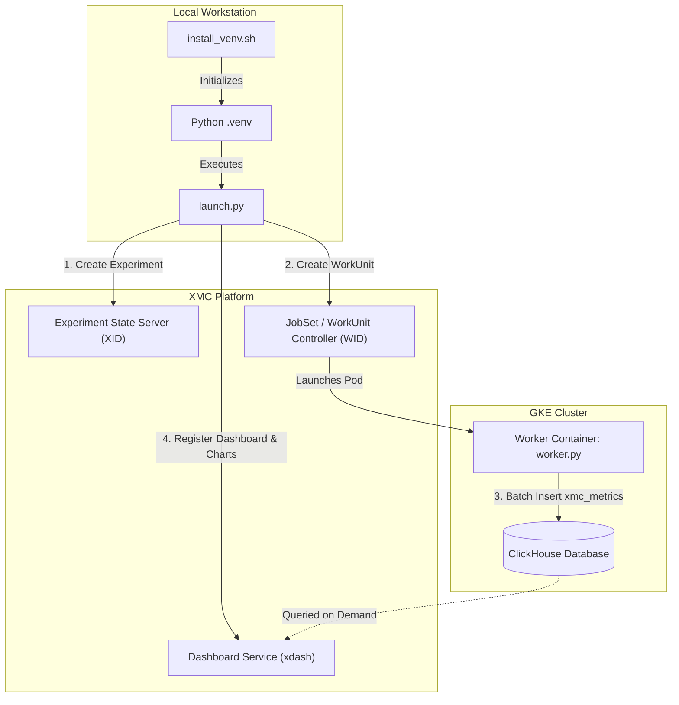

# ClickHouse Metrics WorkUnit & Dashboard Example

This example demonstrates an end-to-end workflow for:
1. Triggering an **XMC WorkUnit** on GKE configured with ClickHouse connection parameters.
2. Executing a **Worker Container** (`worker.py`) that generates realistic time-series training metrics matching the XMC DataEngine schema and bulk-inserts them into ClickHouse under the active Experiment ID (`xid`) and WorkUnit ID (`wid`).
3. Intercepting the dynamically assigned `xid` and `wid` in the **Launch Script** (`launch.py`).
4. Automatically constructing and registering an **XMC Dashboard** containing multiple KPI summary cards and scatter plot curves for the ingested metric names via the `xdash` Python SDK.

---

## Architecture Overview



---

## File Structure

- **`install_venv.sh`**: Setup script compiling Bazel Python protos, creating a `.venv`, installing dependencies (`clickhouse-connect`, `grpcio`, etc.), and installing `xdash` and `xmc` SDKs in editable mode.
- **`launch.py`**: Client-side launch script creating the experiment, launching the WorkUnit, intercepting runtime IDs, and creating the dashboard.
- **`worker.env`**: Environment configuration file pre-configured for the `xmcv2` GKE cluster and in-cluster ClickHouse instance (`clickhouse.xmc-metrics.svc.cluster.local`).
- **`worker.py`**: WorkUnit container script generating synthetic DataEngine metrics and inserting them into ClickHouse.
- **`Dockerfile`**: Container image definition for the ClickHouse worker.
- **`build_and_push.sh`**: Helper script to build and push the worker image to Google Cloud Artifact Registry.
- **`requirements.txt`**: Client-side/host Python dependencies required to execute `launch.py` (`absl-py`, `google-auth`, `grpcio`, `protobuf`, `python-dotenv`).

---

## Prerequisites

1. **GKE Cluster with XMC Deployed**: An active XMC cluster with Experiment State Server and Dashboard Service running.
2. **ClickHouse Addon Deployed**: ClickHouse deployed in the cluster (see `deploy/addons/metrics/clickhouse/README.md`).
3. **Google Cloud CLI (`gcloud`) & Docker**: Authenticated to push container images to your project's Artifact Registry.
4. **Bazel & Python 3.11+**: Installed on your workstation to build proto bindings.
5. **Client-Side Dependencies (`requirements.txt`)**: Host Python dependencies needed to execute `launch.py` and register dashboards and charts via `xdash`:
   ```bash
   pip install -r requirements.txt
   ```
   > [!NOTE]
   > `requirements.txt` defines client-side dependencies for running the launch script on your workstation. In-cluster container workload dependencies for `worker.py` are packaged into the worker container image.

---

## Configuration & Environment Variables

The example includes a pre-configured [`worker.env`](worker.env) file containing default connection parameters for the `xmcv2` environment and cluster-local ClickHouse instance. You can also define an optional `.env` file in the repo root or this directory to override workstation variables:

### Workstation / Launch Environment

| Variable | Description | Default |
| :--- | :--- | :--- |
| `PROJECT_ID` | GCP project ID hosting Artifact Registry and GKE cluster. | `xmc-test-project-6` |
| `XMANAGER_ENDPOINT` | XMC endpoint URI (e.g. `dns:///grpc.xmcv2.example.com`). | Loaded from `.env` |
| `XMANAGER_UI_URL` | Base URL of XMC UI and REST gateway (`https://xmcv2.example.com`). | Loaded from `.env` |
| `XMC_DASHBOARD_ENDPOINT` | Optional override for Dashboard REST/gRPC endpoint. | Derived from `XMANAGER_ENDPOINT`/`XMANAGER_UI_URL` (`https://<domain>/v1/dashboards`) |
| `CREATE_DASHBOARD` | Whether to automatically register dashboard and charts. | `true` |

### In-Cluster ClickHouse Connection (Passed to WorkUnit / from `worker.env`)

| Variable | Description | Default |
| :--- | :--- | :--- |
| `CLICKHOUSE_HOST` | Hostname of ClickHouse service inside GKE. | `clickhouse.xmc-metrics.svc.cluster.local` |
| `CLICKHOUSE_PORT` | HTTP port for ClickHouse. | `8123` |
| `CLICKHOUSE_USER` | ClickHouse username. | `default` |
| `CLICKHOUSE_PASSWORD` | ClickHouse password. | `""` |
| `CLICKHOUSE_DATABASE` | ClickHouse database name. | `default` |
| `CLICKHOUSE_SECURE` | Enable TLS for ClickHouse connection (`true`/`false`). | `false` |
| `CLICKHOUSE_TABLE` | Target metrics table. | `xmc_metrics` |
| `NUM_STEPS` | Total training steps to simulate. | `100` |

---

## Quickstart Guide

### 1. Initialize Local Virtual Environment

Run the automated setup script to build protobuf bindings, create `.venv`, and install required SDKs:

```bash
./install_venv.sh
source .venv/bin/activate
```

### 2. Build and Push the Worker Container Image

Build and push the worker image to Google Cloud Artifact Registry:

```bash
./build_and_push.sh
```

### 3. Run the Launch Script

Launch the WorkUnit and generate the dashboard:

```bash
python3 launch.py
```

Example output:
```text
==================================================
  XMC ClickHouse Metrics WorkUnit Launch Script  
==================================================
Worker Image       : us-docker.pkg.dev/my-project/xmc/clickhouse-metrics-job:latest
Queue Name         : cpu-queue
ClickHouse Host    : my-clickstack-clickhouse.xmc-metrics.svc.cluster.local:8123
ClickHouse Database: default
Dashboard Endpoint : localhost:8080
==================================================

[1/3] Created Experiment successfully: experiments/234911125 (XID: 234911125)
[2/3] Created WorkUnit successfully: experiments/234911125/workUnits/1 (WID: 1)

[3/3] Creating Dashboard and Chart for generated metrics...
--> Connecting to Dashboard Service at localhost:8080...
--> Creating Dashboard 'Experiment 234911125 - Training & Metrics Overview' (ID: exp_234911125_training_overview)...
--> Created Dashboard successfully: dashboards/exp_234911125_training_overview
--> Server-assigned chart IDs: ['b6f1c0a2-3d5e-4f18-9c47-2a0e8d3b7f91']

==================================================
  🎉 Experiment and WorkUnit Launch Completed!    
  Experiment XID : 234911125
  WorkUnit ID    : 1
==================================================
```

---

## Verification

### 1. Verify Ingested Data in ClickHouse

Connect to ClickHouse using `kubectl` and query the `xmc_metrics` table:

```bash
kubectl exec -it -n xmc-metrics my-clickstack-clickhouse-0 -- clickhouse-client \
    --query "SELECT metric_name, count(), min(metric_value), max(metric_value) FROM xmc_metrics WHERE xid = [XID] GROUP BY metric_name"
```

Expected output:
```text
train/loss          100    0.0984    2.0182
train/accuracy      100    0.3012    0.9521
eval/loss           100    0.1823    2.2319
perf/step_time_ms   100    105.32    134.18
```

### 2. Verify Dashboard & Charts in XMC Dashboard Service

You can retrieve the created dashboard and verify chart hydration via the `xdash` CLI or Python client:

```bash
python3 -m xdash get-dashboard exp_[XID]_training_overview
```

Or query chart data directly. The chart is created together with the dashboard in one
transaction, so its ID is assigned by the server rather than chosen by the launch script — take
`[CHART_ID]` from the `chart_ids` of the dashboard above, or from the launch script's own
`Server-assigned chart IDs` line:

```bash
python3 -m xdash get-chart-data experiments/[XID]/workUnits/1/charts/[CHART_ID] --width 800
```
