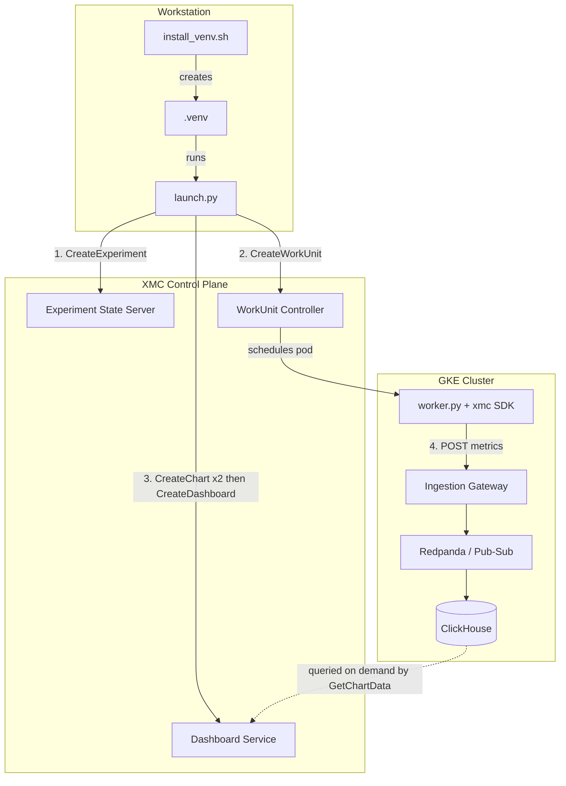

# End-to-End Metrics & Dashboard Example

This example runs the whole XMC metrics loop from a single launch: an Experiment is created, a WorkUnit streams training metrics through the **XMC Python SDK** (`xmc`) to the Ingestion Gateway, and Charts and a Dashboard are registered against that Experiment through the **xdash SDK** — so the run has a dashboard before its first metric lands.

It combines the two halves that previously lived apart: the worker from [`../metrics_job`](../metrics_job) (SDK → gateway) and the dashboard provisioning from [`../clickhouse_metrics_job`](../clickhouse_metrics_job).

**The worker does not touch ClickHouse.** It holds no database credentials and does not know where the metrics come to rest. It calls `xmc.log_metric()`, the SDK buffers and ships to the gateway, and the platform is responsible for landing the rows — which is what a real training job should look like. The `clickhouse_metrics_job` example writes to the database directly on purpose, to exercise the DataEngine schema in isolation; this one exercises the production path.

---

## Architecture



Steps 3 and 4 are independent: the dashboard is registered while the WorkUnit is still starting, and plots fill in as metrics arrive.

---

## Files

| File | Purpose |
| :--- | :--- |
| [`install_venv.sh`](./install_venv.sh) | Builds the Python tooling into a local `.venv`: XManager, the Bazel-generated dashboard protos, and the `xdash` and `xmc` SDKs in editable mode. |
| [`launch.py`](./launch.py) | Creates the Experiment and WorkUnit, then the Charts and Dashboard for the XID/WID just assigned. |
| [`worker.py`](./worker.py) | Runs inside the WorkUnit. Simulates training and logs metrics via `xmc.log_metric()`. |
| [`metric_names.py`](./metric_names.py) | The metric names, declared once and imported by **both** `worker.py` and `launch.py`. |
| [`Dockerfile`](./Dockerfile) | Packages `sdks/python/xmc`, `worker.py` and `metric_names.py` into a Python 3.11 image. |
| [`build_and_push.sh`](./build_and_push.sh) | Builds that image and pushes it to Artifact Registry. |
| [`requirements.txt`](./requirements.txt) | Launch-side Python dependencies. |

### Why `metric_names.py` is shared

A dashboard is only useful if the names in its plot specs are the ones the worker actually logged. A mismatch fails nowhere: the chart is created, the query runs, and the plot renders empty forever. Importing the names from one module on both sides makes that class of typo impossible rather than merely unlikely.

Metrics emitted: `train/loss`, `train/accuracy`, `eval/loss`, `eval/accuracy`, `perf/step_time_ms`.

---

## Prerequisites

1. **A GKE cluster with XMC deployed** — Experiment State Server, Ingestion Gateway and Dashboard Service running.
2. **The metrics pipeline enabled** — Ingestion Gateway plus its backing Redpanda/Pub-Sub and ClickHouse.
3. **`gcloud` and Docker** — authenticated against the project's Artifact Registry.
4. **Bazel and Python 3.11+** — to generate the dashboard proto bindings.
5. **A route to the Dashboard Service** — `launch.py` speaks gRPC to `XMC_DASHBOARD_ENDPOINT`,
   which defaults to `localhost:50051`. Running from a workstation against a remote cluster,
   forward the port first:

   ```bash
   kubectl port-forward -n xmc svc/dashboard-service 50051:50051
   ```

   Leave it running for the duration of the launch. Without it the WorkUnit still starts and
   streams metrics — only the dashboard step fails, with the warning described below.

---

## Configuration

All settings come from the environment; a `.env` file in this directory or the repo root is picked up automatically.

| Variable | Description | Default |
| :--- | :--- | :--- |
| `PROJECT_ID` | GCP project hosting Artifact Registry and the cluster. | `xmc-test-project-6` |
| `IMAGE_PATH` | Worker image to run. | `us-docker.pkg.dev/${PROJECT_ID}/xmc/metrics-dashboard-job:latest` |
| `QUEUE_NAME` | Kueue queue for the WorkUnit. | `cpu-queue` |
| `XMC_GATEWAY_URL` | Ingestion Gateway metrics endpoint, passed to the worker. | `http://ingestion-gateway-service.xmc.svc.cluster.local:8080/api/v1/metrics` |
| `XMC_DASHBOARD_ENDPOINT` | gRPC address of the Dashboard Service. | `localhost:50051` |
| `NUM_STEPS` | Training steps to simulate. | `100` |
| `STEP_DELAY_SECONDS` | Pause between steps, so metrics stream rather than arrive at once. | `0.2` |
| `CREATE_DASHBOARD` | Set to `false` to launch the WorkUnit without a dashboard. | `true` |

### A note on identity env vars

The worker needs `XMC_XID`, `XMC_WORK_UNIT_ID` and `XMC_EXECUTION_ID` to attribute its metrics. Only the first is set by `launch.py`:

- `XMC_WORK_UNIT_ID`, `XMC_EXECUTION_ID` and `XMC_JOB_NAME` are injected into the pod by the platform from its own labels via the downward API.
- `XMC_XID` is **not** — the platform publishes the experiment as `XMC_EXPERIMENT_ID`, while the SDK reads `XMC_XID`, so the launcher passes it explicitly.

This matters because the SDK **fails closed**: if any of the three is missing, or `XMC_GATEWAY_URL` is unset, every `log_metric()` call silently becomes a no-op. That is the right behaviour for a misconfigured pod, but it looks identical to a healthy run in the logs and only surfaces later as a permanently empty dashboard. `worker.py` therefore prints its resolved ingestion configuration and a clear warning at startup — check that first if the charts stay blank.

---

## Quickstart

### 1. Set up the local environment

```bash
./install_venv.sh
source .venv/bin/activate
```

### 2. Build and push the worker image

```bash
./build_and_push.sh
```

### 3. Launch

```bash
python3 launch.py
```

```text
==================================================
  XMC Metrics + Dashboard End-to-End Launch
==================================================
Worker Image       : us-docker.pkg.dev/my-project/xmc/metrics-dashboard-job:latest
Queue Name         : cpu-queue
Ingestion Gateway  : http://ingestion-gateway-service.xmc.svc.cluster.local:8080/api/v1/metrics
Dashboard Endpoint : localhost:50051
Simulated Steps    : 100
==================================================

[1/3] Created Experiment: experiments/234911125 (XID: 234911125)
[2/3] Created WorkUnit: experiments/234911125/workUnits/1 (WID: 1)

[3/3] Creating Charts and Dashboard...
--> Connecting to Dashboard Service at localhost:50051...
--> Creating 2 Charts...
    created experiments/234911125/workUnits/1/charts/training_progress
    created experiments/234911125/workUnits/1/charts/throughput
--> Creating Dashboard (ID: exp_234911125_overview)...
--> Created Dashboard successfully: dashboards/exp_234911125_overview

==================================================
  🎉 Launch completed
  Experiment XID : 234911125
  WorkUnit ID    : 1
  Charts populate as the worker streams metrics.
==================================================
```

---

## Verification

### 1. The worker is shipping metrics

```bash
kubectl logs -n xmc -l xmc.google.com/experiment-id=<XID> --tail=50
```

Look for the configuration block at startup — `metrics will be sent to the ingestion gateway` — followed by per-step progress lines.

### 2. Metrics landed

```bash
kubectl exec -n xmc-metrics my-clickstack-clickhouse-0 -- clickhouse-client \
  --query "SELECT metric_name, count() FROM xmc_metrics WHERE xid = <XID> GROUP BY metric_name"
```

```text
train/loss          100
train/accuracy      100
eval/loss           100
eval/accuracy       100
perf/step_time_ms   100
```

### 3. The dashboard resolves them

```bash
python3 -m xdash get dashboards/exp_<XID>_overview
python3 -m xdash get-data experiments/<XID>/workUnits/1/charts/training_progress
```

Both take the Dashboard Service address from `XMC_DASHBOARD_ENDPOINT`, or from `--endpoint`. TLS is the default for anything but a local address, so add `--insecure` when port-forwarding.

`get` on the dashboard should list both chart IDs; `get-data` on a chart is what proves the metrics made it all the way through.

---

## Troubleshooting

| Symptom | Likely cause |
| :--- | :--- |
| Charts render but stay empty. | The worker silenced itself. Check its startup configuration block for an `(unset)` identifier or a missing `XMC_GATEWAY_URL`. |
| `Could not create dashboard` warning, WorkUnit still runs. | `XMC_DASHBOARD_ENDPOINT` is unreachable. The launch does not fail on this by design; re-run the dashboard step against the printed XID. |
| Only the last steps are missing. | The worker was killed before `xmc.shutdown()` flushed its buffer. |
| `chart ... does not exist` from `CreateDashboard`. | A dashboard references charts by ID and never creates them; `launch.py` creates the charts first and references the server's returned copies. |
