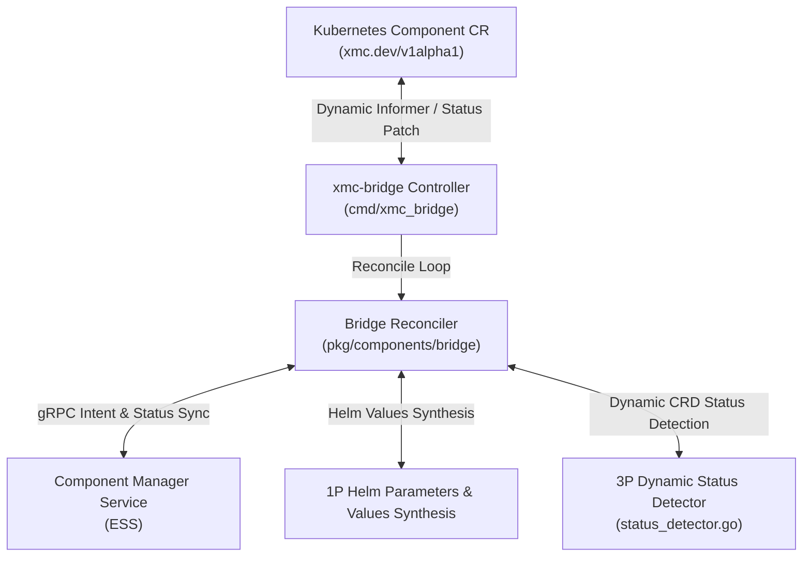

# GitOps Bridge Subsystem (`pkg/components/bridge`)

The **GitOps Bridge** provides bi-directional synchronization between Kubernetes Custom Resources (`Component` CRDs under `xmc.dev/v1alpha1`) and the Component Manager Service (CMS) within the Experiment State Server (ESS).

---

## Architecture Overview

---

## State Machine & Lifecycle

The `Reconciler` evaluates Component CRs through a deterministic state machine:

1. **Deletion Evaluation & Finalizer Gating**:
   - If `metadata.deletionTimestamp` is present and `spec.deletionProtection: true`, emit `ConditionTypeDeletionBlocked` (`True`) and prevent deletion.
   - If unprotected, prune child workloads, execute CMS deletion, and remove the `finalizers.xmc.dev/deletion-protection` finalizer.
2. **Intent Registration** (enabled components):
   - Propagate desired spec (including `spec.dependencies`) to CMS via `SetComponentIntent` on every pass, transitioning CMS state to `COMPONENT_STATE_PENDING_RECONCILIATION`. Registration happens **before** and independently of the activation gate, so CMS knows the dependency edges that make deactivation of a dependency unsafe even while the dependent is still waiting.
   - A `FailedPrecondition` whose message starts with `store.DependencyNotFoundMessagePrefix` (Spanner store: a dependency is not registered yet) is treated as "waiting on dependencies", not as an error; the intent is retried on the next pass. Any other intent failure reports `IntentApplicationFailed`.
3. **Dependency Activation Gate** (`spec.enabled: true` with `spec.dependencies`, all component types):
   - `cmd/xmc_bridge` builds a `DependencySnapshot` (`dependency_readiness.go`) once per reconcile pass from the listed Component CRs and passes it to `ReconcileWithDependencies`. A dependency is ready only if its CR exists, has `spec.enabled: true`, is not being deleted, reports `Ready=True` with `observedGeneration == metadata.generation`, and is not `Degraded=True`.
   - A component on a multi-node `spec.dependencies` cycle (self-references are dropped) reports `Ready=False`/`Degraded=True` reason `DependencyCycle` with the cycle path (e.g. `dependency cycle detected: ingestion -> redpanda -> ingestion`); intent is not sent.
   - **Not yet actuated** (no active 1P release, no `DependenciesReady` condition, and `Ready` not `True`): while any dependency is not ready, the component stays `COMPONENT_STATE_PENDING_RECONCILIATION` with `Ready=False`/`Degraded=False` reason `DependenciesNotReady` and a message such as `waiting on dependencies: redpanda (disabled), foo (not found)`. No workload is created. The next poll retries without logging an error.
   - **Already actuated**: a dependency blip never tears the workload down. The informational `DependenciesReady` condition turns `False` (reason `DependenciesNotReady`) and pending Helm installs/upgrades are held until every dependency is ready again. With nothing to upgrade, `Ready` stays health-derived. When an upgrade to a new generation is held, the component reports `PENDING_RECONCILIATION` with `Ready=False`/`Degraded=False` (reason `HelmUpgradePending`) so the new generation is never reported as ready before it is applied.
   - A chain of N dependent components settles over up to N passes (one poll interval each), because each pass evaluates readiness from a snapshot taken at the start of the pass.
   - `Reconcile` (no resolver) does not gate activation on the snapshot; CMS unregistered-dependency rejections still gate.
4. **Enablement & Workload Actuation**:
   - **Enabled (`spec.enabled: true`)**:
     - For 1P components, synthesizes Helm variable overrides and delegates release updates to `HelmManager`.
     - For 3P wrapper components, queries `StatusDetector` to evaluate dynamic CR health and updates observed status.
     - Transitions to `COMPONENT_STATE_ENABLED` upon success.
   - **Disabled (`spec.enabled: false`)**: Gated by CMS deactivation safety:
     1. `PrepareDeactivation` (skipped once the CR already reports `Ready` reason `ComponentDisabled` at the current generation). If CMS returns `FailedPrecondition` because enabled components still depend on this one, the workload keeps running, `DeactivationBlocked=True` and `Ready=False`/`Degraded=False` reason `DeactivationBlocked` name the active dependents, and the pass returns without error. While blocked, CMS is re-checked at most every 30s (the `DeactivationBlocked` `lastTransitionTime` records the last check). `NotFound` (never registered) proceeds without the handshake.
     2. Deletes the 1P Helm workload.
     3. `CompleteDeactivation` finalizes the CMS handshake (`DISABLING` → `DISABLED`), then `UpdateObservedGeneration` reports `COMPONENT_STATE_DISABLED`. CMS RPC failures before teardown report reason `CMSDeactivationFailed` (`Degraded=True`).
     4. If the handshake fails after the workload was deleted (or a later `PrepareDeactivation` is blocked or fails), `Ready=False`/`Degraded=True` reason `DeactivationIncomplete` is reported and the whole handshake is retried on the next pass (deletion is idempotent).

---

## Condition Types

| Condition Type | Status | Meaning |
| :--- | :--- | :--- |
| `Ready` | `True` / `False` | Operational health and readiness of the underlying component. |
| `Degraded` | `True` / `False` | Presence of active probe failures, crash loops, or provisioning errors. |
| `DeletionBlocked` | `True` / `False` | Deletion request blocked due to active deletion protection policy. |
| `DeactivationBlocked` | `True` | `spec.enabled: false` blocked because enabled components depend on this one; the workload keeps running. |
| `DependenciesReady` | `True` / `False` | Informational, on actuated enabled components with `spec.dependencies`. `False` means Helm upgrades are held (see `HelmUpgradePending`). |

The bridge writes the full conditions list with server-side apply on every pass, so `DeactivationBlocked` and `DependenciesReady` are replaced wholesale and are absent whenever they do not apply (e.g. `DependenciesReady` is dropped while a component is gated or disabled).

Gating reasons (set on `Ready=False`, state `COMPONENT_STATE_PENDING_RECONCILIATION`). CMS receives the same coarse `Ready=False` status message as other unready paths; the details live on the CR conditions:

| Reason | Degraded | Meaning |
| :--- | :--- | :--- |
| `DependenciesNotReady` | `False` | A not-yet-actuated enabled component waits on missing, disabled, deleting, unready, stale, degraded, or CMS-unregistered `spec.dependencies`. |
| `DependencyCycle` | `True` | The component is on a `spec.dependencies` cycle; the message names the cycle path. |
| `HelmUpgradePending` | `False` | An actuated 1P component's Helm upgrade to the current generation is held until its dependencies are ready; the previous release keeps running. |
| `DeactivationBlocked` | `False` | CMS `PrepareDeactivation` rejected disabling the component because it has active dependents. |
| `DeactivationIncomplete` | `True` | The workload was deleted but the CMS deactivation handshake has not completed; retried every pass. |

---

## Component Specification & Parameter Parsing (`ParseSpecFromUnstructured`)

The bridge reconciler ingests Kubernetes Custom Resource manifests and unmarshals them into strongly typed `componentspb.ComponentSpec` protobufs:

- **Structured Parameters (`spec.parameters`)**:
  - Key-value tuning parameters declared under `spec.parameters` (e.g. `topicName`, `port`, `bufferBytes`, `brokerEndpoints`) are parsed into `map<string, string> parameters` on `ComponentSpec`.
  - **Safe Numeric Formatting**: Unstructured JSON unmarshaling in Go parses numbers as `float64`. To prevent scientific notation formatting on large integers ($\ge 1,000,000$, such as `1048576` for 1MB becoming `"1e+06"`), `parseParameters` checks if `val == float64(int64(val))` and uses `strconv.FormatInt(int64(val), 10)` for integral values, while preserving decimals via `strconv.FormatFloat(val, 'f', -1, 64)`. Booleans and integers are explicitly formatted via `strconv`.
- **Dependencies (`spec.dependencies`)**:
  - The list of component names this component depends on is parsed by `parseDependencies` into `repeated string dependencies` on `ComponentSpec`. Entries are canonicalized (`naming.CanonicalComponentName`) and deduplicated in declaration order, and non-string entries are dropped. Strings with an empty canonical name (e.g. `""`, `"/"`) are passed through verbatim, so CMS rejects the spec with `InvalidArgument` instead of silently losing a dependency edge. `ReconcileComponent` also drops self-references in either form (logging a warning) so a component can never wait on itself. CMS persists them as dependency edges so cycle detection, deactivation safety, and deletion safety honor CR-declared dependencies.
- **Manifests & Wrapper References**:
  - `spec.manifests`: Slice of raw YAML strings for declarative workload resources.
  - `spec.wrapperRef`: Target CRD coordinates (`crdKind`, `crdGroup`, `crdVersion`, `targetName`, `targetNamespace`) for third-party operators.
- **Operational Defaults**:
  - `deletionProtection`: Defaults to `true` if omitted to prevent accidental data loss.
  - `enabled`: Defaults to `true` if omitted.

---

## 3P Custom Wrapper Status Detection (`status_detector.go`, `k8s_status_detector.go`, `fake_status_detector.go`)

Third-party (3P) ecosystem components (such as Ray clusters, vLLM inference services, and ClickHouse installations) are managed via external Kubernetes Custom Resource Definitions (CRDs). The GitOps bridge reconciler defines an extensible status detection contract to evaluate their health without hardcoding proprietary schemas:

- **`WrapperRef` Configuration**:
  - `Group`, `Version`, `Kind`: The target CRD's API GroupVersionKind.
  - `Name`, `Namespace`: The target custom resource's coordinates.
  - `ExpectedReadyValue`: Expected value for standard ready conditions (defaults to `"True"`).
- **`StatusDetector` Interface & Implementations**:
  - `DetectStatus(ctx context.Context, ref WrapperRef) (*ResourceStatus, error)`
  - `UnimplementedStatusDetector`: A truthful baseline implementation reporting that dynamic status detection is pending implementation.
  - `FakeStatusDetector`: In-memory test double supporting synthetic status mapping and error injection for unit testing.
  - `K8sStatusDetector`: Production implementation (`k8s_status_detector.go`) using client-go `dynamic.Interface` and `meta.RESTMapper` with automatic GVR discovery, resilient missing-CRD handling (`meta.IsNoMatchError`), and normalized JSONPath evaluation. Companion tests in `k8s_status_detector_test.go`.
- **Dynamic JSONPath Engine (`EvaluateJSONPath`)**: Evaluates arbitrary JSONPath queries against unstructured objects with automatic syntax normalization (`{.field}`, `field`, `$[0]`) and sibling condition failure message discovery.
- **Reconciler Lifecycle Integration**: Integrates 3P wrapper reconciliation into `reconciler.go` (`reconcile3PWrapper`), setting `Ready=False` and `Degraded=True` with explicit reason codes (`ResourceNotFound`, `CRDNotFound`, `StatusDetectionPending`) when unready, and propagating state to CMS.

---

## 1P Component Helm Values Synthesis (`helm_builder.go`)

First-party (1P) components are managed natively through XMC Helm charts. Rather than constructing duplicate Kubernetes `Deployment` and `Service` manifests in Go code, the bridge translates Component CR specifications directly into structured Helm parameter values:

- **`HelmComponentOptions`**: Encapsulates component parameters, explicit chart path overrides (`ChartPath`), image tags, replica counts, port bindings, and lifecycle controls.
- **`BuildHelmValues(opts HelmComponentOptions) map[string]any`**: Translates declarative component options into hierarchical Helm parameter maps (e.g., enabling `<component>Deployment.enabled: true`, setting custom images, and binding ports).
- **`HelmManager` Interface**: Declarative contract for applying, removing, and hydrating synthesized 1P values:
  - `Ensure1PComponent(ctx context.Context, ref ComponentRef, opts HelmComponentOptions) error`
  - `Delete1PComponent(ctx context.Context, ref ComponentRef) error`
  - `Purge1PComponent(ctx context.Context, ref ComponentRef) error`
  - `Orphan1PComponent(ctx context.Context, ref ComponentRef) error`
  - `IsComponentActive(ref ComponentRef) bool`
  - `IsComponentActuated(ref ComponentRef, generation int64) bool`
  - `RecordActuation(ref ComponentRef, generation int64)`
  - `HydrateFromCluster(ctx context.Context) error`
  - `HydrateComponentState(ctx context.Context, ref ComponentRef, observedGeneration int64, crReady bool) error`
  - `ComponentHealth(ctx context.Context, ref ComponentRef) (healthy bool, reason, message string)`
- **`FakeHelmManager`**: In-memory test double supporting concurrent testing, state hydration assertions, and error injection (`EnsureErr`, `DeleteErr`, and `UnhealthyReason` for `ComponentHealth`, which defaults to healthy).

---

## Kubernetes Helm Manager (`helm_manager.go`)

`K8sHelmManager` implements `HelmManager` by synchronizing synthesized values into Kubernetes ConfigMaps, resolving per-component chart paths, executing independent per-component Helm releases, and tracking active 1P component states:

- **Per-Component Independent Release Scoping (`ComponentReleaseName`)**:
  - Each 1P component is actuated into a dedicated, decoupled Helm release formatted as `xmc-cmp-<name>` (e.g., `xmc-cmp-ray-operator`), preserving architectural blast-radius isolation from other components and the core platform release.
- **Dynamic Per-Component Chart Path Resolution (`ResolveComponentChartPath`)**:
  - Supports custom `ChartPathResolver` injection via `WithChartPathResolver` as well as deterministic filesystem candidate discovery relative to a configured base chart path:
    1. Explicit per-component override (`opts.ChartPath` from `spec.parameters["chartPath"]`, validated against path traversal and confined within `<baseChartPath>` when `<baseChartPath>` is configured).
    2. Custom `ChartPathResolver` callback (if configured via `WithChartPathResolver`).
    3. `<baseChartPath>/components/<componentName>` (when `Chart.yaml` is present).
    4. `<baseChartPath>/<componentName>` (when `Chart.yaml` is present).
    5. `<baseChartPath>/<componentName>.tgz` (packaged component chart archive).
    6. Fallback to `<baseChartPath>` (or embedded default chart if empty).
- **Cold-Start State Hydration (`HydrateFromCluster` & `HydrateComponentState`)**:
  - `HydrateFromCluster(ctx)` inspects the `xmc-component-values` ConfigMap in the target namespace on controller startup and restores `activeState` for all previously enabled components.
  - `HydrateComponentState(ctx, ref, observedGeneration, crReady)` lazily reconciles in-memory `activeState` and `actuatedGenerations` from the `xmc-component-values` ConfigMap and the `Component` CR's `.status` (`observedGeneration` and `Ready=True` condition). This prevents redundant Helm release revision increments on cold start and ensures post-restart deactivation (`spec.enabled: false`) properly triggers `Delete1PComponent`.
  - **Release Verification**: Because the values ConfigMap is persisted *before* the (asynchronous) Helm upgrade runs, neither the ConfigMap nor a `Ready=True` condition alone proves that the release exists. When hydration would record a new actuation (`crReady && observedGeneration > 0` with no actuation recorded yet), `HydrateComponentState` first calls `HelmActionRunner.Status` (outside the state mutex). The CR is distrusted only on positive evidence: `driver.ErrReleaseNotFound` or a terminal non-`deployed` status (e.g. `failed`, `superseded`, `uninstalled`). In that case the component is marked inactive and not actuated, so the next `Ensure1PComponent` re-installs it. Transient status errors trust the CR (and are logged) so an API blip during restart does not cause a revision bump. A `pending-install`/`pending-upgrade`/`pending-rollback` release left by a crashed bridge also trusts the CR, because a re-upgrade would only fail with "another operation is in progress"; `ComponentHealth` reports it as `HelmReleaseStuck` instead. The deactivation path (`observedGeneration == 0`) is unchanged and performs no release lookup.
- **1P Component Health (`ComponentHealth`)**:
  - `evaluateHealth` in `reconciler.go` derives 1P health from `HelmManager.ComponentHealth` whenever a `HelmManager` is configured (the `BridgeProber` fallback, which reports non-3P components as healthy, is used only without a `HelmManager`).
  - **`deployed` means applied, not running**: upgrades run without `--wait`, so a `deployed` release means Helm applied the manifests. It does not mean the pods are ready. Pod-level readiness is out of scope for this check.
  - **In-flight upgrades**: `K8sHelmManager` tracks async upgrades per component from enqueue until the worker finishes. While one is queued or running, `Status` would still report the *previous* `deployed` revision, so `ComponentHealth` returns `HelmUpgradePending` instead. An upgrade error takes precedence over pending so `Degraded` stays stable across retries.
  - **Throttling**: a healthy (`deployed`) verdict is cached per component for 1 minute (`healthCacheTTL`) to avoid a Helm `Status` call (which lists release Secrets) on every poll. Any upgrade enqueue or completion invalidates the cache. The upgrade-error and pending checks never use the cache.
  - Checks are evaluated in order. Reason constants are exported from `reconciler.go`, and the reason below is set on both `Ready` and `Degraded`. Every non-healthy result sets `Ready=False` and state `COMPONENT_STATE_PENDING_RECONCILIATION`:

    | Reason | Degraded | Meaning |
    | :--- | :--- | :--- |
    | `InvalidComponentRef` | `True` | The component reference is missing a name or namespace. |
    | `HelmUpgradeFailed` | `True` | The last (sync or async) Helm upgrade for the component failed. |
    | `HelmUpgradePending` | `False` | An async upgrade is queued or running; release status is not yet authoritative. |
    | `HelmRunnerUninitialized` | `True` | No `HelmActionRunner` is configured, so release state cannot be verified. |
    | `HelmReleaseNotFound` | `True` | The `xmc-cmp-<name>` release does not exist (`driver.ErrReleaseNotFound`). |
    | `HelmStatusUnavailable` | *unchanged* | The Helm status query failed transiently (e.g. API server unreachable). The previous `Ready`/`Degraded` conditions are kept and a warning is logged. If there are no conditions at the current generation, it reports `Ready=False`, `Degraded=False`. |
    | `HelmReleaseStuck` | `True` | The latest revision is `pending-install`, `pending-upgrade`, or `pending-rollback` with no in-flight upgrade in this bridge (e.g. the bridge crashed mid-operation). |
    | `HelmReleaseNotReady` | `True` | The latest release revision is in another non-`deployed` state (e.g. `failed`). |
    | `HelmReleaseDrifted` | `True` | The release is `deployed`, but objects in its manifest no longer exist in the cluster (e.g. deleted by hand or pruned by another Helm release). The message lists the missing `Kind/name` objects. |
    | `ComponentHealthy` | `False` | The release is `deployed`, all of its manifest objects exist, and no upgrade is pending or failed (`Ready=True`, state `COMPONENT_STATE_ENABLED`). |

  - **Drift detection**: on each uncached health check of a `deployed` release, `HelmActionRunner.MissingResources` builds the objects in the release manifest and issues a `GET` for each one. Objects that return `NotFound` are reported as drift. Any other lookup error, context cancellation, or an object without a REST mapping aborts the check; the error is logged and the `deployed` verdict is kept, so an API blip never triggers a re-upgrade.
  - **Self-healing repair**: `HelmReleaseNotFound`, `HelmReleaseNotReady`, and `HelmReleaseDrifted` mark the component for repair (`repairNeeded`). While marked, `IsComponentActuated` returns false and `Ensure1PComponent` skips its unchanged-values short-circuit. The next reconcile pass re-runs the Helm upgrade at the *current* generation, which recreates missing objects, without waiting for a spec change. The marker is cleared once the upgrade is triggered, and when the component is uninstalled, purged, or orphaned. Transient and in-flight reasons (`HelmStatusUnavailable`, `HelmUpgradePending`, `HelmReleaseStuck`) never trigger repair. Deactivation and deletion paths do not run health checks, so they never repair.
  - **Recovering a stuck release**: the bridge does not auto-recover `HelmReleaseStuck`. Helm records no lock owner, so an automatic rollback or uninstall could clobber an operation that another actor (an operator or another bridge replica) is actively running. To recover, run `helm rollback xmc-cmp-<name> -n <namespace>` (or `helm uninstall xmc-cmp-<name> -n <namespace>` for a `pending-install` with no prior revision). Then bump the `Component` spec or restart the bridge so it re-actuates.
- **Spec Generation Gating & Change Detection**:
  - `reconcile1PWorkload` consults `IsComponentActuated(ref, in.Generation)`: steady-state reconciliation passes skip Helm upgrades when the current spec generation is already actuated, no errors are pending, and the release is not marked for repair.
  - `persistComponentValues`, `disableComponentValues`, and `removeComponentValues` return `(bool, error)` to detect whether ConfigMap contents actually changed, short-circuiting no-op upgrades.
- **ConfigMap Synchronization (`ComponentValuesConfigMapName = "xmc-component-values"`)**: Serializes component values into JSON payloads (`<componentName>.json`) inside the release ConfigMap.
- **Namespace Isolation**: Scopes component overrides and active state tracking by namespace (`targetNamespace/componentName`), with default fallback to `"xmc"`.
- **Clean Lifecycle Operations**:
  - `Ensure1PComponent`: Writes synthesized values JSON to the release ConfigMap, records per-component chart path overrides and enablement, and triggers a release upgrade.
  - `Delete1PComponent`: Disables the component in the ConfigMap (writing `enabled: false`) while retaining parameter configuration, clears active tracking state, and uninstalls/updates the release.
  - `Purge1PComponent`: Permanently deletes the component JSON key from the ConfigMap upon component teardown, and uninstalls the release.
  - `Orphan1PComponent`: Retains the ConfigMap values while detaching bridge ownership without triggering release upgrades.
- **Live Helm Go SDK Release Actuation (`SDKHelmActionRunner`)**:
  - `HelmActionRunner` Interface: Declarative abstraction over Helm v3 SDK actions (`Upgrade`, `Uninstall`, `Status`, `MissingResources`), allowing in-process Helm release upgrades, uninstalls, read-only release status queries, and manifest drift checks without CLI child processes. `Status` reports missing releases as errors matching `driver.ErrReleaseNotFound`. `MissingResources` returns the `Kind/name` of every object in a release manifest that the cluster reports as `NotFound`.
  - `SDKHelmActionRunner`: Uses `action.NewUpgrade` and dynamic Kubernetes REST client configurations to apply values directly to the component release. Resolves per-component chart paths via `WithRunnerChartPathResolver` and caches loaded `*chart.Chart` instances by path (`chartCache`) to avoid repeated disk I/O. Inspects release history with `action.NewHistory`; when `driver.ErrReleaseNotFound` occurs, falls back cleanly to `action.NewInstall` for initial release provisioning. Automatically falls back to an embedded in-memory default chart if no external chart directory is supplied.
- **Context-Aware Upgrade Lock**:
  - Serializes concurrent component updates using a channel-based semaphore (`upgradeSem`) to prevent release state conflicts while immediately unblocking upon context cancellation.
- **Asynchronous Upgrade Worker Queue & Per-Component Coalescing**:
  - Serializes and debounces rapid successive component modifications through a buffered channel (`upgradeChan`) and worker goroutine (`syncUpgradeWorker`) within a configurable window (default 25ms).
  - Coalesces requests per component (`req.ref.Name`), retaining the latest requested spec values and executing independent component release upgrades (`executeComponentUpgrade`), eliminating cross-tenant lock contention and API stampedes.

---

## Advanced 1P Lifecycle Policies (`helm_builder.go`, `helm_manager.go`)

Production-grade lifecycle controls and graceful deactivation policies for first-party components:

- **4-Tier Image Resolution Precedence**: Deterministically resolves container image overrides:
  1. `opts.Parameters["image"]` (highest priority explicit container image override)
  2. `opts.Parameters["imageRepository"]` + `opts.ImageTag` (repository customization)
  3. `defaultImage` + `opts.ImageTag` (standard component image with version override)
  4. `defaultImage:latest` (fallback default)
- **Graceful Connection Draining**: Automatically injects a `preStop` sleep hook (`/bin/sleep <seconds>`) and clamps `TerminationGracePeriodSeconds` to at least 5s greater than the drain timeout to guarantee pod termination ordering.
- **`Orphan` Deletion Policy**: Supports `spec.deletionPolicy: Orphan`, preserving live configuration during component de-registration while still deactivating managed controllers.

---

## 3P Access Coordinate Resolution (`coordinates.go`)

Parses discovered endpoints and connection secrets from third-party operator CRDs, extracting structured networking coordinates and publishing environment variables:

- **`ParseCoordinates(endpoint, secretName)`**: Extracts URL scheme, hostname, port, and Kubernetes service namespace/name coordinates.
- **Access Status Environment Variables**: Automatically populates `AccessStatus.EnvVars` with `ENDPOINT`, `HOST`, `PORT`, `SCHEME`, and `SECRET_NAME` for consumption by workloads and CMS.

---

## Active Network Health Probing (`health_prober.go`)

To supplement Kubernetes CR condition checks with real data plane health verification, the bridge performs active network health probes:

- **Bounded HTTP GET Probing (`ProbeHTTP`)**: Executes HTTP/HTTPS health checks with context timeouts, closing connections cleanly and draining response bodies up to a bounded 64KB limit. Supports custom clients via `WithHealthHTTPClient`.
- **TCP Socket Probing (`ProbeTCP`)**: Dials target socket addresses with deadline enforcement and closes sockets immediately upon connect.
- **Protocol-Agnostic Probing (`Probe`)**: Automatically sniffs URL schemes (`http://`, `https://`, `tcp://`, or bare `host:port`) and dispatches to HTTP vs TCP probe implementations.
- **`HealthProber` Interface & `FakeHealthProber`**: Enables dependency injection and deterministic health simulation in reconciler unit tests.

---

## 3P Custom Wrapper Reconciliation & Access Publishing (`reconciler.go`)

The reconciler unifies third-party CRD inspection and active health probing in `reconcile3PWrapper`:

- **End-to-End Health Verification**: Combines CR status conditions from `StatusDetector` with runtime probe results from `HealthProber`.
- **Condition Transitions**:
  - `Ready = True`: Emitted only when the underlying CR status is ready and active health probes succeed.
  - `Degraded = True`: Emitted when active probes fail or CR condition reports an error, with root-cause message propagation.
- **Access Coordinate Publishing**: Parses endpoint locations and publishes standard connection environment variables to CMS `AccessStatus.EnvVars`:
  - `ENDPOINT`: Full URL or base address.
  - `HOST`: Target host name or ClusterIP.
  - `PORT`: Service port.
  - `SCHEME`: Access protocol scheme (`http`, `https`, `tcp`).
  - `SECRET_NAME`: Credentials secret name reference.
- **`BridgeProber`**: Aggregates `StatusDetector` and `HealthProber` into a unified prober implementation for controller initialization.
- **Profile 3 Operator-less Support (`reconcileOperatorlessWrapper`)**: For workloads lacking Kubernetes CRD wrappers (`spec.wrapperRef` omitted, endpoint provided), the reconciler bypasses dynamic CRD status discovery and evaluates data-plane readiness exclusively through direct active network health probing.

---

## Controller Hardening & Status Mutation (`cmd/xmc_bridge/main.go`, `reconciler.go`)

Production-grade controller reliability, conflict elimination, and Cloud Spanner write throttling:

- **Server-Side Apply (SSA) Status Mutation**:
  - The controller persists status updates via Kubernetes Server-Side Apply (`types.ApplyPatchType`) against the `/status` subresource using a dedicated `fieldManager = "xmc-bridge"`.
  - Atomic field ownership eliminates optimistic concurrency update conflicts with other controllers (e.g. `xmc-syncer`) and prevents stale object overwrites.
- **Hybrid CMS Heartbeat Throttling (`shouldSyncToCMS`)**:
  - To eliminate Cloud Spanner write amplification caused by periodic steady-state health probe ticks, the bridge decouples Kubernetes data-plane polling from Spanner persistence.
  - Status synchronization RPCs (`UpdateObservedGeneration`) to CMS are triggered only upon:
    1. Initial component reconciliation (no prior `Ready` condition recorded).
    2. Status transitions (e.g., `Ready=True <-> Ready=False`).
    3. Spec metadata generation changes (`ObservedGeneration != in.Generation`).
    4. Heartbeat interval expiration (coarse 5-minute interval via `defaultCMSHeartbeatInterval`).
  - `resetReadyTransitionTime` updates `LastTransitionTime` on the `Ready` condition to current UTC time after successful CMS synchronization, resetting the heartbeat timer.

---

## Core Capabilities

- **State Machine Reconciliation**: Deterministic state transitions (`PENDING_RECONCILIATION`, `ENABLED`, `DISABLED`, `DELETED`) synchronized between Kubernetes CR status conditions and CMS access status.
- **Bi-directional Intent & Status Sync**: Propagates desired spec to CMS via `SetComponentIntent`, and records observed generation and condition history back to the Kubernetes API server.
- **Deletion Protection & Finalizer Engine**: Enforces `finalizers.xmc.dev/deletion-protection` to safeguard active components, emits `ConditionTypeDeletionBlocked` when protected, and orchestrates teardown according to `spec.deletionPolicy` (`Delete` vs `Orphan`).
- **Dynamic 3P CRD Status Detection & Coordinate Resolution**: Query third-party operator CRDs dynamically using normalized JSONPath queries and publish structured connection coordinates into CMS.
- **1P Helm Values Synthesis & Release Management**: Synthesizes structured Helm values and synchronizes release ConfigMaps for automated Helm release actuation.
- **Deterministic 4-Tier Image Resolution**: Prioritizes explicit container images over repository overrides and baseline release tags.
- **Graceful Connection Draining**: Enforces preStop sleep buffers to ensure zero-downtime rolling updates and teardowns.
- **Active Network Health Probing**: Verifies runtime data-plane health across HTTP/HTTPS endpoints and raw TCP sockets with bounded body drains.
- **3P Access Coordinate Publishing**: Translates third-party service coordinates into standard CMS client access environment variables.
- **Server-Side Apply Status Mutation**: Applies atomic SSA patches (`fieldManager=xmc-bridge`) to eliminate multi-controller status conflicts.
- **Hybrid CMS Heartbeat Throttling**: Bypasses Cloud Spanner write amplification by throttling routine probe writes to 5-minute heartbeats or state changes.
- **Profile 3 Operator-less Support**: Direct health checking and CMS coordinate publication for external SaaS or static endpoints lacking CRDs.
- **Resilient Failure Handling**: Non-destructive failure isolation ensuring transient CMS network errors do not tear down live workloads.

