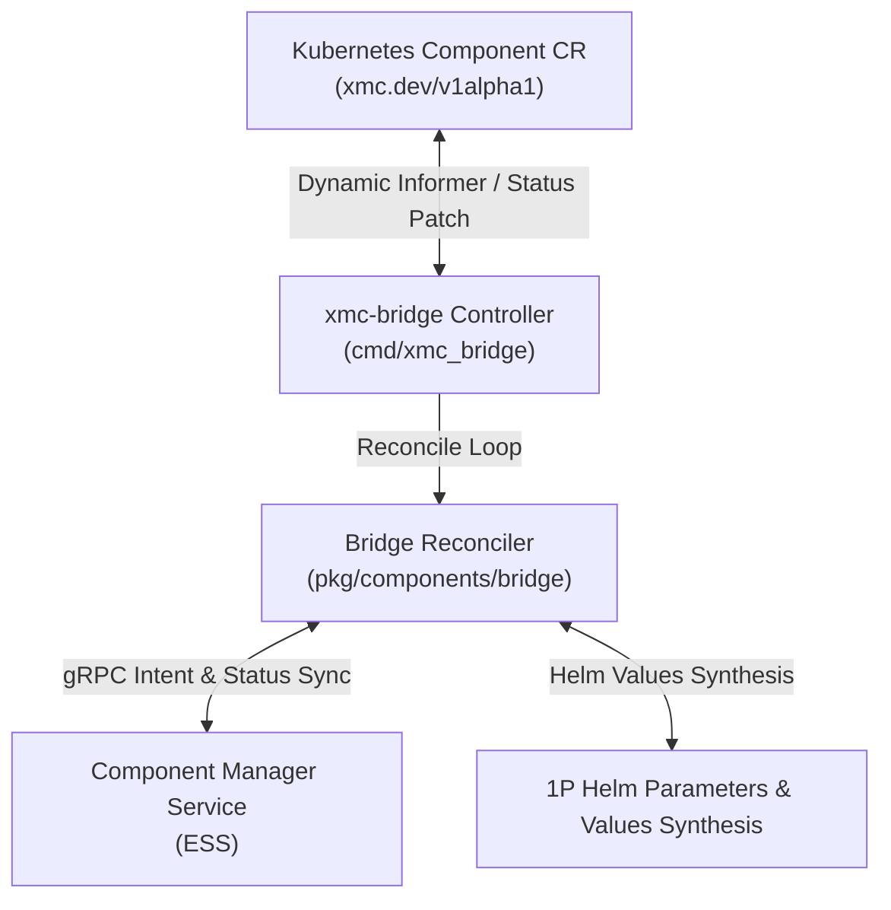

# GitOps Bridge Subsystem (`pkg/components/bridge`)

The **GitOps Bridge** provides bi-directional synchronization between Kubernetes Custom Resources (`Component` CRDs under `xmc.dev/v1alpha1`) and the Component Manager Service (CMS) within the Experiment State Server (ESS).

---

## Architecture Overview

---

## State Machine & Lifecycle

The `Reconciler` evaluates Component CRs through a deterministic state machine:

1. **Deletion Evaluation & Finalizer Gating**:
   - If `metadata.deletionTimestamp` is present and `spec.deletionProtection: true`, emit `ConditionTypeDeletionBlocked` (`True`) and prevent deletion.
   - If unprotected, prune child workloads, execute CMS deletion, and remove the `finalizers.xmc.dev/deletion-protection` finalizer.
2. **Intent Synchronization**:
   - Propagate desired spec to CMS via `SetComponentIntent`, transitioning CMS state to `COMPONENT_STATE_PENDING_RECONCILIATION`.
3. **Enablement & Workload Actuation**:
   - **Enabled (`spec.enabled: true`)**: Synthesizes 1P Helm variable overrides and delegates release updates to `HelmManager`. Transitions to `COMPONENT_STATE_ENABLED` upon success.
   - **Disabled (`spec.enabled: false`)**: Deactivates 1P Helm variable overrides and transitions CMS state to `COMPONENT_STATE_DISABLED`.

---

## Condition Types

| Condition Type | Status | Meaning |
| :--- | :--- | :--- |
| `Ready` | `True` / `False` | Operational health and readiness of the underlying component. |
| `Degraded` | `True` / `False` | Presence of active probe failures, crash loops, or provisioning errors. |
| `DeletionBlocked` | `True` / `False` | Deletion request blocked due to active deletion protection policy. |

---

## 1P Component Helm Values Synthesis (`helm_builder.go`)

First-party (1P) components are managed natively through XMC Helm charts. Rather than constructing duplicate Kubernetes `Deployment` and `Service` manifests in Go code, the bridge translates Component CR specifications directly into structured Helm parameter values:

- **`HelmComponentOptions`**: Encapsulates component parameters, image tags, replica counts, port bindings, and lifecycle controls.
- **`BuildHelmValues(opts HelmComponentOptions) map[string]any`**: Translates declarative component options into hierarchical Helm parameter maps (e.g., enabling `<component>Deployment.enabled: true`, setting custom images, and binding ports).
- **`HelmManager` Interface**: Declarative contract for applying and removing synthesized 1P values:
  - `Ensure1PComponent(ctx context.Context, ref ComponentRef, opts HelmComponentOptions) error`
  - `Delete1PComponent(ctx context.Context, ref ComponentRef) error`
  - `Purge1PComponent(ctx context.Context, ref ComponentRef) error`
  - `Orphan1PComponent(ctx context.Context, ref ComponentRef) error`
  - `IsComponentActive(ref ComponentRef) bool`
- **`FakeHelmManager`**: In-memory test double supporting concurrent testing and error injection.

---

## Kubernetes Helm Manager (`helm_manager.go`)

`K8sHelmManager` implements `HelmManager` by synchronizing synthesized values into Kubernetes ConfigMaps and tracking active 1P component states:

- **ConfigMap Synchronization (`ComponentValuesConfigMapName = "xmc-component-values"`)**: Serializes component values into JSON payloads (`<componentName>.json`) inside the release ConfigMap.
- **Namespace Isolation**: Scopes component overrides and active state tracking by namespace (`targetNamespace/componentName`), with default fallback to `"xmc"`.
- **Clean Lifecycle Operations**:
  - `Ensure1PComponent`: Writes synthesized values JSON to the release ConfigMap, records component enablement, and triggers a release upgrade.
  - `Delete1PComponent`: Disables the component in the ConfigMap (writing `enabled: false`) while retaining parameter configuration, clears active tracking state, and triggers a release upgrade.
  - `Purge1PComponent`: Permanently deletes the component JSON key from the ConfigMap upon component teardown, and triggers a release upgrade.
  - `Orphan1PComponent`: Retains the ConfigMap values while detaching bridge ownership without triggering release upgrades.
- **Live Helm Go SDK Release Actuation (`SDKHelmActionRunner`)**:
  - `HelmActionRunner` Interface: Declarative abstraction over Helm v3 SDK actions (`RunUpgrade(ctx, releaseName, chartPath, values)`), allowing in-process Helm release upgrades without CLI child processes.
  - `SDKHelmActionRunner`: Uses `action.NewUpgrade` with `Upgrade.Install = true` and dynamic Kubernetes REST client configurations to apply values directly to the Helm release.
- **Synchronous Upgrade Serialization**:
  - Serializes concurrent component updates using a channel semaphore (`upgradeSem`) to prevent Helm release state conflicts and lock contention during multi-component updates while supporting context cancellation.

---

## Advanced 1P Lifecycle Policies (`helm_builder.go`, `helm_manager.go`)

Production-grade lifecycle controls and graceful deactivation policies for first-party components:

- **4-Tier Image Resolution Precedence**: Deterministically resolves container image overrides:
  1. `opts.Parameters["image"]` (highest priority explicit container image override)
  2. `opts.Parameters["imageRepository"]` + `opts.ImageTag` (repository customization)
  3. `defaultImage` + `opts.ImageTag` (standard component image with version override)
  4. `defaultImage:latest` (fallback default)
- **Graceful Connection Draining**: Automatically injects a `preStop` sleep hook (`/bin/sleep <seconds>`) and clamps `TerminationGracePeriodSeconds` to at least 5s greater than the drain timeout to guarantee pod termination ordering.
- **`Orphan` Deletion Policy**: Supports `spec.deletionPolicy: Orphan`, preserving live configuration during component de-registration while still deactivating managed controllers.

---

## Core Capabilities

- **State Machine Reconciliation**: Deterministic state transitions (`PENDING_RECONCILIATION`, `ENABLED`, `DISABLED`, `DELETED`) synchronized between Kubernetes CR status conditions and CMS access status.
- **Bi-directional Intent & Status Sync**: Propagates desired spec to CMS via `SetComponentIntent`, and records observed generation and condition history back to the Kubernetes API server.
- **Deletion Protection & Finalizer Engine**: Enforces `finalizers.xmc.dev/deletion-protection` to safeguard active components, emits `ConditionTypeDeletionBlocked` when protected, and orchestrates teardown according to `spec.deletionPolicy` (`Delete` vs `Orphan`).
- **1P Helm Values Synthesis & Release Management**: Synthesizes structured Helm values and synchronizes release ConfigMaps for automated Helm release actuation.
- **Deterministic 4-Tier Image Resolution**: Prioritizes explicit container images over repository overrides and baseline release tags.
- **Graceful Connection Draining**: Enforces preStop sleep buffers to ensure zero-downtime rolling updates and teardowns.
- **Resilient Failure Handling**: Non-destructive failure isolation ensuring transient CMS network errors do not tear down live workloads.

