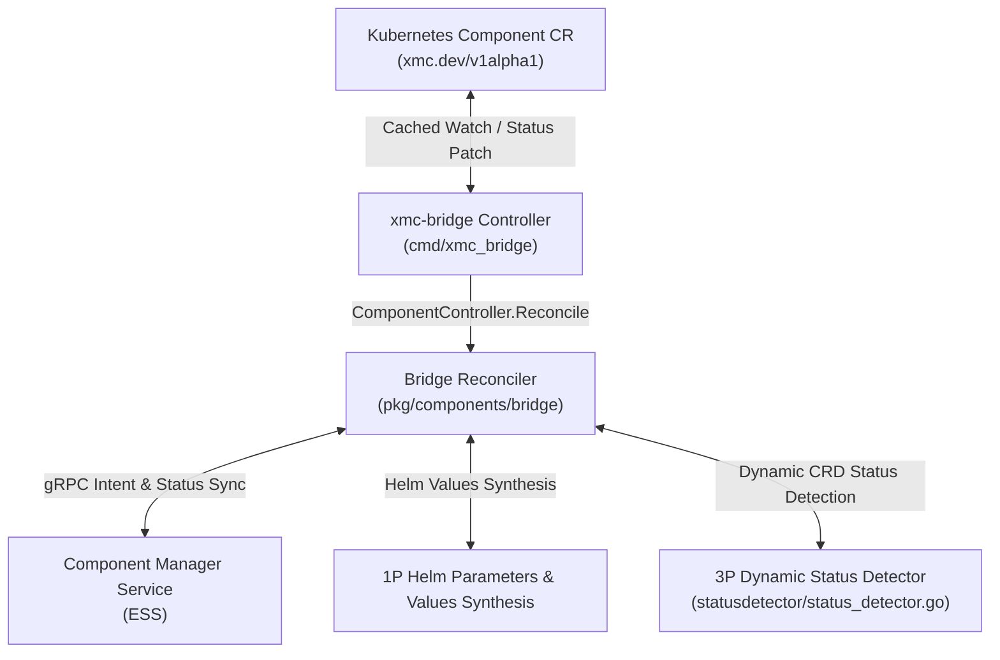

# GitOps Bridge Subsystem (`pkg/components/bridge`)

The **GitOps Bridge** provides bi-directional synchronization between Kubernetes Custom Resources (`Component` CRDs under `xmc.dev/v1alpha1`) and the Component Manager Service (CMS) within the Experiment State Server (ESS).

---

## Architecture Overview



---

## State Machine & Lifecycle

Before any of these steps, `ComponentController` stores the `xmc.dev/cms-cleanup` finalizer on a Component that lacks it, through a JSON patch whose `test` op requires the stored finalizers to equal the cached ones, and continues the same pass on the patched object. No CMS or Helm side effect happens until the finalizer is stored, so a deletion can never skip the cleanup. A failed patch ends the pass with no side effect and returns an error, so the Component is retried with backoff: a `422 Invalid` rejection usually means the cached Component is stale (its finalizers changed or its deletion started), and the retry reads the newer copy. A Component already being deleted without the finalizer has nothing to clean up and is skipped. The `finalizers.xmc.dev/deletion-protection` finalizer of earlier bridge versions counts as the cleanup finalizer, and releasing the cleanup finalizer removes both names.

The `Reconciler` evaluates Component CRs through a deterministic state machine:

1. **Deletion**:
   - If `metadata.deletionTimestamp` is present, execute CMS deletion, tear down child workloads per `spec.deletionPolicy`, and release the `xmc.dev/cms-cleanup` finalizer. `spec.deletionProtection` does not gate this step: the `component-deletion-protection` admission policy is its only enforcement, so a deletion that reached the bridge was already admitted (for example, one issued by the namespace controller).
     - Only `SOURCE_NAMESPACE_CONFLICT`, `SOURCE_INCARNATION_MISMATCH`, `CLUSTER_FENCED` and `CLUSTER_EPOCH_REGRESSED` skip CMS deletion: the bridge records a `StaleDeletion` Warning Event, tears down only this CR's own release, and then releases the finalizer. The Event is recorded before the finalizer is released, so it is never lost with the object. Any other rejection, including a `CLUSTER_NOT_DECLARED` left after the re-declare retry, keeps the finalizer and is retried.
     - A non-cascading (`Orphan`) deletion that CMS rejects with `ACTIVE_DEPENDENTS_EXIST` keeps the workload and the finalizer, reports `Stalled=True (ActiveDependentsExist)` with the previous `Ready` kept, records an `ActiveDependentsExist` Warning Event when the block first appears, and rechecks every 30s.
2. **Intent Registration** (enabled components):
   - Propagate desired spec (including `spec.dependencies`) to CMS via `SetComponentIntent` on every pass, with the CR generation as `ComponentSpec.generation`. CMS treats an unchanged intent as a no-op and moves a changed one to `COMPONENT_STATE_PENDING_RECONCILIATION` (see "Idempotent intent" in [../README.md](../README.md)). Registration happens **before** and independently of the activation gate, so CMS knows the dependency edges that make deactivation of a dependency unsafe even while the dependent is still waiting.
   - A `FailedPrecondition` carrying a `google.rpc.ErrorInfo` with reason `DEPENDENCY_NOT_REGISTERED` in domain `components.xmc.dev` (either store: a dependency is not registered yet) is treated as "waiting on dependencies", not as an error; the intent is retried on the next pass. Reason `DEPENDENCY_CYCLE` reports `Ready=False` and `Stalled=True` (reason `DependencyCycle`) with the CMS message. Reason `STALE_GENERATION` means the reconciled informer snapshot is older than a generation CMS already applied: it is never a `SourceConflict`; the bridge reads the live UID with an uncached GET, writes no status, and requeues after about 1s (`staleComponentRetryDelay`). The bridge matches the reason only, never the message text. Any other intent failure reports `Synced=False` (reason `CMSSyncFailed`) and keeps `status.access`. An already-actuated component keeps being health-probed locally (no CMS call, no Helm upgrade), so `Ready` reflects the latest probe at the last evaluated generation; otherwise the existing `Ready` condition is kept (or `Ready=Unknown` reason `InitialSyncPending` is set if `Ready` was never evaluated).
   - Ownership retries (`callWithOwnership`): `CLUSTER_NOT_DECLARED` (no fence row, or this cluster at an undeclared newer epoch) makes the bridge declare its epoch and retry once. `SOURCE_INCARNATION_MISMATCH` naming an owner in the same cluster and namespace triggers an uncached GET; if the live UID is this CR's, the call is retried once with `expected_owner_uid` set to the recorded owner. If that retry returns `SOURCE_INCARNATION_MISMATCH` with no owner metadata, the recorded owner was deleted in between (rule R1), so the bridge retries once more without `expected_owner_uid`, which creates a fresh record for the live CR. It never reports that case as `SourceConflict`. The takeover requires a non-empty cluster UID on both sides. If the uncached GET shows that the live UID is not this CR's (the reconciled object was deleted or replaced), the pass returns `errStaleLocalIncarnation`: it writes no status, so the newer CR's status is never overwritten, and requeues after `staleComponentRetryDelay` (~1s) so the cache can catch up. A `STALE_GENERATION` from the first call or any retry is handled the same way: the live UID is read, and the pass skips its status write and requeues.
3. **Dependency Activation Gate** (`spec.enabled: true` with `spec.dependencies`, all component types):
   - `ComponentController` (`component_controller.go`) builds a `DependencySnapshot` (`dependency_readiness.go`) from the cached Component CRs of the namespace for every Component it reconciles and passes it to `ReconcileWithDependencies`. A dependency is ready only if its CR exists, has `spec.enabled: true`, is not being deleted, and reports `Ready=True` with `observedGeneration == metadata.generation`.
   - A component on a multi-node `spec.dependencies` cycle (self-references are dropped) reports `Ready=False` (`Stalled=True`, reason `DependencyCycle`) with the cycle path (e.g. `dependency cycle detected: ingestion -> redpanda -> ingestion`); intent is not sent.
   - **Not yet actuated** (no active 1P release, no `DependenciesReady` condition, and `Ready` not `True`): while any dependency is not ready, the component stays `COMPONENT_STATE_PENDING_RECONCILIATION` with `Ready=False` (`Reconciling=True`, reason `DependenciesPending`) and `Ready.reason: DependenciesNotReady` with a message such as `waiting on dependencies: redpanda (disabled), foo (not found)`. No workload is created. The next pass retries without logging an error.
   - **Already actuated**: a dependency blip never tears the workload down. The informational `DependenciesReady` condition turns `False` (reason `DependenciesNotReady`) and pending Helm installs/upgrades are held until every dependency is ready again. With nothing to upgrade, `Ready` stays health-derived. When an upgrade to a new generation is held, the component reports `PENDING_RECONCILIATION` with `Ready=False` (`Reconciling=True`, reason `UpgradePending`) and `Ready.reason: HelmUpgradePending` so the new generation is never reported as ready before it is applied.
   - A dependency's change in readiness enqueues its dependents, so a chain of N dependent components settles in N event-driven passes instead of N probe intervals.
   - `Reconcile` (no resolver) does not gate activation on the snapshot; CMS unregistered-dependency rejections still gate.
4. **Enablement & Workload Actuation**:
   - **Enabled (`spec.enabled: true`)**:
     - For 1P components, synthesizes Helm variable overrides and delegates release updates to `HelmManager`.
     - For 3P wrapper components, queries `StatusDetector` to evaluate dynamic CR health and updates observed status.
     - Transitions to `COMPONENT_STATE_ENABLED` upon success.
   - **Disabled (`spec.enabled: false`)**: Gated by CMS deactivation safety:
     1. `PrepareDeactivation` (skipped once the CR already reports `Ready` reason `ComponentDisabled` at the current generation). If CMS returns `FailedPrecondition` because enabled components still depend on this one, the workload keeps running and serving its dependents, so `Ready` follows the workload's health (normally `True`, reason `ComponentHealthy`), while `DeactivationBlocked=True` and `Stalled=True` (reason `DeactivationBlocked`) name the active dependents, and the pass returns without error with `RequeueAfter: 30s` (`deactivationRecheckInterval`). A blocked component with no running workload (never actuated, e.g. gated on `DependenciesNotReady` or already disabled, or removed by an earlier pass) is not health-probed and reports `DeactivationIncomplete` instead (step 4). While blocked, CMS is re-checked at most every 30s (tracked in memory by `cmsSyncTracker` so `DeactivationBlocked.lastTransitionTime` only changes on status transitions). `NotFound` (never registered) proceeds without the handshake.
     2. Deletes the 1P Helm workload.
     3. `CompleteDeactivation` finalizes the CMS handshake (`DISABLING` → `DISABLED`), then `UpdateObservedGeneration` reports `COMPONENT_STATE_DISABLED` and the pass returns with `RequeueAfter: 5m` (`defaultCMSHeartbeatInterval`): a disabled Component has no workload to probe, so it is re-reconciled on the CMS heartbeat (or immediately on a spec change), not every `ProbeInterval`. CMS RPC failures before teardown report `Synced=False` (reason `CMSSyncFailed`) and preserve the existing `Ready` condition, except that `Ready=True` becomes `Ready=Unknown` (reason `CMSSyncFailed`): `Ready=True` is kept only while `spec.enabled`.
     4. If the handshake fails after the workload was deleted (or a later `PrepareDeactivation` is blocked or fails), or `PrepareDeactivation` is blocked while no workload was ever actuated, `Ready=False` (reason `DeactivationIncomplete`) and `Reconciling=True` (reason `Disabling`) are reported alongside `Synced=False` (`CMSSyncFailed` on RPC errors) and the whole handshake is retried on the next pass (deletion is idempotent).
5. **Observed Generation Gating**:
   - `status.observedGeneration` is advanced to `metadata.generation` whenever the pass evaluated that generation, as `kstatus` expects: the pass completed without error (`err == nil`, including policy blocks such as `DeactivationBlocked` or `DependenciesNotReady` — where `registerIntent` intercepts a CMS `dependency not found:` rejection from `applyIntent`/`handleIntentError` and converts it into a non-error wait message so the pass completes with `err == nil` via `reportGated`), or it ended `Stalled=True` at this generation with `Synced=True` (e.g. a CMS-reported `DependencyCycle`, a failed Helm upgrade `HelmUpgradeFailed`, a missing 3P CRD `CRDNotFound`, or a `ContractBroken` wrapper). When a transient error (`err != nil` without such a `Stalled` outcome, e.g. a CMS outage that reports `Synced=False`) stops the pass, `status.observedGeneration` retains the previous observed generation from the CR while per-condition `observedGeneration` stamps record the generation evaluated for that condition.

---

## Condition Types & kstatus / Argo CD Contract

| Condition Type | Status | Meaning |
| :--- | :--- | :--- |
| `Ready` | `True` / `False` / `Unknown` | Operational health and readiness of the underlying component (`Unknown` with reason `InitialSyncPending` if CMS fails before initial health evaluation). |
| `Synced` | `True` / `False` | Control-plane synchronization with CMS (`CMSSynced` or `CMSSyncFailed`). Transient CMS errors set `Synced=False` and keep `status.access`; already-actuated workloads keep being health-probed, so `Ready` reflects the latest local probe, and `Ready=True` is kept only while `spec.enabled`. A CMS policy rejection (a dependency cycle, a dependency that is not registered yet, or a deactivation blocked by enabled dependents) keeps `Synced=True`, because the CMS write path is healthy; `Stalled` (dependency cycle, blocked deactivation) or `Reconciling` (unregistered dependency) reports the block instead. |
| `Reconciling` | `True` (absent when settled) | Standard `cli-utils/pkg/kstatus` condition present while the bridge is actively converging (`Progressing`, `Disabling`, `DependenciesPending`, `UpgradePending`). Pruned via SSA when settled or stalled. |
| `Stalled` | `True` (absent when not stalled) | Standard `cli-utils/pkg/kstatus` condition present when convergence cannot proceed without external intervention (`DependencyCycle`, `DeactivationBlocked`, `ContractBroken`, `InvalidWrapperSpec`, `InvalidWrapperRef`, `CrossNamespaceForbidden`, `CRDNotFound`, `InvalidComponentRef`, `HelmUpgradeFailed`, `HelmReleaseStuck`, `HelmRunnerUninitialized`). |
| `DeactivationBlocked` | `True` | `spec.enabled: false` blocked because enabled components depend on this one; the workload keeps running. |
| `DependenciesReady` | `True` / `False` | Informational, on actuated enabled components with `spec.dependencies`. `False` means Helm upgrades are held (see `HelmUpgradePending`). |
| `SourceConflict` | `True` (absent when owned) | CMS rejected a sourced RPC because another object or cluster owns the component (`SourceIncarnationMismatch`, `SourceNamespaceConflict`, `ClusterFenced`, or `ClusterEpochRegressed`; `STALE_GENERATION` is a stale snapshot, never a `SourceConflict`). Also sets `Ready=False` (`SourceConflict`) and `Stalled=True` (`SourceConflict`), clears `status.access` and `status.componentGeneration`, and preserves `status.componentId`. |

The bridge writes its owned conditions list with server-side apply (`fieldManager: xmc-bridge`, `ForceOwnership`) on every pass, so `Reconciling`, `Stalled`, `DeactivationBlocked`, `DependenciesReady`, and `SourceConflict` are absent whenever they do not apply (e.g. `Reconciling` and `Stalled` are both omitted once a component settles at `Ready=True` or `Ready=False/ComponentDisabled`).

In addition to `status.observedGeneration`, the bridge persists:
- `status.componentGeneration`: the committed CMS generation returned by `SetComponentIntent` (omitted on `SourceConflict` and preserved across transient `Synced=False` failures).
- `status.componentId`: the CMS `ComponentId` formatted as a decimal string, preserved across transient CMS errors and `SourceConflict` once known.

**Ownership & cluster fencing in the bridge (`reconciler.go`, `cms_client.go`, `cluster_fence.go`)**:
- **Cluster fence declaration & standby**: `ClusterFence` declares `(clusterUID, clusterName, epoch)` to CMS via `DeclareClusterEpoch` at startup and every 5 minutes. While fenced (`CLUSTER_FENCED` or `CLUSTER_EPOCH_REGRESSED`), the bridge stays in cold standby: it performs no Helm actuation or CMS writes, projects `SourceConflict=True`, `Ready=False`, and `Stalled=True` on local CRs, and re-enqueues all CRs (`ClusterFence.Changes()`) whenever the fence state transitions or refreshes every 15 minutes.
- **Same-cluster recreate (R6 -> R5 CAS)**: On `SOURCE_INCARNATION_MISMATCH`, `retrySameClusterTakeover` performs an uncached `GET` via `NewAPIReaderLiveUID(mgr.GetAPIReader())` to verify that the local CR still exists with the same UID and that the recorded `owner_uid` no longer owns the name, then retries once with `expected_owner_uid` set to `owner_uid` to adopt the record in-place under the same `ComponentId`.
- **Per-incarnation Helm actuation state & non-owner deletion**: Each CR incarnation tracks its 1P actuation state by `(namespace, name, uid)` around the `xmc-cmp-<name>` release (`ComponentReleaseNameForRef`). When a CR is deleted in a non-owner namespace or a fenced standby cluster (`SOURCE_NAMESPACE_CONFLICT`, `SOURCE_INCARNATION_MISMATCH`, `CLUSTER_FENCED`, `CLUSTER_EPOCH_REGRESSED`), the bridge skips CMS record deletion, emits a `Warning` Event (`Reason: StaleDeletion` naming the owner from `ErrorInfo.metadata`), tears down its local Helm release according to `spec.deletionPolicy` (unless a newer incarnation is active in the same namespace), and releases the `xmc.dev/cms-cleanup` finalizer.

Gating reasons (set on `Ready=False`, state `COMPONENT_STATE_PENDING_RECONCILIATION`). CMS receives the same coarse `Ready=False` status message as other unready paths; the details live on the CR conditions:

| `Ready` Reason | kstatus Condition | Meaning |
| :--- | :--- | :--- |
| `DependenciesNotReady` | `Reconciling=True` (`DependenciesPending`) | A not-yet-actuated enabled component waits on missing, disabled, deleting, unready, stale, or CMS-unregistered `spec.dependencies`. |
| `DependencyCycle` | `Stalled=True` (`DependencyCycle`) | The component is on a `spec.dependencies` cycle; the message names the cycle path. |
| `HelmUpgradePending` | `Reconciling=True` (`UpgradePending`) | An actuated 1P component's Helm upgrade to the current generation is held until its dependencies are ready; the previous release keeps running. |
| `DeactivationIncomplete` | `Reconciling=True` (`Disabling`) | No workload is running (it was deleted, or never actuated) but the CMS deactivation handshake has not completed; retried every pass. |
| `SourceConflict` | `Stalled=True` (`SourceConflict`) | CMS rejected a sourced mutation due to an ownership or cluster fence conflict; details and cause reason are on `SourceConflict=True`. |

`DeactivationBlocked` is not a `Ready` reason: when CMS `PrepareDeactivation` rejects disabling the component because it has active dependents, the workload keeps running, `Ready` follows its health (normally `True`), and `Stalled=True` (`DeactivationBlocked`) plus `DeactivationBlocked=True` surface the block. Because `Stalled=True` is evaluated before `Ready=True` and `spec.enabled: false` in both the Argo CD Lua health check and `xmc-diag`, a blocked deactivation intentionally surfaces as `Degraded` / `STATE_DEGRADED` (`Healthy: false`) rather than `Healthy` or `Suspended` / `STATE_DISABLED`, alerting operators that the requested deactivation has not converged.

### Argo CD Health Check (`argocd-cm`)

```lua
-- resource.customizations.health.xmc.dev_Component
local hs = { status = "Progressing", message = "Waiting for status" }
if obj.metadata.deletionTimestamp ~= nil then
  return { status = "Progressing", message = "Deleting" }
end
if obj.status == nil or obj.status.conditions == nil then return hs end
if obj.status.observedGeneration ~= obj.metadata.generation then return hs end
local c = {}
for _, x in ipairs(obj.status.conditions) do c[x.type] = x end
if c.Stalled and c.Stalled.status == "True" then
  return { status = "Degraded", message = (c.Stalled.reason or "") .. ": " .. (c.Stalled.message or "") }
end
if c.Reconciling and c.Reconciling.status == "True" then
  return { status = "Progressing", message = c.Reconciling.message or "" }
end
if c.Ready == nil or c.Ready.status == "Unknown" then
  return { status = "Progressing", message = (c.Ready and c.Ready.reason) or "Waiting for Ready" }
end
if c.Ready.status == "True" then
  return { status = "Healthy", message = c.Ready.message or "" }
end
if c.Ready.status == "False" and c.Ready.reason == "ComponentDisabled" then
  return { status = "Suspended", message = "Component is disabled" }
end
return { status = "Degraded", message = (c.Ready.reason or "") .. ": " .. (c.Ready.message or "") }
```

The generation check comes first: `status.observedGeneration` is stamped whenever the bridge evaluated the generation, including `Stalled` outcomes, so a stale value always means the current spec has not been evaluated yet.

---

## Component Specification & Parameter Parsing (`ParseSpecFromUnstructured`)

The bridge reconciler ingests Kubernetes Custom Resource manifests and unmarshals them into strongly typed `componentspb.ComponentSpec` protobufs:

- **Structured Parameters (`spec.parameters`)**:
  - Key-value tuning parameters declared under `spec.parameters` (e.g. `topicName`, `port`, `bufferBytes`, `brokerEndpoints`) are parsed into `map<string, string> parameters` on `ComponentSpec`.
  - **Safe Numeric Formatting**: Unstructured JSON unmarshaling in Go parses numbers as `float64`. To prevent scientific notation formatting on large integers ($\ge 1,000,000$, such as `1048576` for 1MB becoming `"1e+06"`), `parseParameters` checks if `val == float64(int64(val))` and uses `strconv.FormatInt(int64(val), 10)` for integral values, while preserving decimals via `strconv.FormatFloat(val, 'f', -1, 64)`. Booleans and integers are explicitly formatted via `strconv`.
- **Dependencies (`spec.dependencies`)**:
  - The list of component names this component depends on is parsed by `parseDependencies` into `repeated string dependencies` on `ComponentSpec`. Entries are canonicalized (`naming.CanonicalComponentName`) and deduplicated in declaration order, and non-string entries are dropped. Strings with an empty canonical name (e.g. `""`, `"/"`) are passed through verbatim, so CMS rejects the spec with `InvalidArgument` instead of silently losing a dependency edge. `ReconcileComponent` also drops self-references in either form (logging a warning) so a component can never wait on itself. CMS persists them as dependency edges so cycle detection, deactivation safety, and deletion safety honor CR-declared dependencies.
- **Manifests & Wrapper References**:
  - `spec.manifests`: Slice of raw YAML strings for declarative workload resources.
  - `spec.wrapperRef`: Target CRD coordinates (`crdKind`, `crdGroup`, `crdVersion`, `targetName`, `targetNamespace`) for third-party operators.
- **Operational Defaults**:
  - `deletionProtection`: Defaults to `true` if omitted to prevent accidental data loss.
  - `enabled`: Defaults to `true` if omitted.

---

## 3P Custom Wrapper Status Detection (`statusdetector`, `statusdetectortest`)

Third-party (3P) ecosystem components (such as Ray clusters, vLLM inference services, and ClickHouse installations) are managed via external Kubernetes Custom Resource Definitions (CRDs). The GitOps bridge reconciler defines an extensible status detection contract to evaluate their health without hardcoding proprietary schemas:

- **`WrapperRef` Configuration**:
  - `Group`, `Version`, `Kind`: The target CRD's API GroupVersionKind.
  - `Name`, `Namespace`: The target custom resource's coordinates.
  - `ExpectedReadyValue`: Expected value for standard ready conditions (defaults to `"True"`).
- **`StatusDetector` Interface & Implementations**:
  - `DetectStatus(ctx context.Context, ref WrapperRef) (*ResourceStatus, error)`
  - `UnimplementedStatusDetector`: A truthful baseline implementation reporting that dynamic status detection is pending implementation.
  - `FakeStatusDetector` (`statusdetectortest/fake_status_detector.go`): In-memory test double supporting synthetic status mapping and error injection for unit testing.
  - `K8sStatusDetector`: Production implementation (`statusdetector/k8s_status_detector.go`) using client-go `dynamic.Interface` and `meta.RESTMapper` with automatic GVR discovery, resilient missing-CRD handling (`meta.IsNoMatchError`), structural contract validation (`validateStatusPayload` returning `ErrContractBreach` when `.status` is not an object map, `.status.conditions` is not a list of maps, or a condition lacks a non-empty string `type`), and normalized JSONPath evaluation. Companion tests in `statusdetector/k8s_status_detector_test.go`.
- **Dynamic JSONPath Engine (`EvaluateJSONPath`)**: Evaluates arbitrary JSONPath queries against unstructured objects with automatic syntax normalization (`{.field}`, `field`, `$[0]`) and sibling condition failure message discovery.
- **Reconciler Lifecycle Integration**: Integrates 3P wrapper reconciliation into `wrapper_reconciler.go` (`reconcile3PWrapper`), setting `Ready=False` and `Reconciling=True` or `Stalled=True` with explicit reason codes (`ResourceNotFound`, `CRDNotFound`, `InvalidWrapperSpec`, `ContractBroken`, `StatusDetectionPending`) when unready, and propagating state to CMS.

---

## 1P Component Helm Values Synthesis (`helm/helm_builder.go`)

First-party (1P) components are managed natively through XMC Helm charts. Rather than constructing duplicate Kubernetes `Deployment` and `Service` manifests in Go code, the bridge translates Component CR specifications directly into structured Helm parameter values:

- **`HelmComponentOptions`**: Encapsulates component parameters, explicit chart path overrides (`ChartPath`), image tags, replica counts, port bindings, and lifecycle controls.
- **`BuildHelmValues(opts HelmComponentOptions) map[string]any`**: Translates declarative component options into hierarchical Helm parameter maps (e.g., enabling `<component>Deployment.enabled: true`, setting custom images, and binding ports).
- **`HelmManager` Interface**: Declarative contract for applying, removing, and hydrating synthesized 1P values:
  - `Ensure1PComponent(ctx context.Context, ref ComponentRef, opts HelmComponentOptions) error`
  - `Delete1PComponent(ctx context.Context, ref ComponentRef) error`
  - `Purge1PComponent(ctx context.Context, ref ComponentRef) error`
  - `Orphan1PComponent(ctx context.Context, ref ComponentRef) error`
  - `IsComponentActive(ref ComponentRef) bool`
  - `IsComponentActuated(ref ComponentRef, generation int64) bool`
  - `RecordActuation(ref ComponentRef, generation int64)`
  - `HydrateFromCluster(ctx context.Context) error`
  - `HydrateComponentState(ctx context.Context, ref ComponentRef, observedGeneration int64, crReady bool) error`
  - `ComponentHealth(ctx context.Context, ref ComponentRef) (healthy bool, reason, message string)`
- **`FakeHelmManager` (`helm/helmtest/fake_helm_manager.go`)**: In-memory test double supporting concurrent testing, state hydration assertions, and error injection (`EnsureErr`, `DeleteErr`, and `UnhealthyReason` for `ComponentHealth`, which defaults to healthy).

---

## Kubernetes Helm Manager (`helm/helm_manager.go` and related files)

`K8sHelmManager` implements `HelmManager` by synchronizing synthesized values into Kubernetes ConfigMaps, resolving per-component chart paths, executing independent per-component Helm releases, and tracking active 1P component states. Its implementation is split by responsibility in `pkg/components/bridge/helm`:

| File | Responsibility |
| :--- | :--- |
| `helm/helm_manager.go` | `HelmManager` interface, construction options, and the `Ensure`/`Delete`/`Purge`/`Orphan` lifecycle entry points. |
| `helm/chart_resolver.go` | Per-component chart path resolution and validation. |
| `helm/component_values.go` | Read-modify-write of the `xmc-component-values` ConfigMap. |
| `helm/release_executor.go` | Sync and async Helm upgrade/uninstall execution, the upgrade lock, and the debounced worker queue. |
| `helm/release_health.go` | `ComponentHealth`, the deployed-verdict cache, and drift detection. |
| `helm/release_repair.go` | Repair marking (`NeedsRepair`) and repair backoff. |
| `helm/actuation_state.go` | Active/actuated generation tracking and cold-start hydration. |
| `helm/helm_leader_runnable.go` | `NewHelmLeaderRunnable`: a leader-elected `manager.Runnable` that runs `HydrateFromCluster` once elected and, when leadership ends, `Shutdown`s the Helm manager (queued upgrades that have not started are dropped with `errManagerStopped`; the in-flight one gets `helmShutdownTimeout` before it is cancelled). `K8sHelmManager.Shutdown` and `Abort` themselves live in `helm/helm_manager.go`. |

- **Per-Component Independent Release Scoping (`ComponentReleaseName`)**:
  - Each 1P component is actuated into a dedicated, decoupled Helm release formatted as `xmc-cmp-<name>` (e.g., `xmc-cmp-ray-operator`), preserving architectural blast-radius isolation from other components and the core platform release.
  - The CRD's CEL validation limits `metadata.name` to 45 characters, so the release name stays within Helm's 53-character limit, and rejects names that start with `xmc-cmp-`, so release names are never doubly prefixed.
  - Actuation state is tracked per CR incarnation (`<namespace>/<name>@<uid>`). Actuating a new incarnation evicts the state of superseded incarnations and the namespace-level entry hydrated from the values ConfigMap; once the CR is gone, `Reconciler.ForgetComponent` evicts the state of every incarnation.
- **Dynamic Per-Component Chart Path Resolution (`ResolveComponentChartPath`)**:
  - Supports custom `ChartPathResolver` injection via `WithChartPathResolver` as well as deterministic filesystem candidate discovery relative to a configured base chart path:
    1. Explicit per-component override (`opts.ChartPath` from `spec.parameters["chartPath"]`, validated against path traversal and confined within `<baseChartPath>` when `<baseChartPath>` is configured).
    2. Custom `ChartPathResolver` callback (if configured via `WithChartPathResolver`).
    3. `<baseChartPath>/components/<componentName>` (when `Chart.yaml` is present).
    4. `<baseChartPath>/<componentName>` (when `Chart.yaml` is present).
    5. `<baseChartPath>/<componentName>.tgz` (packaged component chart archive).
    6. Fallback to `<baseChartPath>` (or embedded default chart if empty).
- **Cold-Start State Hydration (`HydrateFromCluster` & `HydrateComponentState`)**:
  - `HydrateFromCluster(ctx)` inspects the `xmc-component-values` ConfigMap in the target namespace once the bridge is elected leader (`NewHelmLeaderRunnable`) and restores `activeState` for all previously enabled components. It runs concurrently with the first reconciles, which hydrate their own component through `HydrateComponentState`; a torn-down component (`Delete1PComponent`, `Purge1PComponent`, `Orphan1PComponent`) stays recorded as inactive, so hydration never re-activates it while the other components are still hydrated.
  - `HydrateComponentState(ctx, ref, observedGeneration, crReady)` lazily reconciles in-memory `activeState` and `actuatedGenerations` from the `xmc-component-values` ConfigMap and the `Component` CR's `.status` (`observedGeneration` and `Ready=True` condition). This prevents redundant Helm release revision increments on cold start and ensures post-restart deactivation (`spec.enabled: false`) properly triggers `Delete1PComponent`.
  - **Release Verification**: Because the values ConfigMap is persisted *before* the (asynchronous) Helm upgrade runs, neither the ConfigMap nor a `Ready=True` condition alone proves that the release exists. When hydration would record a new actuation (`crReady && observedGeneration > 0` with no actuation recorded yet), `HydrateComponentState` first calls `HelmActionRunner.Status` (outside the state mutex). The CR is distrusted only on positive evidence: `driver.ErrReleaseNotFound` or a terminal non-`deployed` status (e.g. `failed`, `superseded`, `uninstalled`). In that case the component is marked inactive and not actuated, so the next `Ensure1PComponent` re-installs it. Transient status errors trust the CR (and are logged) so an API blip during restart does not cause a revision bump. A `pending-install`/`pending-upgrade`/`pending-rollback` release left by a crashed bridge also trusts the CR, because a re-upgrade would only fail with "another operation is in progress"; `ComponentHealth` reports it as `HelmReleaseStuck` instead. The deactivation path (`observedGeneration == 0`) is unchanged and performs no release lookup.
- **1P Component Health (`ComponentHealth`)**:
  - `evaluateHealth` in `reconciler.go` derives 1P health from `HelmManager.ComponentHealth` whenever a `HelmManager` is configured (the `BridgeProber` fallback, which reports non-3P components as healthy, is used only without a `HelmManager`).
  - **`deployed` means applied, not running**: upgrades run without `--wait`, so a `deployed` release means Helm applied the manifests. It does not mean the pods are ready. Pod-level readiness is out of scope for this check.
  - **In-flight upgrades**: `K8sHelmManager` tracks async upgrades per component from enqueue until the worker finishes. While one is queued or running, `Status` would still report the *previous* `deployed` revision, so `ComponentHealth` returns `HelmUpgradePending` instead. An upgrade error takes precedence over pending so the failure reason stays stable across retries.
  - **Throttling**: a healthy (`deployed`) verdict is cached per component for 1 minute (`healthCacheTTL`) to avoid a Helm `Status` call (which lists release Secrets) on every poll. Any upgrade enqueue or completion invalidates the cache. The upgrade-error and pending checks never use the cache.
  - Checks are evaluated in order. Reason constants are exported from `reconciler.go`, and every non-healthy result sets `Ready=False` and state `COMPONENT_STATE_PENDING_RECONCILIATION`:

    | `Ready` Reason | kstatus Condition | Meaning |
    | :--- | :--- | :--- |
    | `InvalidComponentRef` | `Stalled=True` (`InvalidComponentRef`) | The component reference is missing a name or namespace. |
    | `HelmUpgradeFailed` | `Stalled=True` (`HelmUpgradeFailed`) | The last (sync or async) Helm upgrade for the component failed; surfaces immediately as `Degraded` in Argo CD and `xmc-diag`. |
    | `HelmUpgradePending` | `Reconciling=True` (`UpgradePending`) | An async upgrade is queued or running; release status is not yet authoritative. |
    | `HelmRunnerUninitialized` | `Stalled=True` (`HelmRunnerUninitialized`) | No `HelmActionRunner` is configured, so release state cannot be verified. |
    | `HelmReleaseNotFound` | `Reconciling=True` (`Progressing`) | The `xmc-cmp-<name>` release does not exist (`driver.ErrReleaseNotFound`); marked for automatic self-healing repair on the next pass. |
    | `HelmStatusUnavailable` | *unchanged* / `Reconciling=True` | The Helm status query failed transiently (e.g. API server unreachable). The previous health conditions at the current generation are kept and a warning is logged; otherwise `Ready=False` and `Reconciling=True` (`Progressing`) are reported. |
    | `HelmReleaseStuck` | `Stalled=True` (`HelmReleaseStuck`) | The latest revision is `pending-install`, `pending-upgrade`, or `pending-rollback` with no in-flight upgrade in this bridge (e.g. the bridge crashed mid-operation). |
    | `HelmReleaseNotReady` | `Reconciling=True` (`Progressing`) | The latest release revision is in another non-`deployed` state (e.g. `failed` or `uninstalled`); marked for automatic self-healing repair (`release_repair.go`) on the next pass. |
    | `HelmReleaseDrifted` | `Reconciling=True` (`Progressing`) | The release is `deployed`, but objects in its manifest no longer exist in the cluster (e.g. deleted by hand or pruned by another Helm release). Marked for automatic self-healing repair; the message lists the missing `Kind/name` objects. |
    | `ComponentHealthy` | *(none — settled)* | The release is `deployed`, all of its manifest objects exist, and no upgrade is pending or failed (`Ready=True`, state `COMPONENT_STATE_ENABLED`). |

  - **Drift detection**: on each uncached health check of a `deployed` release, `HelmActionRunner.MissingResources` builds the objects in the release manifest and issues a `GET` for each one. Objects that return `NotFound` are reported as drift. Any other lookup error, context cancellation, or an object without a REST mapping aborts the check; the error is logged and the `deployed` verdict is kept, so an API blip never triggers a re-upgrade.
  - **Self-healing repair**: `HelmReleaseNotFound`, `HelmReleaseDrifted`, and `HelmReleaseNotReady` with a `failed` or `uninstalled` latest revision mark the component for repair (`repairNeeded`). While marked, `NeedsRepair(ref, generation)` returns true for the already-actuated generation and `Ensure1PComponent` skips its unchanged-values short-circuit. The next reconcile pass re-runs the Helm upgrade at the *current* generation, which recreates missing objects, without waiting for a spec change. A repair re-applies an already-approved spec rather than a new mutation, so it bypasses the unready-dependency hold; a new generation still waits for its dependencies. The drift verdict therefore stays visible (`HelmReleaseDrifted`, `Reconciling=True`) instead of being masked as `HelmUpgradePending`. Dependents of a drifted component see it as not ready (`DependenciesReady=False`), which holds their upgrades but leaves their running workloads and their own `Ready` untouched. The marker is cleared once the repair upgrade starts, and when the component is uninstalled, purged, or orphaned. Transient and in-flight verdicts never trigger repair: `HelmStatusUnavailable`, `HelmUpgradePending`, `HelmReleaseStuck`, and `HelmReleaseNotReady` for any other status (`uninstalling`, `unknown`, `superseded`), so the bridge never races an operator's `helm uninstall`. Deactivation and deletion paths do not run health checks, so they never repair.
  - **Recovering a stuck release**: the bridge does not auto-recover `HelmReleaseStuck`. Helm records no lock owner, so an automatic rollback or uninstall could clobber an operation that another actor (an operator or another bridge replica) is actively running. To recover, run `helm rollback xmc-cmp-<name> -n <namespace>` (or `helm uninstall xmc-cmp-<name> -n <namespace>` for a `pending-install` with no prior revision). Then bump the `Component` spec or restart the bridge so it re-actuates.
  - **Repair backoff**: repairs are rate-limited per component so an actor that keeps deleting a rendered object (another Helm release, GitOps, a controller, or owner-reference garbage collection) cannot make the bridge re-upgrade on every sweep. The first repair runs immediately; after the *n*-th repair the next one waits `30s × 2^(n-1)`, capped at `10m`, plus up to 10% random jitter. While backed off, the component keeps reporting its `HelmReleaseDrifted` or `HelmReleaseNotReady` verdict. The backoff resets when a new generation is actuated, when the component is uninstalled, purged, or orphaned, or when the release is observed healthy at least `10m` after the last repair (any healthy verdict would not do, because a repaired release is briefly healthy before the actor deletes the object again). This policy is separate from, and deliberately longer than, transient-error retry backoff: each repair writes a Helm revision, so it should not churn against a persistent conflict. Component upgrades also set Helm `MaxHistory` to `10` (`componentReleaseMaxHistory`), so revisions never accumulate unbounded release Secrets.
- **Spec Generation Gating & Change Detection**:
  - `reconcile1PWorkload` consults `IsComponentActuated(ref, in.Generation)` and `NeedsRepair(ref, in.Generation)`: steady-state reconciliation passes skip Helm upgrades when the current spec generation is already actuated, no errors are pending, and the release is not marked for repair.
  - `persistComponentValues`, `disableComponentValues`, and `removeComponentValues` (`component_values.go`) are value mutations applied through a shared `mutateComponentValues` read-modify-write loop (`RetryOnConflict`, creating the ConfigMap on first write). They return `(bool, error)` to detect whether ConfigMap contents actually changed, short-circuiting no-op upgrades.
- **ConfigMap Synchronization (`ComponentValuesConfigMapName = "xmc-component-values"`)**: Serializes component values into JSON payloads (`<componentName>.json`) inside the release ConfigMap.
- **Namespace Isolation**: Scopes component overrides and active state tracking by namespace (`targetNamespace/componentName`), with default fallback to `"xmc"`.
- **Clean Lifecycle Operations**:
  - `Ensure1PComponent`: Writes synthesized values JSON to the release ConfigMap, records per-component chart path overrides and enablement, and triggers a release upgrade.
  - `Delete1PComponent`: Disables the component in the ConfigMap (writing `enabled: false`) while retaining parameter configuration, clears active tracking state, and uninstalls/updates the release.
  - `Purge1PComponent`: Permanently deletes the component JSON key from the ConfigMap upon component teardown, and uninstalls the release.
  - `Orphan1PComponent`: Retains the ConfigMap values while detaching bridge ownership without triggering release upgrades.
- **Live Helm Go SDK Release Actuation (`SDKHelmActionRunner`)**:
  - `HelmActionRunner` Interface: Declarative abstraction over Helm v3 SDK actions (`Upgrade`, `Uninstall`, `Status`, `MissingResources`), allowing in-process Helm release upgrades, uninstalls, read-only release status queries, and manifest drift checks without CLI child processes. `Status` reports missing releases as errors matching `driver.ErrReleaseNotFound`. `MissingResources` returns the `Kind/name` of every object in a release manifest that the cluster reports as `NotFound`.
  - `SDKHelmActionRunner`: Uses `action.NewUpgrade` and dynamic Kubernetes REST client configurations to apply values directly to the component release. Resolves per-component chart paths via `WithRunnerChartPathResolver` and caches loaded `*chart.Chart` instances by path (`chartCache`) to avoid repeated disk I/O. Inspects release history with `action.NewHistory`; when `driver.ErrReleaseNotFound` occurs, falls back cleanly to `action.NewInstall` for initial release provisioning. Automatically falls back to an embedded in-memory default chart if no external chart directory is supplied.
- **Context-Aware Upgrade Lock**:
  - Serializes every Helm release operation (synchronous upgrades, asynchronous worker upgrades, and uninstalls) through one channel-based semaphore (`upgradeSem`) to prevent release state conflicts while immediately unblocking upon context cancellation. The worker records each upgrade's outcome before releasing the semaphore.
  - Teardowns (`Delete1PComponent`, `Purge1PComponent`, `Orphan1PComponent`) discard the component's queued asynchronous upgrade (`pendingUpgrades`), and an uninstall waits for any in-flight upgrade to finish, so a stale upgrade can never recreate a release after teardown. The worker likewise skips a request superseded by a newer enqueue.
- **Asynchronous Upgrade Worker Queue & Per-Component Coalescing**:
  - Serializes and debounces rapid successive component modifications through a buffered channel (`upgradeChan`) and worker goroutine (`syncUpgradeWorker`) within a configurable window (default 25ms).
  - Coalesces requests per component (`req.ref.Name`), retaining the latest requested spec values and executing independent component release upgrades (`executeComponentUpgrade`), eliminating cross-tenant lock contention and API stampedes.

---

## Advanced 1P Lifecycle Policies (`helm/helm_builder.go`, `helm/helm_manager.go`)

Production-grade lifecycle controls and graceful deactivation policies for first-party components:

- **4-Tier Image Resolution Precedence**: Deterministically resolves container image overrides using `effectiveTag` (`spec.imageTag` when set, otherwise `spec.version` when `spec.version != spec.chartVersion`, or `""` when `spec.version == spec.chartVersion`—operators pinning workload tags equal to the chart SemVer must set `spec.imageTag` or `parameters.image`):
  1. `opts.Parameters["image"]` (highest priority explicit container image override)
  2. `opts.Parameters["imageRepository"]` + `effectiveTag` (or `:latest` when `effectiveTag` is empty)
  3. `DEFAULT_<COMPONENT>_IMAGE` environment variable verbatim when `effectiveTag` is empty, or its repository + `effectiveTag` when `effectiveTag` is non-empty
  4. `DefaultComponentRepository(componentName)` + `effectiveTag` (or `:latest` fallback default)
- **Graceful Connection Draining**: Automatically injects a `preStop` sleep hook (`/bin/sleep <seconds>`) and clamps `TerminationGracePeriodSeconds` to at least 5s greater than the drain timeout to guarantee pod termination ordering.
- **`Orphan` Deletion Policy**: Supports `spec.deletionPolicy: Orphan`, preserving live configuration during component de-registration while still deactivating managed controllers.

---

## 3P Access Coordinate Resolution (`coordinates.go`)

Parses discovered endpoints and connection secrets from third-party operator CRDs, extracting structured networking coordinates and publishing environment variables:

- **`ParseCoordinates(endpoint, secretName)`**: Extracts URL scheme, hostname, port, and Kubernetes service namespace/name coordinates.
- **Access Status Environment Variables**: Automatically populates `AccessStatus.EnvVars` with `ENDPOINT`, `HOST`, `PORT`, `SCHEME`, and `SECRET_NAME` for consumption by workloads and CMS.

---

## Active Network Health Probing (`healthprobe`, `healthprobetest`)

To supplement Kubernetes CR condition checks with real data plane health verification, the bridge performs active network health probes:

- **Bounded HTTP GET Probing (`ProbeHTTP`)**: Executes HTTP/HTTPS health checks with context timeouts, closing connections cleanly and draining response bodies up to a bounded 64KB limit. Supports custom clients via `WithHealthHTTPClient`.
- **TCP Socket Probing (`ProbeTCP`)**: Dials target socket addresses with deadline enforcement and closes sockets immediately upon connect.
- **Protocol-Agnostic Probing (`Probe`)**: Automatically sniffs URL schemes (`http://`, `https://`, `tcp://`, or bare `host:port`) and dispatches to HTTP vs TCP probe implementations.
- **`HealthProber` Interface & `FakeHealthProber` (`healthprobetest/fake_health_prober.go`)**: Enables dependency injection and deterministic health simulation in reconciler unit tests.

---

## 3P Custom Wrapper Reconciliation & Access Publishing (`wrapper_reconciler.go`, `reconciler.go`)

The reconciler unifies third-party CRD inspection and active health probing in `reconcile3PWrapper`:

- **End-to-End Health Verification**: Combines CR status conditions from `StatusDetector` with runtime probe results from `HealthProber`.
- **Condition Transitions**:
  - `Ready = True`: Emitted only when the underlying CR status is ready and active health probes succeed (`Reconciling` and `Stalled` are omitted).
  - `Reconciling = True` (`Progressing`): Emitted when active probes fail (`ProbeFailed`, `ProbeUnhealthy`, `HealthProbeFailed`), the status detector encounters a transient API error (`StatusDetectionFailed`), or the target CR is not yet found (`ResourceNotFound`) or ready (`ResourceNotReady`) while the 3P operator/workload is starting up (`Ready = False`).
  - `Stalled = True`: Emitted when the `wrapperRef` contains an invalid JSONPath expression (`ErrInvalidWrapperSpec` -> `Reason = InvalidWrapperSpec`), references a missing/cross-namespace target (`InvalidWrapperRef`, `CrossNamespaceForbidden`), targets a CRD that is not installed in the cluster (`CRDNotFound`), or the target CR's `.status` payload violates the structural contract (`ErrContractBreach` -> `Reason = ContractBroken`), with root-cause message propagation.
- **Access Coordinate Publishing**: Parses endpoint locations and publishes standard connection environment variables to CMS `AccessStatus.EnvVars`:
  - `ENDPOINT`: Full URL or base address.
  - `HOST`: Target host name or ClusterIP.
  - `PORT`: Service port.
  - `SCHEME`: Access protocol scheme (`http`, `https`, `tcp`).
  - `SECRET_NAME`: Credentials secret name reference.
- **`BridgeProber`**: Aggregates `StatusDetector` and `HealthProber` into a unified prober implementation for controller initialization.
- **Profile 3 Operator-less Support (`reconcileOperatorlessWrapper`)**: For workloads lacking Kubernetes CRD wrappers (`spec.wrapperRef` omitted, endpoint provided), the reconciler bypasses dynamic CRD status discovery and evaluates data-plane readiness exclusively through direct active network health probing.

---

## Controller Hardening & Status Mutation (`component_controller.go`, `status_applier.go`, `reconciler.go`)

Production-grade controller reliability, conflict elimination, and Cloud Spanner write throttling:

- **controller-runtime Controller (`component_controller.go`, `component_manager.go`, `component_rate_limiter.go`)**:
  - `ComponentController` runs the `Reconciler` per Component in a controller-runtime manager whose cache is limited to one namespace (`ComponentManagerOptions` in `component_manager.go`). The manager's client sets `CacheOptions.Unstructured`, so the Get of the reconciled Component and the Lists behind the dependency snapshot and the dependents watch are served from that cache, not the API server; reads can therefore lag the latest write by one watch event. The same manager client persists results with `AddCleanupFinalizer` and `PersistReconcileResult`.
  - With `ComponentManagerConfig.LeaderElection`, the manager runs the controller only while it holds the `ComponentLeaseName` (`xmc-bridge`) Lease and releases it on shutdown. `NewHelmLeaderRunnable` (`helm_leader_runnable.go`) ties the Helm manager to the same Lease: it hydrates once elected and stops Helm upgrades before the Lease is released. `AddComponentHealthChecks` registers a `/healthz` ping and a `/readyz` check that passes once the cache has synced, which followers also reach.
  - A Component is reconciled when its generation, labels or annotations change or its deletion starts; when a Component it depends on is created, deleted, changes generation, or changes readiness as a dependency (`dependencyReadinessChanged`); and, after each successful pass, after the pass's explicit `RequeueAfter` when it sets one (always honored, whether shorter or longer than `ProbeInterval`: 30s while `DeactivationBlocked`, the 5m `defaultCMSHeartbeatInterval` for a disabled Component) and otherwise after `ProbeInterval`.
  - A failed pass persists its status and returns its error, so `NewComponentRateLimiter` retries it with per-Component exponential backoff from 5s to 300s and ±10% jitter.
- **Server-Side Apply (SSA) Status & Finalizer Helpers (`status_applier.go`)**:
  - `ApplyComponentStatusSSA`: Persists status updates via Kubernetes Server-Side Apply against the `/status` subresource using `FieldManagerBridge = "xmc-bridge"`. When the reconciled item has a UID, the applied object carries it as `metadata.uid`, a precondition that makes the API server reject (409) a write aimed at a Component that was replaced by a newer incarnation.
  - `AddCleanupFinalizer` and `ReleaseCleanupFinalizer`: Add or remove `FinalizerCMSCleanup` with a JSON patch (`test` + `add` on `/metadata/finalizers`) that fails instead of overwriting finalizers another writer changed. Releasing also removes the legacy `finalizers.xmc.dev/deletion-protection` name, which `HasCleanupFinalizer` accepts, and succeeds for a Component that no longer exists.
  - `PersistReconcileResult`: Records the result's Warning Event first (if any), then releases the finalizer when the result asks for it and otherwise applies `.status` via SSA, treating a Component that no longer exists, or a 409 on a UID-guarded apply (the Component was replaced), as persisted; any other conflict is returned. It skips stale-incarnation results, rejects a nil item and never mutates the caller's item. `ComponentController` calls it on success and failure paths.
  - `BuildStatus` and `BuildStatusMap`: Construct RFC3339-formatted typed and unstructured status payloads. Companion unit tests in `status_applier_test.go`.
  - Atomic field ownership eliminates optimistic concurrency update conflicts with other controllers (e.g. `xmc-syncer`) and prevents stale object overwrites.
- **Control-Plane `envtest` Integration Suite (`components_admission_test.go`, `reconciler_test.go`)**:
  - Boots an in-process `kube-apiserver` and `etcd` via `controller-runtime/pkg/envtest` to verify `Component` CRD OpenAPI v3 structural schema defaults, `x-kubernetes-validations` CEL rules, `ValidatingAdmissionPolicy` deletion protection (including rejection of `xmc-platform-admins`, which has no exemption), multi-manager SSA `.status.conditions` merge semantics, and 3P `ContractBroken` condition persistence.
- **Hybrid CMS Heartbeat Throttling (`cmsSyncTracker`)**:
  - To eliminate Cloud Spanner write amplification caused by periodic steady-state health probe ticks, the bridge decouples Kubernetes data-plane polling from Spanner persistence.
  - Status synchronization RPCs (`UpdateObservedGeneration`) to CMS are triggered only upon:
    1. Initial component reconciliation on the reconciler instance.
    2. Status or state transitions (e.g., `Ready=True <-> Ready=False`, `ENABLED <-> DISABLED`).
    3. Spec metadata generation changes (`generation != in.Generation`).
    4. Heartbeat interval expiration (coarse 5-minute interval via `defaultCMSHeartbeatInterval`).
  - `cmsSyncTracker` records the last synced state, generation, and timestamp in memory per component so `Ready.lastTransitionTime` only changes on actual condition status transitions rather than being overwritten on every 5-minute heartbeat. A pass whose CMS component generation is still unknown (0) skips `UpdateObservedGeneration` and records nothing, so the first real sync after the component registers is not delayed by the heartbeat.
  - Steady-state passes stay quiet in the logs too: `"Evaluated component health"` and `"Component disabled"` are logged at `Info` only when the pass changes the recorded `Ready`, `Reconciling`, or `Stalled` condition (presence, status, or reason) or is the first evaluation of a CR generation, and `"Applied component intent to CMS"` only when the intent commits a new CMS generation or `ComponentId`; otherwise they are logged at `Debug`. `"Component reconciliation gated"` follows the same condition rule, and `"Component deactivation blocked by active dependents"` is logged at `Info` only when the block first appears or its message changes, so a steady `DeactivationBlocked` component logs at `Debug` on every pass and recheck. Free-form error/gate messages are logged under the `"detail"` attribute so they never collide with the structured JSON `"message"` field.

---

## Core Capabilities

- **State Machine Reconciliation**: Deterministic state transitions (`PENDING_RECONCILIATION`, `ENABLED`, `DISABLED`, `DELETED`) synchronized between Kubernetes CR status conditions and CMS access status.
- **Bi-directional Intent & Status Sync**: Propagates desired spec to CMS via `SetComponentIntent`, and records observed generation and condition history back to the Kubernetes API server.
- **Cleanup Finalizer Engine**: Stores `xmc.dev/cms-cleanup` before any CMS or Helm side effect and, on deletion, runs CMS deletion and teardown according to `spec.deletionPolicy` (`Delete` vs `Orphan`) before releasing it. Deletion protection is enforced only by the `component-deletion-protection` admission policy.
- **Dynamic 3P CRD Status Detection & Coordinate Resolution**: Query third-party operator CRDs dynamically using normalized JSONPath queries and publish structured connection coordinates into CMS.
- **1P Helm Values Synthesis & Release Management**: Synthesizes structured Helm values and synchronizes release ConfigMaps for automated Helm release actuation.
- **Deterministic 4-Tier Image Resolution**: Prioritizes explicit container images over repository overrides and baseline release tags.
- **Graceful Connection Draining**: Enforces preStop sleep buffers to ensure zero-downtime rolling updates and teardowns.
- **Active Network Health Probing**: Verifies runtime data-plane health across HTTP/HTTPS endpoints and raw TCP sockets with bounded body drains.
- **3P Access Coordinate Publishing**: Translates third-party service coordinates into standard CMS client access environment variables.
- **Server-Side Apply Status Mutation**: Applies atomic SSA patches (`fieldManager=xmc-bridge`) to eliminate multi-controller status conflicts.
- **Hybrid CMS Heartbeat Throttling**: Bypasses Cloud Spanner write amplification by throttling routine probe writes to 5-minute heartbeats or state changes.
- **Profile 3 Operator-less Support**: Direct health checking and CMS coordinate publication for external SaaS or static endpoints lacking CRDs.
- **Resilient Failure Handling**: Non-destructive failure isolation ensuring transient CMS network errors do not tear down live workloads.


