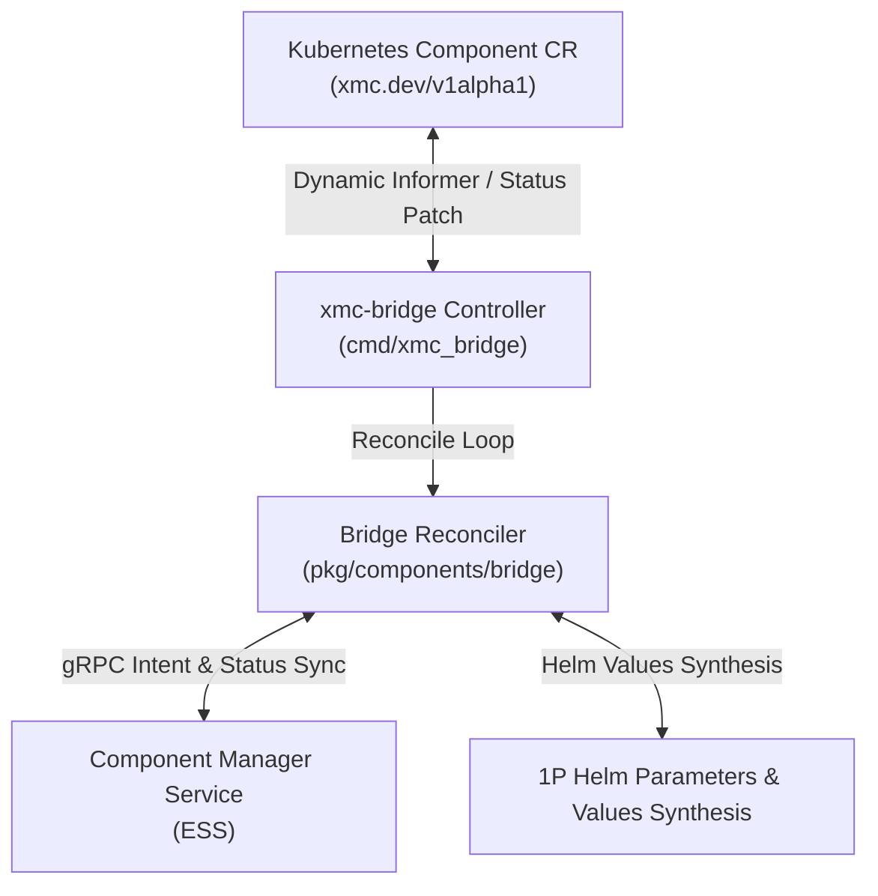

# GitOps Bridge Subsystem (`pkg/components/bridge`)

The **GitOps Bridge** provides bi-directional synchronization between Kubernetes Custom Resources (`Component` CRDs under `xmc.dev/v1alpha1`) and the Component Manager Service (CMS) within the Experiment State Server (ESS).

---

## Architecture Overview

---

## State Machine & Lifecycle

The `Reconciler` evaluates Component CRs through a deterministic state machine:

1. **Deletion Evaluation & Finalizer Gating**:
   - If `metadata.deletionTimestamp` is present and `spec.deletionProtection: true`, emit `ConditionTypeDeletionBlocked` (`True`) and prevent deletion.
   - If unprotected, prune child workloads, execute CMS deletion, and remove the `finalizers.xmc.dev/deletion-protection` finalizer.
2. **Intent Synchronization**:
   - Propagate desired spec to CMS via `SetComponentIntent`, transitioning CMS state to `COMPONENT_STATE_PENDING_RECONCILIATION`.
3. **Enablement & Workload Actuation**:
   - **Enabled (`spec.enabled: true`)**: Synthesizes 1P Helm variable overrides and delegates release updates to `HelmManager`. Transitions to `COMPONENT_STATE_ENABLED` upon success.
   - **Disabled (`spec.enabled: false`)**: Deactivates 1P Helm variable overrides and transitions CMS state to `COMPONENT_STATE_DISABLED`.

---

## Condition Types

| Condition Type | Status | Meaning |
| :--- | :--- | :--- |
| `Ready` | `True` / `False` | Operational health and readiness of the underlying component. |
| `Degraded` | `True` / `False` | Presence of active probe failures, crash loops, or provisioning errors. |
| `DeletionBlocked` | `True` / `False` | Deletion request blocked due to active deletion protection policy. |

---

## 1P Component Helm Values Synthesis (`helm_builder.go`)

First-party (1P) components are managed natively through XMC Helm charts. Rather than constructing duplicate Kubernetes `Deployment` and `Service` manifests in Go code, the bridge translates Component CR specifications directly into structured Helm parameter values:

- **`HelmComponentOptions`**: Encapsulates component parameters, image tags, replica counts, port bindings, and lifecycle controls.
- **`BuildHelmValues(opts HelmComponentOptions) map[string]any`**: Translates declarative component options into hierarchical Helm parameter maps (e.g., enabling `<component>Deployment.enabled: true`, setting custom images, and binding ports).
- **`HelmManager` Interface**: Declarative contract for applying and removing synthesized 1P values:
  - `Ensure1PComponent(ctx context.Context, namespace string, componentName string, opts HelmComponentOptions) error`
  - `Delete1PComponent(ctx context.Context, namespace string, componentName string) error`
  - `IsComponentActive(componentName string) bool`
- **`FakeHelmManager`**: In-memory test double supporting concurrent testing and error injection.

---

## Kubernetes Helm ConfigMap Lifecycle (`helm_manager.go`)

The `K8sHelmManager` provides the cluster-side actuation runtime for synthesized 1P values:

- **Centralized ConfigMap (`xmc-component-values`)**: Persists active component configuration JSON maps (e.g. `ingestion-gateway.json`) within the target namespace (`xmc`).
- **Atomic Concurrency & Conflict Merging**: Reads, merges, and updates the ConfigMap using Kubernetes client-go dynamic interfaces with optimistic concurrency control.
- **Deactivation & Teardown**: Automatically sets component enablement to `false` upon deactivation and clears entries when components are deleted.
- **Daemon Integration (`cmd/xmc_bridge`)**: Initializes `K8sHelmManager` with the in-cluster Kubernetes config and injects it into the primary controller reconciliation loop.

---

## Advanced 1P Lifecycle Policies (`helm_builder.go`, `helm_manager.go`)

Production-grade lifecycle controls and graceful deactivation policies for first-party components:

- **4-Tier Image Resolution Precedence**: Deterministically resolves container image overrides:
  1. `opts.Parameters["image"]` (highest priority explicit container image override)
  2. `opts.Parameters["imageRepository"]` + `opts.ImageTag` (repository customization)
  3. `defaultImage` + `opts.ImageTag` (standard component image with version override)
  4. `defaultImage:latest` (fallback default)
- **Graceful Connection Draining**: Automatically injects a `preStop` sleep hook (`/bin/sleep <seconds>`) and clamps `TerminationGracePeriodSeconds` to at least 5s greater than the drain timeout to guarantee pod termination ordering.
- **`Orphan` Deletion Policy**: Supports `spec.deletionPolicy: Orphan`, preserving live configuration during component de-registration while still deactivating managed controllers.

---

## Third-Party (3P) CRD Dynamic Status Detection (`status_detector.go`)

Third-party components (e.g. Ray Cluster, ClickHouse Operator, Redis) are managed by external Kubernetes operators and CRDs. The bridge uses a dynamic JSONPath query engine and RESTMapper resolution to inspect unstructured CRDs without requiring static compile-time Go structs:

- **Dynamic GVR Resolution (`ResolveGVR`)**: Resolves Group, Version, Kind to GroupVersionResource using the cluster `RESTMapper` with heuristic pluralization fallbacks.
- **Normalized JSONPath Engine (`EvaluateJSONPath`)**: Safely evaluates expressions across root or nested subtrees (`{.status.conditions[?(@.type=="Ready")].status}`, `$.status.phase`, `status.readyReplicas`).
- **`StatusDetector` Interface**:
  - `DetectStatus(ctx context.Context, ref WrapperRef) (*ResourceStatus, error)`
  - `ExtractResourceStatus(unstr *unstructured.Unstructured, ref WrapperRef) (*ResourceStatus, error)`
- **`FakeStatusDetector`**: Mock double for simulating healthy, unready, and degraded CRD conditions in unit tests.

---

## Core Capabilities

- **State Machine Reconciliation**: Deterministic state transitions (`PENDING_RECONCILIATION`, `ENABLED`, `DISABLED`, `DELETED`) synchronized between Kubernetes CR status conditions and CMS access status.
- **Bi-directional Intent & Status Sync**: Propagates desired spec to CMS via `SetComponentIntent`, and records observed generation and condition history back to the Kubernetes API server.
- **Deletion Protection & Finalizer Engine**: Enforces `finalizers.xmc.dev/deletion-protection` to safeguard active components, emits `ConditionTypeDeletionBlocked` when protected, and orchestrates teardown according to `spec.deletionPolicy` (`Delete` vs `Orphan`).
- **1P Helm Values Synthesis Engine**: Synthesizes structured Helm values and enablement toggles (`<component>Deployment.enabled = true`, `global.imageTag`, `parameters`) from component specifications for Helm release actuation.
- **Dynamic ConfigMap Management**: Automates persistence and synchronization of active Helm parameters into cluster-level ConfigMaps.
- **Deterministic 4-Tier Image Resolution**: Prioritizes explicit container images over repository overrides and baseline release tags.
- **Graceful Connection Draining**: Enforces preStop sleep buffers to ensure zero-downtime rolling updates and teardowns.
- **Dynamic 3P CRD Status Detection**: Query third-party operator CRDs dynamically using normalized JSONPath queries without compile-time Go types.
- **Resilient Failure Handling**: Non-destructive failure isolation ensuring transient CMS network errors do not tear down live workloads.
