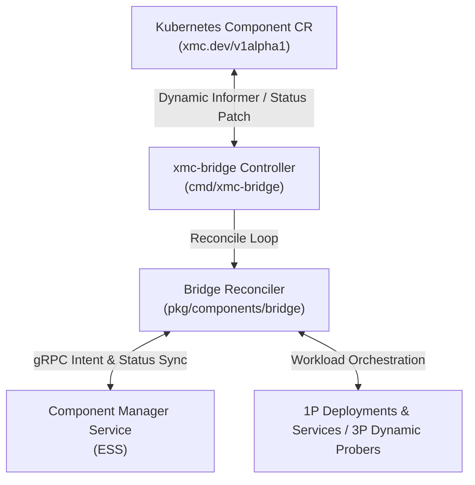

# GitOps Bridge Subsystem (`pkg/components/bridge`)

The **GitOps Bridge** provides bi-directional synchronization between Kubernetes Custom Resources (`Component` CRDs under `xmc.dev/v1alpha1`) and the Component Manager Service (CMS) within the Experiment State Server (ESS).

---

## Architecture Overview

---

## State Machine & Lifecycle

The `Reconciler` evaluates Component CRs through a deterministic state machine:

1. **Deletion Evaluation & Finalizer Gating**:
   - If `metadata.deletionTimestamp` is present and `spec.deletionProtection: true`, emit `ConditionTypeDeletionBlocked` (`True`) and prevent deletion.
   - If unprotected, prune child workloads, execute CMS deletion, and remove the `finalizers.xmc.dev/deletion-protection` finalizer.
2. **Intent Synchronization**:
   - Propagate desired spec to CMS via `SetComponentIntent`, transitioning CMS state to `COMPONENT_STATE_PENDING_RECONCILIATION`.
3. **Enablement & Workload Actuation**:
   - **Enabled (`spec.enabled: true`)**: Reconciles 1P native workloads (Deployments, Services) or evaluates 3P CR readiness and active HTTP/TCP health probes. Transitions to `COMPONENT_STATE_ENABLED` upon success.
   - **Disabled (`spec.enabled: false`)**: Tears down 1P child workloads and transitions CMS state to `COMPONENT_STATE_DISABLED`.

---

## Condition Types

| Condition Type | Status | Meaning |
| :--- | :--- | :--- |
| `Ready` | `True` / `False` | Operational health and readiness of the underlying component. |
| `Degraded` | `True` / `False` | Presence of active probe failures, crash loops, or provisioning errors. |
| `DeletionBlocked` | `True` / `False` | Deletion request blocked due to active deletion protection policy. |

---

## Package Sub-Components

- [`reconciler.go`](reconciler.go): Core reconciliation state machine, condition management, and CMS client adapter.
- [`workload_builder.go`](workload_builder.go): 1P Deployment and Service specification constructors with 4-tier image resolution and 5s preStop connection drain hooks.
- [`workload_manager.go`](workload_manager.go): Kubernetes client-go workload lifecycle engine with optimistic locking and sidecar container preservation.
- [`status_detector.go`](status_detector.go): Dynamic 3P wrapper CR status detector with normalized JSONPath query evaluation.
- [`health_prober.go`](health_prober.go): Active HTTP and TCP network health socket prober with coordinate parser.
