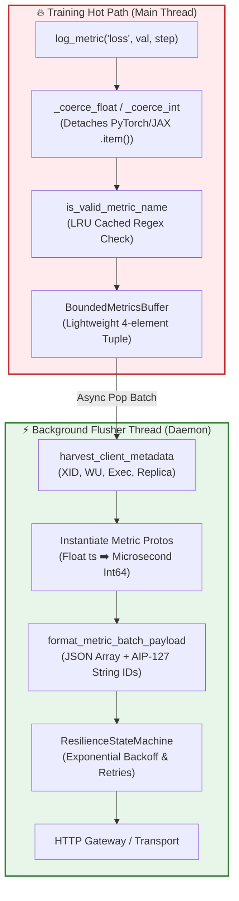
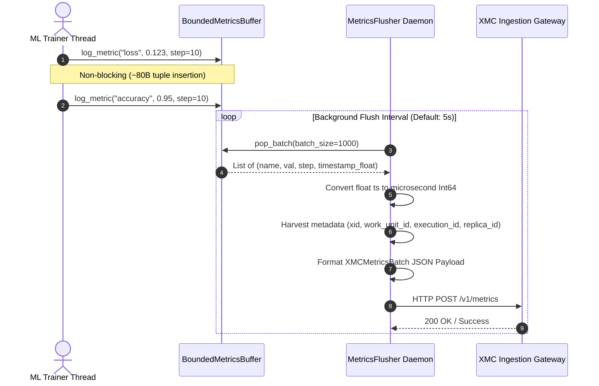
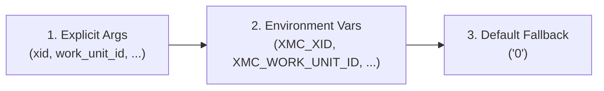

# XMC Python SDK (`xmc`)

[](#)
[](#)

The `xmc` Python SDK is a high-throughput, thread-safe metrics ingestion client designed for distributed Machine Learning (ML) workloads (PyTorch, JAX, TensorFlow) running across GKE, Vertex AI, Slurm, and local workstations.

---

## 🏗️ Architecture & Thread Boundaries

To guarantee zero training loop stall, `xmc` separates the **Training Hot Path** from **Network Serialization & Flushing**.



---

## 🔄 Sequence Flow Diagram



---

## 🌐 Metadata Harvesting Hierarchy

`harvest_client_metadata()` automatically extracts cluster context for zero-boilerplate logging across orchestrated environments (GKE, Vertex AI, Slurm):



1. **Explicit Override Parameters**: Optional overrides (`xid=...`, `work_unit_id=...`).
2. **Environment Variables**: Primary source injected by XMC cluster infrastructure (`XMC_XID`, `XMC_WORK_UNIT_ID`, `XMC_EXECUTION_ID`, `XMC_REPLICA_ID`).
3. **Default Fallback String**: Fallback string `"0"` for un-orchestrated local development.

> [!NOTE]
> Per **Google AIP-127**, all 64-bit metadata IDs (`xid`, `work_unit_id`, `execution_id`, `replica_id`) are serialized as stringified integers (e.g. `"xid": "482019"`) in the JSON payload to prevent IEEE 754 float precision loss in web UIs.

---

## 🎯 Distributed ML Rank Detection & Silencing

In distributed training (`WORLD_SIZE > 1`), logging from every process can saturate network gateways. `xmc` auto-detects process rank:

- **Rank 0 (Chief / Driver)**: Actively logs metrics.
- **Rank > 0 (Workers)**: Automatically silenced unless `log_all_replicas=True`.

### Auto-Harvested Rank Variables:
- **PyTorch Distributed**: `RANK`, `WORLD_SIZE`
- **JAX Distributed**: `JAX_PROCESS_INDEX`
- **MPI**: `OMPI_COMM_WORLD_RANK`
- **Kubernetes / Vertex Jobs**: `JOB_COMPLETION_INDEX`, `XMC_JOB_INDEX`

---

## 💻 Quickstart Usage Examples

### 1. Basic Single-Process Logging

```python
from xmc import Client, MetricsFlusher

# Auto-starts background flusher daemon thread
with MetricsFlusher(client=Client(base_url="https://xmc-gateway.internal.net")) as flusher:
    for step in range(1000):
        loss = train_step()
        flusher.log_metric("train/loss", loss, step=step)
```

### 2. Distributed Training Setup (PyTorch / JAX)

```python
import os
from xmc import Client, MetricsFlusher

# Client auto-detects process rank and silences worker processes
client = Client(base_url="https://xmc-gateway.internal.net")
flusher = MetricsFlusher(client=client)

for step in range(1000):
    loss = distributed_train_step()
    # Rank 0 logs to buffer; non-zero ranks drop locally without lock contention
    flusher.log_metric("train/loss", loss, step=step)

flusher.shutdown()
```

### 3. Opting Into All-Replica Logging

```python
# Pass log_all_replicas=True to capture metrics from every GPU rank
client = Client(base_url="https://xmc-gateway.internal.net", log_all_replicas=True)
flusher = MetricsFlusher(client=client)
```

---

## ⚙️ Resilience & Rate-Limited Drop Logging

- **Ring Buffer Overflow Protection**: `BoundedMetricsBuffer` defaults to 500,000 metrics (~85MB RAM). If network drops cause buffer overflow, oldest metrics are evicted FIFO.
- **Rate-Limited Warnings**: Drop warnings are logged at most once every **10 seconds** to prevent log stdout flooding.
- **Resilience State Machine**: Retries transient network/5xx errors using exponential backoff with jitter while immediately failing fast on terminal client errors (e.g., 400 Bad Request, 422 Unprocessable).

---

## 🧪 Running Tests & Linters

```bash
# Run all Bazel unit tests
bazel test //sdks/python/...

# Run pre-commit linters (Ruff, Buildifier, addlicense)
./.githooks/pre-commit
```
