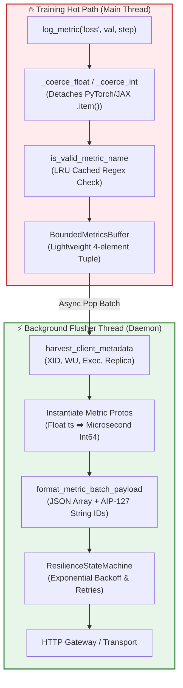
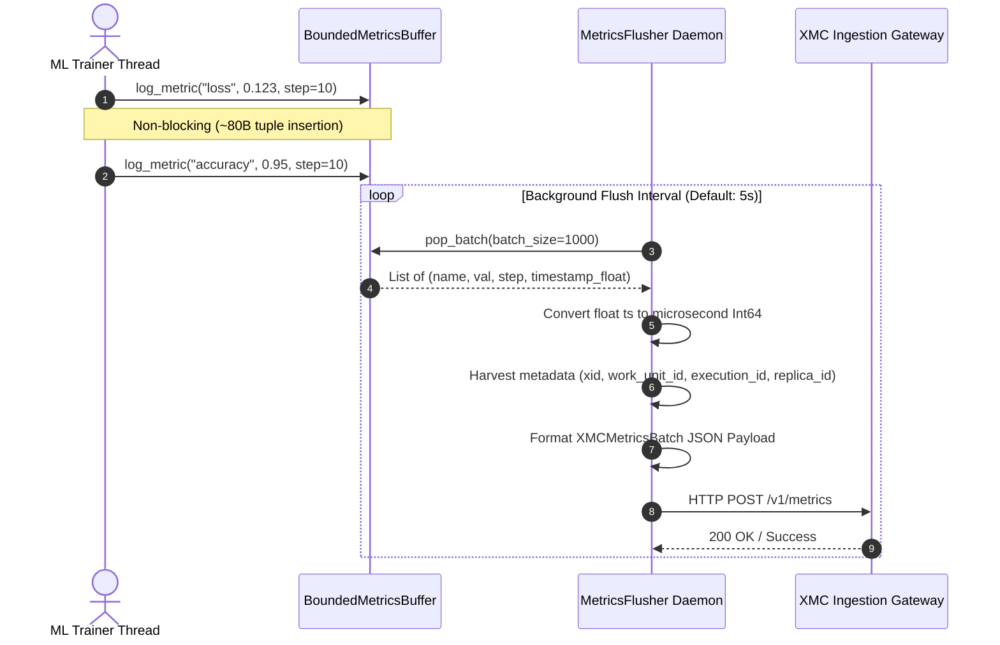
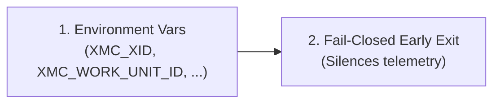

# XMC Python SDK (`xmc`)

[](#)
[](#)

The `xmc` Python SDK is a high-throughput, thread-safe metrics ingestion client designed for distributed Machine Learning (ML) workloads (PyTorch, JAX, TensorFlow) running across GKE, Vertex AI, Slurm, and local workstations.

---

## 🏗️ Architecture & Thread Boundaries

To guarantee zero training loop stall, `xmc` separates the **Training Hot Path** from **Network Serialization & Flushing**.



---

## 🔄 Sequence Flow Diagram



---

## 🌐 Metadata Harvesting Hierarchy

`harvest_client_metadata()` automatically extracts cluster context for zero-boilerplate logging across orchestrated environments (GKE, Vertex AI, Slurm):



1. **Environment Variables**: Primary source injected by XMC cluster infrastructure (`XMC_XID`, `XMC_WORK_UNIT_ID`, `XMC_EXECUTION_ID`, `XMC_REPLICA_ID`).
2. **Fail-Closed Missing Configs**: If `XMC_XID`, `XMC_WORK_UNIT_ID`, or `XMC_EXECUTION_ID` are missing, the SDK logs an error and exits the metric flow early (silences ingestion) instead of reverting to arbitrary fallback values. (`XMC_REPLICA_ID` naturally defaults to `"0"` for undiscovered ranks).

> [!NOTE]
> Per **Google AIP-127**, all 64-bit metadata IDs (`xid`, `work_unit_id`, `execution_id`, `replica_id`) are serialized as stringified integers (e.g. `"xid": "482019"`) in the JSON payload to prevent IEEE 754 float precision loss in web UIs.

---

## 🎯 Distributed ML Rank Detection & Silencing

In distributed training (`WORLD_SIZE > 1`), logging from every process can saturate network gateways. `xmc` auto-detects process rank:

- **Rank 0 (Chief / Driver)**: Actively logs metrics.
- **Rank > 0 (Workers)**: Automatically silenced unless `log_all_replicas=True`.

### Auto-Harvested Rank Variables:
- **PyTorch Distributed**: `RANK`, `WORLD_SIZE`
- **JAX Distributed**: `JAX_PROCESS_INDEX`
- **MPI**: `OMPI_COMM_WORLD_RANK`
- **Kubernetes / Vertex Jobs**: `JOB_COMPLETION_INDEX`, `XMC_JOB_INDEX`

---

## 💻 Quickstart Usage Examples

### 1. Basic Single-Process Logging

```python
import xmc

for step in range(1000):
    loss = train_step()
    xmc.log_metric("train/loss", loss, step=step)

# Optional: Ensure buffer is flushed before script exit
xmc.shutdown()
```

### 2. Distributed Training Setup (PyTorch / JAX)

```python
import xmc

for step in range(1000):
    loss = distributed_train_step()
    # Auto-detects process rank. Rank 0 logs to buffer; non-zero ranks drop locally.
    xmc.log_metric("train/loss", loss, step=step)

xmc.shutdown()
```

### 3. Opting Into All-Replica Logging

```python
import xmc

# Initialize the global flusher with log_all_replicas=True to capture metrics from every GPU rank
xmc.init(log_all_replicas=True)

xmc.log_metric("train/loss", loss, step=step)
xmc.shutdown()
```

---

## ⚡ Framework Integrations & Autologging

XMC provides two modes for framework integration: **Automatic Zero-Configuration Autologging (`xmc.autolog()`)** for zero-code-change telemetry, and **Explicit Callbacks & Loggers** for advanced customization.

---

### 1. Automatic Autologging (`xmc.autolog()`) [Recommended]

`xmc.autolog()` enables zero-configuration automatic framework patching for Keras (`keras>=3.0.0`) and PyTorch Lightning (`pytorch-lightning>=2.0.0`). When activated, `model.fit()` and `trainer.fit()` automatically log training/evaluation metrics without requiring manually instantiated callbacks or loggers.

```python
import xmc

# Activate automatic framework patching for Keras & PyTorch Lightning
xmc.autolog()

# Keras training automatically logs metrics without adding callbacks manually
model.fit(x_train, y_train, epochs=5)
```

#### ⚙️ Autologging Disable Knob & Override
- **Environment Variable**: Set `XMC_DISABLE_AUTOLOG=1` in your environment to safely disable autologging and skip framework patching without modifying code.
- **Explicit Disable Flag**: Call `xmc.autolog(disable=True)` to explicitly unpatch frameworks and disable autologging.

---

### 2. Explicit & Custom Integrations (Advanced Usage)

If you need custom metric prefixes, custom logging frequencies, or explicit `Client` instances, you can use the explicit integration classes directly instead of `xmc.autolog()`.

> [!TIP]
> **Combining `xmc.autolog()` with Explicit Callbacks**: If `xmc.autolog()` is active and an explicit `XmcKerasCallback` or `XmcLogger` is passed to `fit()`, XMC automatically detects the explicit instance and preserves it without adding a duplicate callback or logger.

#### 📦 Keras Explicit Callback (`XmcKerasCallback`)

```python
import keras
from xmc.integrations.keras import XmcKerasCallback

model = keras.Sequential([...])
model.compile(optimizer="adam", loss="mse", metrics=["accuracy"])

# Attach XmcKerasCallback manually with custom prefix or batch frequency
model.fit(
    x_train,
    y_train,
    epochs=5,
    callbacks=[XmcKerasCallback(prefix="train/", log_batch_frequency=10)],
)
```

#### 📦 PyTorch Lightning Explicit Logger (`XmcLogger`)

```python
import lightning.pytorch as pl
from xmc.integrations.lightning import XmcLogger

# Instantiate XmcLogger with custom experiment name and prefix
logger = XmcLogger(name="my_experiment", prefix="pl_metrics/")
trainer = pl.Trainer(logger=logger)
trainer.fit(model, dataloader)
```

#### 🔒 Guarantees & Operational Characteristics
- **Strict Decoupled Eager Imports**: Importing from `xmc.integrations.keras` or `xmc.integrations.lightning` validates version constraints eagerly at process startup (<10s fail-fast check). Missing or incompatible dependencies fail immediately before allocating GPU/TPU cluster resources.
- **Global Optimizer Step Mapping**: Batch and epoch metrics are mapped to the global optimizer iteration count (`model.optimizer.iterations`) to guarantee continuous time-series metrics across epoch boundaries in ClickHouse without step collisions.
- **Rank-Zero Silencing**: Automatically drops metric logging on worker ranks (`RANK > 0`) during multi-replica distributed training unless explicit multi-replica logging is configured.

> [!NOTE]
> **Legacy Keras 2 Support**: `XmcKerasCallback` requires `keras>=3.0.0`. For legacy Keras 2 (`tf.keras` <= 2.15), use `xmc.log_metric()` directly inside a `LambdaCallback`:
> ```python
> from tensorflow.keras.callbacks import LambdaCallback
> cb = LambdaCallback(on_epoch_end=lambda ep, logs: xmc.log_metric("loss", logs["loss"], step=ep))
> ```

---

## ⚙️ Resilience & Rate-Limited Drop Logging

- **Ring Buffer Overflow Protection**: `BoundedMetricsBuffer` defaults to 500,000 metrics (~85MB RAM). If network drops cause buffer overflow, oldest metrics are evicted FIFO.
- **Rate-Limited Warnings**: Drop warnings are logged at most once every **10 seconds** to prevent log stdout flooding.
- **Resilience State Machine**: Retries transient network/5xx errors using exponential backoff with jitter while immediately failing fast on terminal client errors (e.g., 400 Bad Request, 422 Unprocessable).

---

## 🔑 Authentication (`xmc login`)

The package ships an `xmc` command that signs local clients (such as the XManager CLI) in to an XMC deployment **as you**, instead of through a shared service account ([google/xmc#1309](https://github.com/google/xmc/issues/1309)). It needs only the Python standard library: install it with `pip install ./sdks/python/xmc` from a checkout, or run it as `bazel run //sdks/python/xmc:xmc_bin -- <subcommand>`.

```bash
xmc login --server https://xmc.example.com      # Opens your browser; no prompts if you are already signed in.
export XMC_AUTH_TOKEN=$(xmc print-token)        # Hands the token to the XManager CLI.
xmc status                                      # Shows the account and expiry; exits 1 if not logged in.
xmc logout                                      # Revokes the token on the server and deletes it locally.
```

| Subcommand | Behavior |
|---|---|
| `login [--no-browser] [--timeout SECONDS]` | Browser sign-in with PKCE. Waits up to 300 seconds by default. Re-logins pre-select the cached account. |
| `print-token` | Prints the cached token to stdout. Exits 1 if it is missing or expires within 60 seconds. This is the only command that prints a token. |
| `status` | Prints the account, server, and expiry. Exits 0 if logged in, otherwise 1. |
| `logout` | Calls `POST /api/cli/logout` (best effort; deployments without it are skipped), then deletes the cached entry. |

Every subcommand accepts `--server`. Without it, the server is read from `XMC_API_URL`, then from `XMANAGER_UI_URL`, then derived from `XMANAGER_ENDPOINT` if its host starts with `grpc.` (`dns:///grpc.<host>:443` becomes `https://<host>`), then from the credentials cache if it holds exactly one deployment (if it holds several, the error lists them). Only the origin (`https://host[:port]`) is used, and `https://` is required unless the host is a loopback IP literal (`127.0.0.1`, `[::1]`). Plain-HTTP `localhost` is also accepted, but only for local development, because it depends on name resolution. Prefer the IP literals.

### Headless machines and SSH sessions

Over SSH, or without `DISPLAY`/`WAYLAND_DISPLAY` on Linux, `xmc login` switches to manual mode on its own. You can also force it with `xmc login --no-browser`. In manual mode the CLI prints a URL. Open it in a browser on any device, sign in, and paste the code the page shows back into the terminal.

> [!WARNING]
> Only paste a code from a login you started yourself, just now, in that terminal. Never paste a code that someone else sent you, and never share the code your browser shows.

### Credentials cache (stable v1 format)

Tokens are cached in `$XDG_CONFIG_HOME/xmc/credentials.json` (default `~/.config/xmc/credentials.json`). The directory is created with mode `0700` and the file with `0600`, and every write is atomic. The cache is ignored with a warning if the file is a symlink, if it or its directory is owned by another user, or if group or others can access it. Other clients may read this format directly:

```json
{
  "version": 1,
  "deployments": {
    "https://xmc.example.com": {
      "server": "https://xmc.example.com",
      "access_token": "<CLI session token>",
      "email": "you@example.com",
      "expires_at": 1767225600
    }
  }
}
```

Entries are keyed by the deployment origin (`scheme://host[:port]`, lowercased host), and `server` must equal its key. A token is used only for exactly that origin. `expires_at` is in Unix seconds.

### Security notes

- **Loopback listener:** It binds only `127.0.0.1` on an ephemeral port, and accepts only `GET /callback` with `Host: 127.0.0.1:<port>`. The `state` value is compared in constant time. Forged or mismatched requests are rejected and the CLI keeps waiting. A connection that stalls is dropped after 2 seconds, so it can't hold the login past its deadline. If the deployment reports an error such as `access_denied`, the login stops right away. Once the code or error arrives, the browser is redirected to `/api/cli/success`, so the code doesn't stay in the address bar.
- **Token exchange:** The one-time code is redeemed with its PKCE (S256) verifier over TLS-verified HTTPS at `POST /api/cli/token`. Redirects are refused rather than followed. Loopback deployments bypass HTTP proxies. Login codes, verifiers, and tokens are never logged or printed, except by `print-token`.
- **Exported tokens:** `XMC_AUTH_TOKEN` is inherited by every child process, so export it only in shells where you run XMC clients.

---

## 🧪 Running Tests & Linters

```bash
# Run all Bazel unit tests
bazel test //sdks/python/...

# Run pre-commit linters (Ruff, Buildifier, addlicense)
./.githooks/pre-commit
```
