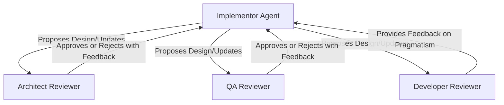

# Task: XMC Workload Pause/Resume Design Review

## Goal
Produce a final, production-ready, and architecturally sound design document ([dd.md](file:///usr/local/google/home/andrzejfudro/Documents/Deployment/xmc-pause-dd/dd.md)) for the XMC workload pause/resume mechanism, using the requirements and context provided in [dd-context.md](file:///usr/local/google/home/andrzejfudro/Documents/Deployment/xmc-pause-dd/dd-context.md).

The final design must guarantee data durability (no silent message drops), system stability (no OOM), multi-replica safety, and graceful resume behavior under stress.

### Dependencies & Future Scope
- **Admin UI & Health Service Dependency**: The Admin Panel UI pause toggle button and status display depend directly on the **Health Service** design. Refer to the local [health-service-dd.md](file:///usr/local/google/home/andrzejfudro/Documents/Development/xmc-pause-dd/health-service-dd.md) (or [go/xmc-admin-panel-dd](http://goto.google.com/xmc-admin-panel-dd)) for the full scope of the health-service API and visibility logic.

---

## Orchestration Loop

This task is an iterative design-and-review loop:

1.  **Iterative Critique & Pivot Loop**:
    *   The **Implementor** evaluates the current [dd.md](file:///usr/local/google/home/andrzejfudro/Documents/Deployment/xmc-pause-dd/dd.md) against [dd-context.md](file:///usr/local/google/home/andrzejfudro/Documents/Deployment/xmc-pause-dd/dd-context.md) and proposes design updates.
    *   The **Architect**, **QA**, and **Developer** Reviewers evaluate the proposed design.
    *   *If the design has fatal flaws* (e.g., potential for data loss due to queue size caps, or OOM under load):
        *   The Reviewers must reject the design and detail the fatal flaws in their feedback.
        *   The Implementor must **not** simply try to "patch" the flawed design with weak mitigations (like alerts or shifting limits). Instead, the Implementor must re-evaluate the architecture and **pivot to a different, more robust solution** (e.g., transitioning from transient Redis-based buffering to durable Spanner-based status tracking) if the current path cannot guarantee absolute safety.
    *   **Reviewer 3 (Developer / Pragmatism)**: Evaluates the design for overengineering, unnecessary complexity, and pragmatism. Their feedback must be addressed, but their concerns do not block the design if a more complex solution is strictly required for safety (Architecture and QA have priority).
    *   **Audit Trail (`log.md`)**: On every iteration, the Implementor **must** write or append a summary of changes, reviewer feedback, and the rationale for architectural decisions (e.g., why an alternative was chosen or why a pivot occurred) to [log.md](file:///usr/local/google/home/andrzejfudro/Documents/Development/xmc-pause-dd/log.md). This file serves as the audit log for the design history.
    *   *Exit Condition*: The loop continues until the design contains a solid, viable, and fully-specified architecture that meets all requirements, handles all edge cases, and receives explicit "LGTM" sign-off from both Reviewer 1 (Architecture) and Reviewer 2 (QA), with feedback from Reviewer 3 (Developer) addressed, and the history fully documented in `log.md`.

---

## General Rules & Guidelines

### Communication & Language Rules
- **Ask Human**: If requirements or context in `dd-context.md` are unclear, do not make wild assumptions; ask the human for clarification.
- **Simple, Professional English**: All agents must write the design document and logs in clear, simple, and professional software engineering English. **Avoid AI word salad, buzzwords, and dramatized jargon** (e.g., do not invent terms like "split-brain prevention loops" or "dual-path execution pipelines" if simple descriptions work). Keep the language natural, concise, and easy for a human developer to read.
- **Document & Resolve Unknowns**: If a system limit, capacity parameter, or configuration is initially unknown, the agents **must actively search the codebase** (e.g., terraform files, environment configurations, constants, build files) to resolve them before classifying them as permanently unknown. Only list them as unknowns in the `"Verified Assumptions & Unknowns"` section of `dd.md` if they cannot be resolved from the repository content (e.g., external cloud infrastructure details).
- **Document Rejected Alternatives**: For every design choice, transport mechanism, or architecture considered but discarded during the loop, the Implementor **must** list and explain the reason for rejection under the `# Rejected Alternatives` section of `dd.md`.
- **Files Allowed**: The Implementor must **only** modify [dd.md](file:///usr/local/google/home/andrzejfudro/Documents/Deployment/xmc-pause-dd/dd.md) and [log.md](file:///usr/local/google/home/andrzejfudro/Documents/Development/xmc-pause-dd/log.md). They are **not** allowed to edit [dd-context.md](file:///usr/local/google/home/andrzejfudro/Documents/Deployment/xmc-pause-dd/dd-context.md).

### Reviewer Guidelines

The Reviewer agents should focus on the following broad areas to find flaws in the design:

1.  **Data Loss & Eviction**:
    *   Analyze the queue configuration and transport layers. If the queue is paused for 24+ hours under high volume (thousands of requests), are messages guaranteed to be retained? Or is there any mechanism (like a buffer size cap, queue trim, or TTL eviction) that could cause silent message drops?
2.  **System Capacity & Limits**:
    *   Identify the exact configuration parameters of the queue (e.g., maximum length, storage limits).
    *   What happens if the system limits are hit? Does it fail gracefully with errors returned to the client, or does it degrade silently?
3.  **Eviction & Memory Management**:
    *   Check how the queue memory is allocated. If it uses an in-memory database or broker, what is its memory limit? What is the eviction policy when it hits the limit? Can it cause OOM or evict other critical cached keys?
4.  **Credential Lifetime**:
    *   Evaluate the lifetime of any authentication tokens, OIDC credentials, or signatures embedded in tasks. If the system remains paused for 24+ hours, will these credentials expire by the time they are finally processed on resume? If yes, ensure the design dynamically generates or refreshes them at draining/dispatch time rather than storing expired credentials in Spanner or memory.
5.  **Stress, Resumption & Concurrency**:
    *   Analyze the transition from **paused** to **resumed**. Does the act of resuming cause a sudden flood of creations (thundering herd) that might degrade downstream systems? How does the design handle this?
    *   What happens to persistence of the pause state between service restarts?
6.  **Pragmatism & Overengineering (Developer Reviewer)**:
    *   Evaluate if the proposed architecture is unnecessarily complex.
    *   Check if we are adding new dependencies when existing features can be leveraged.
    *   **No Redundant Control Gates**: Check if the design implements duplicate or redundant control mechanisms for the same problem (e.g., both buffering tasks in a database AND pausing the queue consumer). If yes, reject as overengineered. Seek the simplest path where only one control point is active (e.g., if ESS buffers tasks, the Actuator does not need custom pausing logic—it naturally runs out of tasks to process).
    *   Verify if the code changes or schema additions are pragmatic for the scope of a POC while maintaining a clean production path.

### Strict Mitigation Acceptance Criteria (Gates for Approval)

Reviewers must REJECT any design update that uses the following "weak" mitigations:

1.  **No "Monitoring-Only" Mitigations**:
    *   *Rule*: Setting up alerts, logging, or monitoring (e.g., Prometheus alerts on memory/OOM) is **not** a valid mitigation for a system failure. The design must include active architectural controls (e.g., backpressure, rate-limiting, blocking/rejecting writes) to prevent the failure.
2.  **No "Limit-Shifting" for Data Loss**:
    *   *Rule*: Simply increasing a buffer limit (e.g., raising `MaxLen` to 100,000) is **not** a valid mitigation for data loss.
    *   *Check*: The design must guarantee **zero silent drops**, regardless of the volume of requests. If a limit exists, the design must either:
        *   Implement a hard, atomic fail-fast check that returns an explicit error to the client (rejecting the request gracefully).
        *   Or, use a fundamentally durable, unbounded storage medium (like Spanner) for buffering.
3.  **No Single-Replica Assumptions**:
    *   *Rule*: A mitigation that works on a single replica but does not address state synchronization or race conditions across multiple active replicas must be rejected.
4.  **No Internal Contradictions (Document Cleanliness)**:
    *   *Rule*: The design document must be 100% internally consistent.
    *   *Check*: If the design pivots to a new architecture (e.g., "Zero Actuator changes", "No Spanner polling in Actuator", or "Removed Redis broadcast streams"), all detailed sections in the document **must** be updated or deleted to match. Reviewers must reject the design if deprecated mechanisms, rejected alternatives, or library changes are still described as active or "selected" in other sections.

