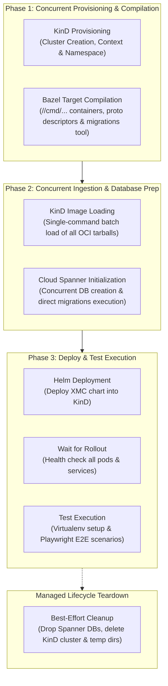

# E2E Test Suite Orchestration (`test/e2e`)

This directory contains the end-to-end (E2E) integration test framework for XManager on Cloud (XMC). It provisions an ephemeral Kubernetes cluster (via KinD), initializes isolated Cloud Spanner databases, builds and packages all microservice containers, deploys the platform via Helm, and runs Playwright integration scenarios.

---

## Architecture & Concurrency Pipeline (`lib/orchestrator.py`)

The E2E orchestrator organizes setup and teardown into distinct, parallelized execution phases to maximize throughput and minimize overall test duration:



### Concurrency Phases

1. **Phase 1: Parallel Cluster Spin-Up & Bazel Builds**:
   - `KinD.setup()` creates the local KinD cluster and initializes Kubernetes namespaces and secrets.
   - `ImageBuilder.build_all()` compiles all Go microservice binaries, UI bundles, and the Spanner `migrations` binary concurrently via Bazel.
2. **Phase 2: Parallel Image Ingestion & Spanner Provisioning**:
   - `KinD.load_images()` loads all built container images into KinD nodes in a single batch.
   - `SpannerManager.setup()` creates the `e2e-ess` and `e2e-xid` databases concurrently and applies DDL schemas.
3. **Phase 3: Deployment & Scenario Execution**:
   - `HelmDeployer.deploy()` first installs the pinned upstream JobSet v0.12.0 and Kueue v0.18.2 controllers from `//test/e2e/manifests:jobset_manifests` and `//test/e2e/manifests:kueue_manifests` ([`lib/controller_installer.py`](lib/controller_installer.py)). It waits until their CRDs are established, their deployments are rolled out, the Kueue visibility `APIService`s are available, and both controllers have injected their webhook CA bundles: Kueue's webhooks fail closed, so they must serve before the chart creates any pods. It then installs the XMC Helm chart (including dev Kueue queue and `WorkloadPriorityClass` manifests) into the cluster, applies the `preemption-queue` Kueue queue ([`manifests/preemption_queue.yaml`](manifests/preemption_queue.yaml)), and waits for workload readiness.
   - `TestExecutor.run_tests()` invokes the Playwright scenario suite ([test_e2e_flow.py](test_e2e_flow.py)) in an isolated virtualenv, verifying authentication/authorization boundaries, experiment/artifact creation, and work unit execution in `cpu-queue`. A work unit running `echo hello` must produce a `JobSet` that satisfies the Non-Restarting JobSets Contract, whose Kueue `Workload` is admitted ([`lib/jobset_verifier.py`](lib/jobset_verifier.py)), and must reach `COMPLETED`; a work unit that exits with code 50 must reach `FAILED`. Work unit states are read through the REST API ([`lib/work_unit_state.py`](lib/work_unit_state.py)). Stopping a running work unit must make it `STOPPED` and delete its `JobSet`, restarting it must create a `JobSet` for its second execution, and multi-execution history must record the executions in descending order with the latest active. Live mutations verify updating experiment metadata and work unit priority, patching the JobSet's Kueue priority class label. Batch stop and batch restart coordinate lifecycle transitions across multiple concurrent work units. In `preemption-queue`, whose quota fits only one of its 400m work units, a `HIGH` priority work unit must preempt a `LOW` priority one and reach `COMPLETED`. Finally, the experiment page must show the `Completed`, `Failed`, or `Stopped` status chip of each of these work units.
   - If the deployment or the scenarios fail, `HelmDeployer.capture_diagnostics()` writes the pods, events, and recent container logs of the `xmc`, `dex`, `jobset-system`, `kueue-system`, `cpu-queue`, and `preemption-queue` namespaces to `k8s_diagnostics.log` in the screenshots directory before teardown.
4. **Teardown (`managed_lifecycle`)**:
   - Handled via a Python context manager that drops the ephemeral Spanner databases and deletes the KinD cluster after a success, a failure, or a stop. Teardown is best effort; see [Stopping & Teardown](#stopping--teardown).

---

## Exit Codes & Infra Retry

The orchestrator tags every failure with the lifecycle phase that raised it ([`lib/phases.py`](lib/phases.py)). Only the phases that provision CI infrastructure are infra phases; the other phases exercise the code under test:

| Phase id | Step | Failure class |
| :--- | :--- | :--- |
| `image-build` | `ImageBuilder.build_all()` | Product |
| `kind-create` | `KindClusterManager.setup()` | Infra |
| `image-load` | `KindClusterManager.load_images()` | Infra |
| `spanner-setup` | `SpannerManager.setup()` | Infra |
| `helm-deploy` | `HelmDeployer.deploy()`, including the JobSet and Kueue controller installation and the wait for workload readiness | Product |
| `tests` | `PlaywrightTestExecutor.execute()`: virtualenv setup, the Dex token fetch, and the Playwright scenarios | Product |

`runner.py` exits with the outcome of its last attempt (`Outcome` in [`lib/outcome.py`](lib/outcome.py)):

| Exit code | Outcome | Meaning |
| :--- | :--- | :--- |
| `0` | Pass | Every phase passed. |
| `1` | Product failure | The `image-build`, `helm-deploy`, or `tests` phase failed. |
| `3` | Infra failure | An infra phase failed, or the [harness deadline](#harness-deadline) expired. |
| `4` | Harness error | An unexpected error outside the lifecycle phases, for example when no `kind` binary can be found. |

Two more exit codes are not outcomes:

- `2`: invalid command-line arguments.
- `128 + N`: stopped by signal `N`, for example `130` for `SIGINT` or `143` for `SIGTERM`, after a best-effort teardown.

> [!IMPORTANT]
> Never retry the job externally, whatever its exit code. The harness already retries an infra failure once within the job timeout, and the other exit codes do not report transient failures.

### Infra Retry

The harness retries an infra failure once ([`lib/infra_retry.py`](lib/infra_retry.py)), but only if the failed attempt, including its teardown, ended within 480 s of the harness start, so that a healthy retry still ends before the harness deadline:

1. Teardown of the failed attempt completes first: its Spanner databases are dropped, and its KinD cluster and temporary directory are deleted.
2. The harness prints a GitHub Actions warning annotation that names the failed phase, for example:

   ```text
   ::warning::E2E infra failure in phase spanner-setup on attempt 1/2; retrying
   ```

3. The retry runs every phase again with fresh Spanner database names and a fresh temporary directory. It skips the image build if the failed attempt finished it. It reuses the KinD cluster name, because `KindClusterManager.setup()` deletes any leftover cluster with that name first.

Each attempt writes its screenshots and diagnostics to its own subdirectory of `--screenshots-dir`: `attempt-1/` and, after a retry, `attempt-2/`. Product failures are never retried. `--keep-cluster` disables the retry, because it skips the teardown that a retry depends on.

### Harness Deadline

900 s after it started, the harness stops itself as described in [Stopping & Teardown](#stopping--teardown) and exits with `3`. Together with the workflow steps before and after the harness, a stopped run still ends more than a minute before the job timeout of 20 minutes.

### Stopping & Teardown

The first `SIGINT` or `SIGTERM` stops the harness ([`lib/cancellation.py`](lib/cancellation.py)): running commands are killed within about 0.5 s, Spanner retry waits and readiness polls end within about 0.5 s, no further attempt starts, and teardown runs. Every command runs in its own session, so the kill reaches the whole process group of the command, for example the `docker` processes that `kind` starts. Processes outside that group, such as the Bazel server and the containers that the Docker daemon runs, are not killed; teardown deletes the KinD cluster and its containers. Further `SIGINT` and `SIGTERM` signals are ignored so that they do not interrupt teardown, and each teardown command is limited to 20 s.

Teardown is best effort. When GitHub Actions cancels a job, or the job times out, the runner sends `SIGINT`, then `SIGTERM` about 7.5 s later, and then `SIGKILL` about 2.5 s after that, so teardown may not finish. The workflow starts `runner.py` with `exec`, so that these signals reach the harness rather than a shell. Spanner databases that a stopped run leaves behind are deleted by the stale-database cleanup of a later run once they are more than one hour old.

### Job Summary

When `GITHUB_STEP_SUMMARY` is set, as it is in GitHub Actions, `runner.py` appends a table to the job summary after the last attempt ([`lib/step_summary.py`](lib/step_summary.py)). The table shows the outcome, the number of attempts, what ended each failed attempt (its failed phase, or `harness deadline`), and the total harness duration. Runs that end with exit code `2` or `4`, or that a signal stops, write no summary.

---

## Key Performance & Resiliency Optimizations

### 1. Direct Migration Binary Execution (`lib/spanner.py`)
Rather than invoking `bazel run //internal/storage/spanner/migrations:migrations` repeatedly during database setup, the orchestrator compiles the binary once during Phase 1 and invokes the compiled executable directly from `bazel-bin`. This eliminates Bazel startup and analysis overhead, reducing database schema provisioning time from ~100s to ~8s.

### 2. Spanner Transient-Error Backoff (`lib/spanner.py`, `lib/spanner_retry.py`)
Concurrent database creation and schema migrations against Cloud Spanner can hit instance-level DDL queuing, quota limits, and transient server errors. Both operations retry within a fixed budget, which bounds how long Spanner setup can take:

| Operation | Attempts | Waits between attempts | Timeout per attempt | Total cap |
| :--- | :--- | :--- | :--- | :--- |
| Database creation | 4 | 15 s, 30 s, 60 s, each ±20% | 120 s | 240 s |
| Migration version initialization | 3 | 5 s, 10 s | 45 s | 90 s |

No retry starts unless at least 30 s of the total cap remain after its wait, which the timeouts per attempt leave even after a first attempt that timed out. Errors are classified on the command's captured output only, never on its command line:

- Retried within the budget: a command timeout; `UNAVAILABLE`, `DEADLINE_EXCEEDED`, `ABORTED`, or `RESOURCE_EXHAUSTED` as a status name or gRPC code; the plain-text messages `Deadline exceeded`, `unavailable` as a whole word, `Quota exceeded`, `too many concurrent`, and `pending DDL operations`, which `gcloud` can print without a status code; and HTTP 429, 503, or 504 when preceded by an `http`, `status`, or `code` token.
- Retried at most once: `INTERNAL` and `Internal error encountered`, which can be deterministic.
- Never retried: any other error, including `ALREADY_EXISTS` from the first database creation attempt. A retried creation that fails with `ALREADY_EXISTS` may have been preceded by an attempt that timed out after creating the database, so it polls `gcloud spanner databases describe` every 5 s for the rest of the attempt and succeeds once the database is `READY`. A database that is not `READY` by then counts as a command timeout.

Every failed attempt logs the retry decision and the last 2 KB of the command's error output. Because CI logs are public, `projects/<id>` resource paths and project numbers are masked in that output before it is truncated.

### 3. Artifact Registry KinD Node Image Mirror (`lib/kind.py`)
In CI environments, KinD boots using an Artifact Registry mirror image (`us-docker.pkg.dev/.../kindest-node:v1.33.1`) pulled via high-speed GCP internal networks (~15s spin-up). If the mirror image is unreachable or fails to boot, `kind.py` automatically cleans up and falls back gracefully to the Docker Hub upstream image.

### 4. Single-Command Batch Image Loading (`lib/kind.py`)
Loading images concurrently can trigger containerd socket exhaustion and write-lock contention inside the KinD node. The orchestrator batches all container image tarballs into a single `kind load docker-image <img1> <img2> ...` invocation, maximizing containerd import efficiency.

### 5. Pre-Baked Playwright Discovery (`lib/test_executor.py`)
In CI and developer containers where Playwright browser binaries are pre-installed (e.g. at `/ms-playwright` or standard system cache locations), `test_executor.py` automatically detects them and sets `PLAYWRIGHT_BROWSERS_PATH`, avoiding redundant browser downloads.

---

## Running E2E Tests Locally

### Prerequisites
- Docker or Podman
- KinD (`kind`)
- `kubectl` and `helm`
- Python 3.10+
- Google Cloud SDK (`gcloud`) with credentials configured for Spanner access

### Basic Invocations

Run the complete E2E flow:
```bash
python3 test/e2e/runner.py
```

### Useful CLI Flags

- `--keep-cluster`: Prevents cluster teardown on exit for interactive debugging with `kubectl`. Also disables the [infra retry](#infra-retry).
- `--skip-build`: Skips Bazel compilation and reuses existing container images.
- `--custom-kind-node-image <image>`: Overrides the KinD node image (e.g. to test custom Kubernetes versions).
- `--spanner-instance <instance>`: Target specific Spanner instance for testing.

---

## OSS 3P Component KinD E2E Suites (`clickhouse_3p_test.go`, `redpanda_3p_test.go`)

In addition to the full-platform Playwright orchestrator, `test/e2e` includes standalone Go KinD integration suites that verify `xmc-bridge` 3P `Component` CR reconciliation, active health probing, `.status.access.envVars` projection, typed component config resolvers, and live connectivity from mock ML workload pods:

- **ClickHouse 3P E2E Suite** ([clickhouse_3p_test.go](clickhouse_3p_test.go)): Deploys `clickhouse/clickhouse-server:24.3-alpine` inside KinD and validates both operator-managed `wrapperRef` (`ClickHouseInstallation`) discovery and `stable-2026a` operator-less active probing, `componentconfig.ResolveOptions`, and live SQL execution (`CREATE TABLE`, `INSERT`, `SELECT`) from a mock ML workload Pod injected with `.status.access.envVars`.
- **Redpanda 3P E2E Suite** ([redpanda_3p_test.go](redpanda_3p_test.go)): Deploys `docker.redpanda.com/redpandadata/redpanda:v24.1.1` inside KinD and validates both operator-managed `wrapperRef` (`Cluster`) discovery and `stable-2026a` operator-less active probing, `ingestiongateway.ResolveRedpandaComponentConfig`, and live Kafka topic creation, message production, and consumption (`rpk topic create/produce/consume`) from a mock ML workload Pod injected with `.status.access.envVars`.
- **KinD 3P Harness** ([kind_3p_harness_test.go](kind_3p_harness_test.go)): Provisions an isolated ephemeral KinD cluster (or attaches to `KIND_CLUSTER_NAME` when set), preloads container images, installs [crd.yaml](../../deploy/helm/templates/components/crd.yaml), bridges cluster-local service probes over KinD `NodePort`s, and drives in-process CMS and `xmc-bridge` reconciliation. Each reconcile pass persists finalizer and status changes through `bridge.ComponentController`, the controller `cmd/xmc_bridge` runs; namespace cleanup releases the `xmc.dev/cms-cleanup` finalizer so reused clusters do not keep namespaces in `Terminating`.

> [!NOTE]
> The harness server-side applies the CRD with the `e2e-harness` field manager and `force`, so on a cluster reused through `KIND_CLUSTER_NAME` it takes ownership of it. The Go KinD targets are tagged `manual` and do not run in CI yet.

### Running the 3P Component E2E Suites

```bash
# Run hermetic unit tests for the KinD 3P harness:
bazel test //test/e2e:kind_3p_harness_unit_test

# Run live KinD E2E integration suites (provisions and tears down an ephemeral KinD cluster):
bazel test //test/e2e:clickhouse_3p_test --test_output=streamed
bazel test //test/e2e:redpanda_3p_test --test_output=streamed

# Optionally reuse an existing KinD cluster:
bazel test //test/e2e:clickhouse_3p_test //test/e2e:redpanda_3p_test \
  --test_env=KIND_CLUSTER_NAME=xmc-dev --test_output=streamed
```

---

## BYO Vizier KinD E2E Suite (`vizier_kind_test.go`)

[vizier_kind_test.go](vizier_kind_test.go) installs the [BYO Vizier reference chart](../../deploy/addons/hpo/vizier/README.md) with its KinD overlay (`values-kind.yaml`: `NodePort` Service, SQLite on the KinD default StorageClass) into a fresh test namespace, waits for the `vizier` Deployment to become Available, applies the `stable-2026a` [`vizier` Component blueprint](../../deploy/profiles/stable-2026a/components/vizier/README.md) with `parameters.endpoint` set to `vizier-service.<namespace>.svc.cluster.local:7077`, and asserts that the in-process `xmc-bridge` TCP probe (over the KinD `NodePort`) reports the component Ready with the expected `ENDPOINT`, `HOST` and `PORT` access envVars.

No public Vizier image exists, so the suite expects the image in the local Docker daemon. It uses `xmc-vizier:<chart appVersion>` (`xmc-vizier:0.1.24`) and skips with a build hint when that image is missing; `XMC_VIZIER_IMAGE` names another image, and the suite fails rather than skips when that image is missing. The shared harness helpers it uses (`applyRenderedManifests`, `waitForDeploymentAvailable`, `splitImageRef`) live in [kind_3p_harness_test.go](kind_3p_harness_test.go).

```bash
# Build the Vizier server image into the local Docker daemon:
docker build -t xmc-vizier:0.1.24 deploy/addons/hpo/vizier/image

# Run the suite (provisions and tears down an ephemeral KinD cluster):
bazel test //test/e2e:vizier_kind_test --test_output=streamed

# Optionally reuse an existing KinD cluster or test another image:
bazel test //test/e2e:vizier_kind_test \
  --test_env=KIND_CLUSTER_NAME=xmc-dev \
  --test_env=XMC_VIZIER_IMAGE=xmc-vizier:0.1.24 --test_output=streamed
```

---

## Component Lifecycle KinD E2E Suite (`components_lifecycle_e2e_test.go`)

`TestComponentsLifecycle` reuses the KinD harness to verify `Component` lifecycle control-plane behavior. Components are 1P without a Helm manager, so no workloads run; each subtest asserts CMS state, CR status conditions, and finalizers. CRD schema, CEL, and deletion `ValidatingAdmissionPolicy` admission are covered by the hermetic `envtest` suite in [pkg/components/bridge](../../pkg/components/bridge/README.md) (`components_admission_test.go`), so this suite does not install the policy:

- **BlockedDeactivation**: Both components first reach CMS `COMPONENT_STATE_ENABLED` at their CR generation. Disabling a component that an enabled component depends on is rejected by CMS `PrepareDeactivation`. The bridge reports `DeactivationBlocked=True` naming the dependent, CMS keeps the component in `COMPONENT_STATE_PENDING_RECONCILIATION` at its CR generation, and the CR keeps its finalizer. After the dependent is disabled, both components reach `COMPONENT_STATE_DISABLED` and the blocked condition clears. Every CMS check also asserts that repeated bridge passes did not bump the CMS generation past the CR generation. The bridge re-checks a blocked deactivation at most every 30s, so this subtest takes about 30s.
- **FinalizerCleanup**: The bridge attaches `xmc.dev/cms-cleanup` before registering the component in CMS. After `DELETE`, the finalizer holds the CR until CMS `ExecuteDeletion` runs. The bridge then removes the finalizer and the CR is gone.

```bash
bazel test //test/e2e:components_lifecycle_test --test_output=streamed

# Optionally reuse an existing KinD cluster:
bazel test //test/e2e:components_lifecycle_test \
  --test_env=KIND_CLUSTER_NAME=xmc-dev --test_output=streamed
```

---

## Profile Migration KinD E2E Suite (`profile_migration_test.go`)

`TestProfileMigrationE2E` upgrades the `Component` CRs of a profile while workloads keep running. It is the only KinD suite that enables the harness `helmActuation` option, which wires a real in-process `helm.K8sHelmManager` (`pkg/components/bridge/helm`). With it, the bridge installs and upgrades 1P Helm releases through the Helm Go SDK; the other suites keep a nil Helm manager. Unlike `cmd/xmc_bridge` with `--chart-path`, the harness sets no chart base path, so the absolute `parameters.chartPath` override is accepted without the base-directory containment check. The suite therefore does not prove the production `chartPath` resolution.

- **Baseline**: Renders the real [stable-2026a](../../deploy/profiles/stable-2026a/README.md) profile with `helm template`, using the admin values in [stable-2026a-values.yaml](testdata/profile_migration/stable-2026a-values.yaml) plus per-run values. ClickHouse (3P, operator-less) points at an in-cluster ClickHouse server. `ingestion-gateway` (1P) uses `parameters.chartPath` to install the test-only [rolling-gateway](testdata/profile_migration/rolling-gateway/Chart.yaml) chart. That chart runs the public `registry.k8s.io/e2e-test-images/agnhost` image as 2 non-root replicas with `maxSurge: 1` and `maxUnavailable: 0`.
- **Candidate**: [stable-2026b-overlay.yaml](testdata/profile_migration/stable-2026b-overlay.yaml) is a **test-only fixture, not a product profile**. The suite re-renders stable-2026a with the overlay's `global.imageTag`. It then rewrites each CR's `xmc.dev/profile` label, `spec.chartVersion`, and `spec.version`, because the profile catalog fixes those fields. The bridge ignores `spec.chartVersion`. The workload rolls because of the image tag bump: the profile renders `global.imageTag` as `spec.imageTag`, which the bridge uses as the image tag in preference to `spec.version`.
- **Assertions**:
  - A continuous in-cluster HTTP probe against the gateway Service (about 5 requests/s, a new connection per request) records zero failed requests from the start of the upgrade. After the last old gateway Pod exits, it makes 75 more successful requests, and at least one of them is served by a new-ReplicaSet Pod.
  - A continuous ClickHouse `INSERT`/`SELECT` stream, which reads `.status.access.envVars`, records zero failed iterations. ClickHouse itself is not rolled: this shows that the bridge re-reconciling the bumped 3P spec does not disrupt the endpoint. `.status.access.envVars` stays unchanged across the upgrade.
  - The gateway rolls onto a new ReplicaSet with all replicas available, and the old ReplicaSet scales to 0.
  - Each enabled Component is `Ready=True` (`ComponentHealthy`), not `Stalled`, with `status.observedGeneration == metadata.generation`. Its generation and `status.componentGeneration` have advanced, and CMS is `COMPONENT_STATE_ENABLED` at the new generation.
  - A CMS snapshot locked before the upgrade keeps the baseline spec. Its generation now differs from `status.componentGeneration`, the predicate behind the actuator's component drift warning annotation. The suite checks only this predicate input, not the actuator or any UI.

> [!NOTE]
> The Go KinD harness always installs the Component CRD and runs an in-process bridge per test namespace, so this suite does not depend on the deployment's `enable_components` setting.

```bash
bazel test //test/e2e:profile_migration_test --test_output=streamed

# Optionally reuse an existing KinD cluster:
bazel test //test/e2e:profile_migration_test \
  --test_env=KIND_CLUSTER_NAME=xmc-dev --test_output=streamed
```

