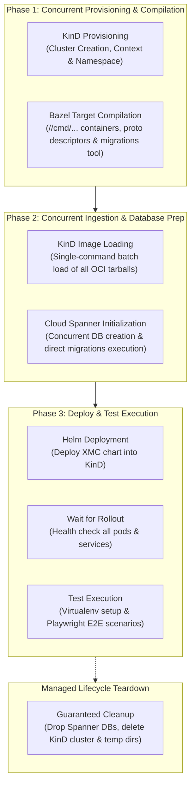

# E2E Test Suite Orchestration (`test/e2e`)

This directory contains the end-to-end (E2E) integration test framework for XManager on Cloud (XMC). It provisions an ephemeral Kubernetes cluster (via KinD), initializes isolated Cloud Spanner databases, builds and packages all microservice containers, deploys the platform via Helm, and runs Playwright integration scenarios.

---

## Architecture & Concurrency Pipeline (`lib/orchestrator.py`)

The E2E orchestrator organizes setup and teardown into distinct, parallelized execution phases to maximize throughput and minimize overall test duration:



### Concurrency Phases

1. **Phase 1: Parallel Cluster Spin-Up & Bazel Builds**:
   - `KinD.setup()` creates the local KinD cluster and initializes Kubernetes namespaces and secrets.
   - `ImageBuilder.build_all()` compiles all Go microservice binaries, UI bundles, and the Spanner `migrations` binary concurrently via Bazel.
2. **Phase 2: Parallel Image Ingestion & Spanner Provisioning**:
   - `KinD.load_images()` loads all built container images into KinD nodes in a single batch.
   - `SpannerManager.setup()` creates the `e2e-ess` and `e2e-xid` databases concurrently and applies DDL schemas.
3. **Phase 3: Deployment & Scenario Execution**:
   - `HelmDeployer.deploy()` installs the XMC Helm chart into the cluster and waits for workload readiness.
   - `TestExecutor.run_tests()` invokes the Playwright scenario suite ([test_e2e_flow.py](test_e2e_flow.py)) in an isolated virtualenv.
4. **Teardown (`managed_lifecycle`)**:
   - Handled via a Python context manager to guarantee that ephemeral Spanner databases and KinD clusters are dropped even if errors or SIGINT occur during provisioning.

---

## Key Performance & Resiliency Optimizations

### 1. Direct Migration Binary Execution (`lib/spanner.py`)
Rather than invoking `bazel run //internal/storage/spanner/migrations:migrations` repeatedly during database setup, the orchestrator compiles the binary once during Phase 1 and invokes the compiled executable directly from `bazel-bin`. This eliminates Bazel startup and analysis overhead, reducing database schema provisioning time from ~100s to ~8s.

### 2. Spanner Quota & Rate-Limit Backoff (`lib/spanner.py`)
Concurrent database creation and schema migrations against Cloud Spanner can hit instance-level DDL queuing and rate limits (gRPC 429 / RESOURCE_EXHAUSTED). The Spanner manager employs exponential backoff retry loops (with jitter) on transient quota errors.

### 3. Artifact Registry KinD Node Image Mirror (`lib/kind.py`)
In CI environments, KinD boots using an Artifact Registry mirror image (`us-docker.pkg.dev/.../kindest-node:v1.33.1`) pulled via high-speed GCP internal networks (~15s spin-up). If the mirror image is unreachable or fails to boot, `kind.py` automatically cleans up and falls back gracefully to the Docker Hub upstream image.

### 4. Single-Command Batch Image Loading (`lib/kind.py`)
Loading images concurrently can trigger containerd socket exhaustion and write-lock contention inside the KinD node. The orchestrator batches all container image tarballs into a single `kind load docker-image <img1> <img2> ...` invocation, maximizing containerd import efficiency.

### 5. Pre-Baked Playwright Discovery (`lib/test_executor.py`)
In CI and developer containers where Playwright browser binaries are pre-installed (e.g. at `/ms-playwright` or standard system cache locations), `test_executor.py` automatically detects them and sets `PLAYWRIGHT_BROWSERS_PATH`, avoiding redundant browser downloads.

---

## Running E2E Tests Locally

### Prerequisites
- Docker or Podman
- KinD (`kind`)
- `kubectl` and `helm`
- Python 3.10+
- Google Cloud SDK (`gcloud`) with credentials configured for Spanner access

### Basic Invocations

Run the complete E2E flow:
```bash
python3 test/e2e/runner.py
```

### Useful CLI Flags

- `--keep-cluster`: Prevents cluster teardown on exit for interactive debugging with `kubectl`.
- `--skip-build`: Skips Bazel compilation and reuses existing container images.
- `--custom-kind-node-image <image>`: Overrides the KinD node image (e.g. to test custom Kubernetes versions).
- `--spanner-instance <instance>`: Target specific Spanner instance for testing.
