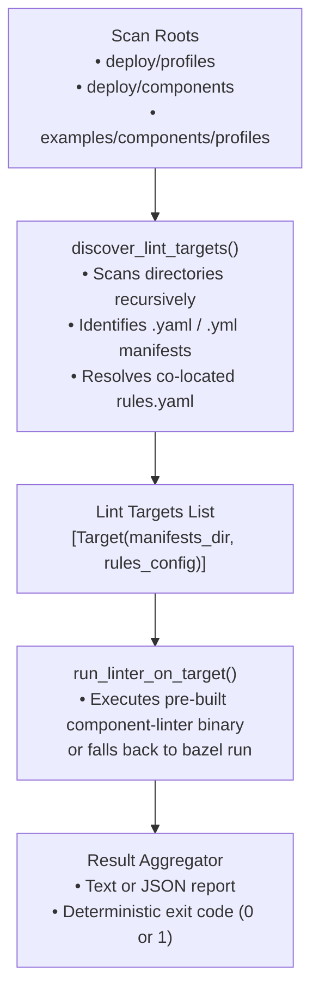

# Component Manifest Profile Discovery Runner (`tools/components/`)

`tools/components/run_linter.py` is an automated discovery runner and multi-target verification harness for XMC Component manifests and profile rules. It bridges repository profile structures with the standalone [`component-linter`](../../cmd/component-linter/README.md) CLI binary.

---

## 1. Overview & Architecture

While `component-linter` validates a single directory of component manifests against a rules configuration file, `run_linter.py` scans multiple directory roots across the repository, automatically identifies profile targets, locates co-located `rules.yaml` files, and coordinates sequential linter execution with unified exit codes and aggregated reporting.



---

## 2. CLI Usage & Flags

### Execution via Bazel

Run the discovery runner using Bazel:

```bash
# Default scan across all standard roots
bazel run //tools/components:run_linter

# Scan specific directories with strict mode
bazel run //tools/components:run_linter -- --scan-roots examples/components/profiles/default --strict
```

### Execution via Python Directly

```bash
# Run with a pre-compiled binary for fast execution
python3 tools/components/run_linter.py \
  --linter-binary="bazel-bin/cmd/component-linter/component-linter_/component-linter" \
  --scan-roots examples/components/profiles/default \
  --output=text
```

### Command-Line Arguments

| Flag | Type | Default | Description |
| :--- | :--- | :--- | :--- |
| `--scan-roots` | `list[str]` | `deploy/profiles`, `deploy/components`, `examples/components/profiles` | Space-separated list of root directories to scan recursively for component profiles. |
| `--linter-binary` | `string` | `""` | Path to a pre-compiled `component-linter` binary. If omitted, falls back to `bazel run //cmd/component-linter:component-linter`. |
| `--output` | `string` | `"text"` | Output format: `text` (human-readable console) or `json` (machine-readable structured report). |
| `--strict` | `bool` | `False` | When set, fails with non-zero exit code if no component profile targets are discovered. |

---

## 3. Profile Discovery Rules

A directory is recognized as a valid lint target if:
1. It contains at least one `.yaml` or `.yml` file that is not a rules configuration file (`rules.yaml`, `rules.yml`, `.rules.yaml`, `.rules.yml`).
2. If a `rules.yaml` (or variants) file is present in the same directory, it is automatically passed to `component-linter` as `--rules-config=<path>`.
3. Directories that are empty or contain only non-manifest files are skipped.
4. If no targets are found across all scan roots:
   - In **default mode** (`--strict` not set): Logs an informative notice and exits with code `0`.
   - In **strict mode** (`--strict` set): Logs an error and exits with code `1`.

---

## 4. Output Formats

### Text Format (`--output=text`)

Logs individual target scan banners and diagnostic errors directly to stdout:

```text
============================================================
Target: examples/components/profiles/default
Manifests Dir: examples/components/profiles/default
Rules Config:  examples/components/profiles/default/rules.yaml
============================================================
All component manifests passed static validation successfully!

============================================================
Lint Summary: 1 targets checked, 1 passed, 0 failed.
============================================================
```

### JSON Format (`--output=json`)

Aggregates structured JSON reports for CI/CD pipelines:

```json
{
  "all_valid": true,
  "summary": {
    "total_targets": 1,
    "passed": 1,
    "failed": 0
  },
  "results": [
    {
      "manifests_dir": "examples/components/profiles/default",
      "rules_config": "examples/components/profiles/default/rules.yaml",
      "success": true,
      "returncode": 0,
      "report": {
        "valid": true,
        "diagnostics": null,
        "errors": null,
        "warnings": null
      }
    }
  ]
}
```

---

## 5. Testing & Verification

Run the hermetic unit test suite via Bazel:

```bash
bazel test //tools/components:run_linter_test
```
